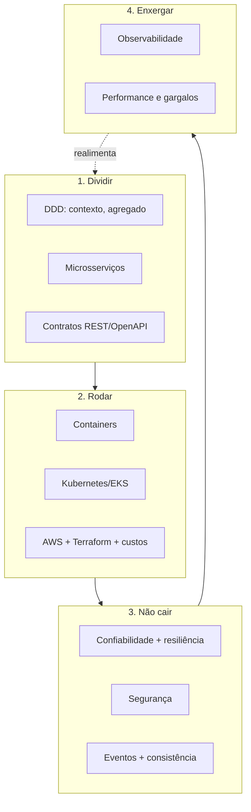
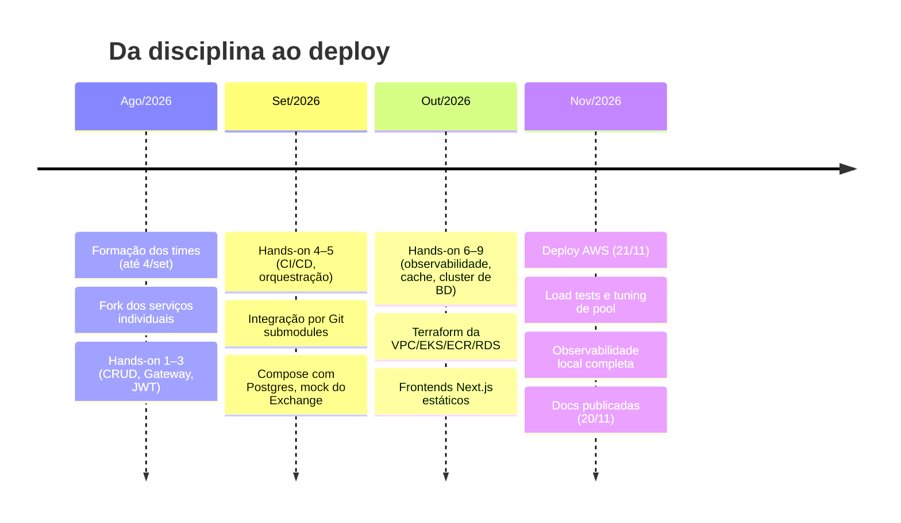

# Mapa da matéria

provaprojeto

Este capítulo existe para você não estudar 18 capítulos como se fossem independentes. A disciplina inteira cabe em **quatro perguntas**:

1. **Como dividir?** — domínio, fronteiras, contratos (microsserviços, DDD, APIs).
2. **Como fazer rodar?** — containers, orquestração, nuvem, deploy, custo (Docker, Kubernetes, AWS, Terraform).
3. **Como não cair?** — disponibilidade, resiliência, segurança, consistência (CAP, padrões, Zero Trust, eventos).
4. **Como saber o que está acontecendo?** — SLI/SLO, métricas, logs, traces, alertas (observabilidade, performance).

O projeto é a prova de que as quatro se conectam: a mesma decisão (ex.: *um gateway público*) aparece nas quatro.

---

## As aulas, os capítulos e o projeto

| Aula de 2026.2 | Capítulo aqui | Onde aparece no projeto |
| --- | --- | --- |
| 1. Sistemas distribuídos (CAP, consenso) | [Sistemas distribuídos](02-distribuidos.md) | Réplicas stateless, RDS Single-AZ, consistência do pedido em USD, cache desligado |
| 2. Containerização (Docker, Compose) | [Containers e Compose](03-containers.md) | `compose.yml`, Dockerfiles multi-stage, mock do Exchange, health checks |
| 3. APIs (REST, OpenAPI) | [APIs e contratos](04-apis.md) | `/products`, `/orders`, `/auth/login`, `/session/*`, status 201/400/404/422, UUIDs |
| 4. Microsserviços (DDD, componentes) | [Microsserviços e DDD](05-microsservicos-ddd.md) | Seis serviços, tabelas por dono, gateway, DNS do cluster, contratos |
| 5. Segurança (OAuth2, Zero Trust) | [Segurança e identidade](07-seguranca.md) | JWT HMAC curto, cookie HttpOnly + CSRF, ROLE_ADMIN, NetworkPolicy limitada |
| 6. Arquiteturas (SOLID, Clean, Hexagonal) | [Arquiteturas de software](06-arquiteturas.md) | Controller → service → repository; Ports & Adapters no Exchange (provider) |
| 7. Event-Driven Architecture | [Eventos e mensageria](08-eventos.md) | **Não implementado**; é a lacuna consciente do projeto |
| 8. Confiabilidade (SLI/SLO, padrões, caos) | [Confiabilidade e SLOs](09-confiabilidade.md) | SLO 99,5%, error budget, probes, pool de conexões, PDB |
| 9. Observabilidade | [Observabilidade](11-observabilidade.md) | Prometheus, Mimir, Loki, Tempo, Pyroscope, Grafana, Alloy, Faro |
| 10. Modelos de serviço | [Nuvem, deploy e custos](12-nuvem-custos.md) | EKS (CaaS), RDS/ElastiCache (DBaaS), S3/CloudFront, GitHub Actions (SaaS) |
| 11. Roteiro de deploy na nuvem | [Nuvem, deploy e custos](12-nuvem-custos.md) | Terraform, EKS, LocalStack, staging, deploy shell-first |
| Hands-on 5 (orquestração) | [Kubernetes e HA](10-kubernetes-ha.md) | Deployments, Services, HPA, PDB, probes, Kustomize overlays |
| Hands-on 6/11 (métricas/traces) | [Observabilidade](11-observabilidade.md) | Micrometer, agente OTel, `traceparent`, dashboards RED |
| Exercício de gargalos | [Performance e gargalos](13-performance-gargalos.md) | k6, HPA 2→6, pool 10/5/8, teto medido |
| Projeto (AWS/EKS/CI/CD/custos) | [O projeto por dentro](01-projeto.md) | 126 commits, submodules, OIDC, orçamento, evidências |

### Fontes diretas das aulas

| Aula | Link |
| --- | --- |
| 1. Sistemas distribuídos | [overview](https://insper.github.io/platform/2026.2/classes/distributed_systems/) · [CAP](https://insper.github.io/platform/2026.2/classes/distributed_systems/cap/) · [consenso](https://insper.github.io/platform/2026.2/classes/distributed_systems/consensus/) |
| 2. Containerização | [overview](https://insper.github.io/platform/2026.2/classes/containerization/) · [Docker](https://insper.github.io/platform/2026.2/classes/containerization/docker/) · [Compose](https://insper.github.io/platform/2026.2/classes/containerization/compose/) |
| 3. APIs | [overview](https://insper.github.io/platform/2026.2/classes/api/) · [REST](https://insper.github.io/platform/2026.2/classes/api/rest/) · [OpenAPI](https://insper.github.io/platform/2026.2/classes/api/swagger/) |
| 4. Microsserviços | [overview](https://insper.github.io/platform/2026.2/classes/microservices/) · [DDD](https://insper.github.io/platform/2026.2/classes/microservices/ddd/) · [componentes](https://insper.github.io/platform/2026.2/classes/microservices/architecture/) |
| 5. Segurança | [overview](https://insper.github.io/platform/2026.2/classes/security/) · [OAuth/OIDC](https://insper.github.io/platform/2026.2/classes/security/oauth/) · [Zero Trust](https://insper.github.io/platform/2026.2/classes/security/zero-trust/) |
| 6. Arquiteturas | [overview](https://insper.github.io/platform/2026.2/classes/architectures/) · [SOLID](https://insper.github.io/platform/2026.2/classes/architectures/solid/) · [Clean](https://insper.github.io/platform/2026.2/classes/architectures/clean/) · [Hexagonal](https://insper.github.io/platform/2026.2/classes/architectures/hexagonal/) |
| 7. Eventos | [overview](https://insper.github.io/platform/2026.2/classes/event_driven/) |
| 8. Confiabilidade | [overview](https://insper.github.io/platform/2026.2/classes/reliability/) · [SLI/SLO/SLA](https://insper.github.io/platform/2026.2/classes/reliability/sli-slo-sla/) · [padrões](https://insper.github.io/platform/2026.2/classes/reliability/patterns/) · [caos](https://insper.github.io/platform/2026.2/classes/reliability/chaos/) |
| 9. Observabilidade | [overview](https://insper.github.io/platform/2026.2/classes/observability/) |
| 10. Modelos de serviço | [overview](https://insper.github.io/platform/2026.2/classes/service_models/) |
| 11. Deploy na nuvem | [overview](https://insper.github.io/platform/2026.2/classes/deployment/) |
| Projeto | [enunciado](https://insper.github.io/platform/2026.2/exercises/project/) |

!!! note "O que a ementa cobra de verdade"
    Os objetivos de aprendizagem das aulas usam verbos como **comparar**, **justificar**, **escolher**, **calcular** e **estimar**. A prova não premia quem lista componentes; premia quem explica o custo de cada escolha.

---

## O mapa em uma imagem

Cada seta é uma dependência real: não dá para observar o que não foi instrumentado; não dá para instrumentar sem contrato; não dá para definir contrato sem fronteira de domínio.

---

## Plano de estudo em 7 sessões

| Sessão | Foco | Leitura | Entregável seu |
| --- | --- | --- | --- |
| 1 | Visão de sistema | capítulos 0–1 | Desenhar a arquitetura e o fluxo de um pedido de memória |
| 2 | Distribuição e containers | 2–3 | Calcular disponibilidade de uma cadeia e explicar o que o Compose não resolve |
| 3 | Contratos e fronteiras | 4–5 | Justificar por que Order não lê a tabela de Product |
| 4 | Código e segurança | 6–7 | Explicar a Regra de Dependência e o caminho do token até o serviço |
| 5 | Falha e eventos | 8–9 | Comparar REST síncrono × evento para o e-mail de confirmação |
| 6 | Plataforma e operação | 10–13 | Contar a história do pool 10→5→8 e o gargalo final |
| 7 | Fechamento | 14–17 | Simulado fechado + defesa oral de 10 min |

!!! tip "Regra dos 5 minutos"
    Ao fim de cada capítulo, feche o navegador e escreva em uma folha: **uma definição, uma fórmula, uma decisão do projeto e um risco**. Se não conseguir escrever os quatro, releia apenas a seção correspondente.

---

## Linha do tempo do projeto (o "como foi desenvolvido")

O repositório tem 126 commits e a documentação registra a evolução. A sequência abaixo é a história que a banca pode pedir:

| Fase | O que foi entregue | Evidência |
| --- | --- | --- |
| Serviços individuais | Product (Java/Spring), Order (Java/Spring + Feign), Exchange (Python/FastAPI) | Contratos em `api/*` e exercícios da disciplina |
| Integração | Gateway, Auth, Account, submodules e Compose | `compose.yml`, `.gitmodules`, docs de arquitetura |
| Nuvem | VPC, EKS 1.35, ECR, RDS, ElastiCache, S3, CloudFront, NLB | Terraform + inventário de entrega |
| Operação | Prometheus/LGTM, 8 dashboards, alertas, k6 | Logs de verificação de 21/11 |
| Entrega | Docs Zensical no GitHub Pages, limitações explícitas | `docs.yml`, site publicado |

!!! warning "O que a documentação **não** afirma"
    Não há Kafka, não há Cart service, não há cache em uso, não há domínio customizado, não há teste de carga autenticado em AWS e o deploy é manual. A documentação trata isso como **escopo**, não como esquecimento — e você deve fazer o mesmo na prova. Cada lacuna, com benefício, motivo e caminho de adoção, está em [O que não foi implementado](18-lacunas-e-evolucao.md).

---

## Os três eixos de trade-off que a banca explora

### 1. Acoplamento × autonomia

Mais serviços = mais autonomia de deploy e escala, mas **mais chamadas de rede, mais contratos, mais observabilidade e mais custo operacional**. O projeto escolhe seis serviços para um time de 2–3 pessoas: é didático, não é a recomendação para uma startup. A própria aula de deploy diz que EKS nesse tamanho é "passivo", e o projeto assume que usa EKS **para aprender**.

### 2. Consistência × disponibilidade × latência

O pedido precisa de preço atual (chamada síncrona ao Product) e o contrato prevê conversão de moeda via Exchange (a implementação checada ainda rejeita não-USD). Isso encurta a consistência, mas **encomprida a cadeia de falha** quando a integração estiver ativa. O projeto mitiga com timeout, réplicas e observabilidade; não elimina, porque não há evento/outbox. CAP e PACELC explicam o resto.

### 3. Custo fixo × elasticidade

EKS, NAT, NLB, RDS e ElastiCache cobram por hora, mesmo sem tráfego: ≈ US$ 175/mês antes de qualquer compute. HPA e Cluster Autoscaler dão elasticidade, **não idle saving**. Em time pequeno, Railway/Render ou ECS Fargate podem ser a resposta certa — e saber dizer isso vale nota.

---

## Teste de orientação

  
Qual sequência representa corretamente a direção das dependências na Clean Architecture?

  <ul class="options">
    <li data-key="a">Controller → Service → JPA → banco, e o serviço importa o framework.</li>
    <li data-key="b">Banco → Service → Controller, porque os dados definem o domínio.</li>
    <li data-key="c">Adaptadores externos → casos de uso → entidades; o núcleo nunca importa o adaptador.</li>
    <li data-key="d">Todos os pacotes podem se importar, desde que haja testes.</li>
  </ul>
  
A Regra de Dependência aponta sempre para dentro. O caso de uso declara a interface (porta) e o adaptador a implementa; em tempo de execução a chamada vai para fora, mas o código-fonte depende para dentro.

---

## Como a prova costuma ser corrigida

| Critério | O que tira nota | O que ganha nota |
| --- | --- | --- |
| Precisão conceitual | Trocar SLO por SLA, CAP por ACID, liveness por readiness | Definir e contrastar em uma frase |
| Justificativa | "Porque é boas práticas" | Custo, risco e alternativa descartada |
| Números | Citar "alta disponibilidade" | 99,9% em 28 dias = 40,3 min; 3 elos = 99,7% |
| Evidência | "O sistema escala" | "Product foi a 6/6, p95 1,25 s a 300 req/s, RDS 52/112" |
| Limites | Esconder lacunas | "Não medimos falha do provedor; o próximo passo é X" |

!!! quote "Se levar uma frase"
    **Arquitetura é o conjunto de decisões que você não consegue desfazer barato.** A prova pede que você mostre quais decisões foram caras no projeto, por que foram tomadas e o que você faria diferente com outra restrição.
