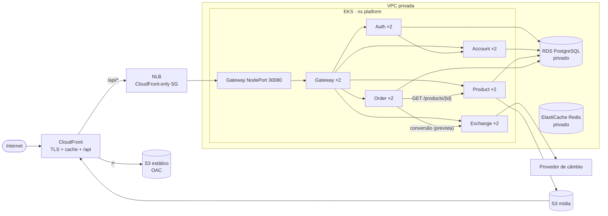
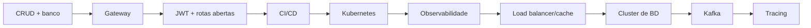
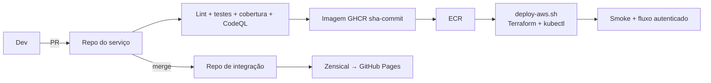

# O projeto por dentro

<span class="study-tag prova">prova</span><span class="study-tag projeto">projeto</span>

Se a disciplina ensina os conceitos, o projeto mostra **o preço de aplicá-los**. Este capítulo é a visão de raio X: o que o sistema faz, como o repositório é organizado, como o time trabalhou, o que a arquitetura resolve e — igualmente importante — o que ela apenas **desloca** para outro lugar.

!!! info "Escopo em uma frase"
    Loja demonstrativa em que visitantes navegam pelo catálogo e usuários autenticados criam pedidos persistidos. **Não há pagamento real, transação financeira, estoque ou envio.** O valor está na engenharia de integração, deploy e operação.

---

## 1. Requisitos e capacidades

O projeto segue o exercício de 2026.2: integrar os serviços individuais (Product, Order, Exchange) com Gateway, Auth e Account, entregar uma aplicação disponível e documentar o ciclo completo.

| Serviço | Responsabilidade | Dono dos dados | Depende de |
| --- | --- | --- | --- |
| **Gateway** | Roteamento, autenticação de borda, CORS, validação de sessão, autorização por papel | — | Auth, Account, Product, Order, Exchange |
| **Auth** | Login, emissão e validação de token | — (lê Account) | Account, banco |
| **Account** | Cadastro, perfil, papéis | `accounts` | banco |
| **Product** | Catálogo, preço, unidade, imagens | `products`, `product_images` | banco, S3 |
| **Order** | Pedidos do usuário, totais | `orders`, itens | banco, Product, Exchange (previsto) |
| **Exchange** | Câmbio e adaptação do provedor | — (cache curto) | provedor externo |

!!! warning "Contrato × implementação: a conversão de moeda"
    O contrato do exercício prevê `GET /orders/{id}?currency=BRL` chamando o **Exchange**. Porém a implementação checada do Order responde **422** para qualquer moeda diferente de USD ("Currency conversion is unavailable"), e o frontend opera apenas em USD. O Exchange existe, isola o provedor e expõe `/exchanges/{from}/{to}`; o que falta é a chamada fim a fim no Order. Na prova, diga **"capacidade prevista, integração pendente"** — não afirme que a conversão está funcionando. É o exemplo perfeito de por que a documentação separa estado atual de contrato.

Regras de domínio que a prova adora:

- **Order não aceita preço do cliente.** Ele lê o preço atual do Product no momento do checkout.
- **Order armazena em USD**; o contrato prevê converter via Exchange quando o cliente pede outra moeda, mas a implementação checada ainda rejeita não-USD (ver aviso abaixo).
- **Pedido pertence a um usuário.** `GET /orders/{id}` de outro usuário retorna `404`, não `403` — não se revela a existência do recurso.
- **Auth não acessa o banco do Account.** Ele chama a API do Account; a separação é de contrato, não apenas de pasta.
- **Product é a autoridade do catálogo**, mas o pedido guarda o preço praticado no item (`total`), porque o preço de amanhã não pode reescrever o pedido de ontem.

!!! tip "Por que isso é DDD, não só organização"
    O item do pedido guarda `productId` + quantidade + total, e não um objeto `Product` inteiro. É exatamente a regra de agregados: **referencie outros agregados pela identidade** e congele o que o negócio precisa preservar. No contexto de Catálogo, "produto" tem preço mutável; no contexto de Pedido, tem preço praticado.

---

## 2. Arquitetura de runtime



### O que é público e o que é interno

| Caminho | Público? | Por quê |
| --- | --- | --- |
| CloudFront (`/`, `/store/`, `/admin/`, `/media/*`) | Sim | É a borda: TLS, cache, OAC para buckets privados |
| `/api/*` no CloudFront | Sim | Reescreve para o Gateway; o cliente nunca vê hostnames internos |
| Gateway | Sim, via NLB/NodePort | Único ponto de aplicação; aplica políticas transversais |
| Auth, Account, Product, Order, Exchange | **Não** | ClusterIP; alcançáveis só dentro do namespace |
| RDS, ElastiCache | **Não** | Subnets privadas, sem endpoint público |
| Grafana/Prometheus/Loki/Tempo | **Não** | ClusterIP; acesso por `kubectl port-forward` ou ALB+Cognito |

!!! warning "A fronteira de confiança é o Gateway"
    Se um serviço de negócio ganhasse um `NodePort` ou um Ingress público, qualquer cliente poderia forjar o header de identidade (`id-account`) que o Gateway repassa. O modelo inteiro depende de **só o Gateway ser alcançável** e de ele **sobrescrever** headers de identidade vindos de fora.

### O caminho de uma requisição autenticada

1. O navegador chama `https://<cloudfront>/api/orders` com o cookie de sessão.
2. CloudFront termina o TLS, aplica a função que **remove o prefixo `/api`** e adiciona o header `x-site` (usado na chave de cache dos três frontends), e encaminha ao NLB.
3. O NLB entrega ao `gateway-public` (NodePort 30080), que chega a uma réplica do Gateway.
4. O Gateway valida o JWT (assinatura, expiração, emissor), troca o cookie por `Authorization: Bearer` e verifica CSRF em métodos de escrita.
5. O Gateway injeta a identidade e roteia para o Order. Os serviços Java revalidam a assinatura HS256 (defesa em profundidade) e aplicam a autorização fina.
6. O Order valida a propriedade, consulta o preço no Product e grava no PostgreSQL. Para moeda ≠ USD, o contrato prevê chamar o Exchange; a implementação checada responde 422 e o frontend usa USD.
7. A resposta volta pelo caminho inverso. Cada salto emite métrica, log estruturado e span; o `traceparent` W3C conecta os spans.

!!! note "Por que o cookie é do Gateway, e não do Next.js"
    Os três frontends são **static exports**: não há servidor Next.js em produção. Quem pode guardar um segredo de sessão é o backend. O Gateway emite um cookie `HttpOnly`, `SameSite=Lax`, `Path=/api` e `Secure` (exceto no Compose local), com expiração igual ao access token. O JavaScript da página nunca lê o JWT. Isso elimina a classe de falha "token no `localStorage` + XSS".

---

## 3. Modelo de repositório: submodules, não monorepo

O repositório `Microsserv52/platform` é de **integração e documentação**. Cada serviço vive no próprio repositório e entra como **Git submodule** em `api/`:

```text
platform/
├── api/
│   ├── gateway/          → Microsserv52/gateway
│   ├── auth/             → Microsserv52/auth
│   ├── account/          → Microsserv52/account
│   ├── product/          → Microsserv52/product
│   ├── product-interface/
│   ├── order/            → contrato Java (biblioteca)
│   ├── order-service/    → implementação
│   ├── exchange/         → Microsserv52/exchange (Python)
│   └── exchange-interface/
├── web/
│   ├── landing/ store/ admin/   → três Next.js independentes
├── observability/        → submodule da stack LGTM
├── k8s/                  → base + overlays (aws, microk8s, localstack, staging)
├── terraform/            → módulos + ambientes
├── compose.yml           → topologia local
├── docs/                 → Zensical
└── scripts/              → deploy, imagens, seed, observabilidade
```

### Por que submodules?

| Vantagem | Custo |
| --- | --- |
| Histórico e release independentes por serviço | O commit raiz aponta para um **SHA**, não para os arquivos; `git submodule update` é obrigatório |
| Ownership claro: cada time/PR mexe no seu repositório | Um clone sem `--recursive` fica incompleto |
| O repositório de integração registra a combinação exata testada | Atualizar um serviço exige dois commits: um no serviço, outro no ponteiro |
| CI consegue buildar cada serviço isoladamente | Versões de contrato precisam ser coordenadas |

O fluxo correto é **serviço primeiro, integração depois**:

```bash
# 1. no repositório do serviço
git checkout -b feature/order-idempotency
# implementa, testa, abre PR, faz merge
git log -1 --oneline        # ex.: a1b2c3d feat: add idempotency key

# 2. no repositório de integração
git -C api/order checkout a1b2c3d
git add api/order
git commit -m "chore: update order to a1b2c3d"
```

!!! warning "Erro clássico de prova"
    "Monorepo e polyrepo são a mesma coisa, só muda a pasta." Não. O que muda é **quem pode fazer deploy sem coordenação** e **como o contrato é versionado**. O submodule preserva a independência de release, mas cria um acoplamento de *ponteiro*: o repositório raiz precisa saber qual combinação de SHAs é válida.

### Convenções de contribuição

- Branches `feature/*`, `fix/*`, `docs/*`; nunca commit direto em `main`.
- PR com evidência de verificação (teste, screenshot, saída de comando).
- Mudança de contrato atualiza o doc do serviço **no mesmo PR**.
- `AGENTS.md` define o protocolo de trabalho, inclusive de assistentes de IA; a entrega exige **divulgação do uso de IA** e defesa oral de todo o código.
- Commits convencionais (`feat:`, `fix:`, `docs:`, `chore:`), 126 commits no repositório de integração.

---

## 4. Como o projeto foi desenvolvido

A evolução seguiu os hands-on da disciplina. Entender essa ordem ajuda a explicar **por que** cada peça existe:



| Etapa | Conhecimento aplicado | Reflexo no projeto |
| --- | --- | --- |
| CRUD + repository | Camadas, JPA, Flyway, contrato | Account/Product com tabelas próprias |
| Gateway | Ponto único, roteamento, CORS | Spring Cloud Gateway; só ele é público |
| JWT | Autenticação, filtro, claims | Token HMAC de 900 s; cookie HttpOnly; CSRF |
| DevOps | Build, imagem, pipeline | CI por serviço, imagem `sha-<commit>`, CodeQL |
| Orquestração | Deployment, Service, probes, ConfigMap/Secret | `k8s/base` + Kustomize overlays |
| Observabilidade | Micrometer, Prometheus, Grafana | 8 dashboards, alertas, SLO |
| Carga/gargalos | k6, HPA, pool | Pool 8; teto em 300 req/s |
| Kafka (aula) | Outbox, saga, idempotência | **Não integrado**; lacuna documentada |
| Tracing | OTel, `traceparent`, sampling | Agente Java, Alloy → Tempo, 20% local |

!!! tip "Documentação como artefato de engenharia"
    As páginas não são um relatório escrito no fim: são mantidas junto com o código, versionadas, publicadas por CI (`.github/workflows/docs.yml`) no GitHub Pages. O padrão é **afirmar apenas o que tem evidência** — inclusive quando a evidência é "ainda não medimos". Isso é ouro numa arguição oral.

---

## 5. Modos de execução (e o que cada um prova)

| Modo | Como sobe | Prova | Não prova |
| --- | --- | --- | --- |
| **Compose** | `docker compose up` | Integração diária, contratos, fluxo completo local | HA, autoscaling, nuvem |
| **Frontend demo** | `compose.frontend-demo.yml` | UI isolada com fixtures | Integração real com Product/Exchange |
| **MicroK8s** | `kubectl apply -k k8s/overlays/microk8s` | Manifests, probes, HPA (com metrics-server) | Nuvem, multi-AZ, RDS |
| **LocalStack** | `scripts/localstack-up.sh` | Rehearsal Terraform/EKS/ECR/RDS/S3/CloudFront | Rede real, durabilidade, HA |
| **AWS EKS** | `scripts/deploy-aws.sh` | Deploy real, NLB, RDS, CloudFront, carga | Multi-região, DR completo |
| **Staging AWS** | Terraform + overlay manual | Versão única, isolamento, telemetria separada | Produção, HA (1 nó, 1 AZ) |

Compose é o **loop diário**; EKS é o **ambiente de entrega**. O projeto insiste que `depends_on` expressa apenas ordem de inicialização, **não readiness** — por isso todo serviço expõe health/readiness de verdade.

---

## 6. CI/CD e entrega



Decisões que valem citar:

- **Imagem imutável por SHA.** `latest` só em desenvolvimento. Rollback = `kubectl set image` para o SHA anterior; não se reconstrói a mesma tag.
- **Deploy shell-first.** `scripts/deploy-aws.sh` roda Terraform, add-ons, push de imagens, Secret e overlay. O workflow manual **Deploy to AWS EKS** chama o mesmo script via OIDC; não roda em push.
- **Sem chaves AWS de longa duração.** OIDC + role + environment `production` com revisores.
- **CI por serviço**, integração no repositório raiz. O job de integração puxa `sha-<commit>` do GHCR e só builda se a imagem não existir.
- **Docs no CI.** O site é gerado e publicado automaticamente em `main`.

!!! warning "Isso é CD ou apenas CI?"
    É **CI completo + deploy manual reproduzível**. A escolha é consciente: menos segredos em CI, operador vê o `terraform plan`, mesmo script serve para recuperação. Na prova, chame de *continuous delivery com aprovação manual*, não de *continuous deployment*.

---

### IA no ciclo de entrega

O projeto trata assistentes de IA como **ferramenta de engenharia**, não como autoria. O repositório tem um `AGENTS.md` com hierarquia de contexto, comandos, guardrails de segurança e regras de estilo; a entrega exige **divulgação do uso** e cada membro precisa defender todo o código, inclusive o assistido.

| Uso aceitável | Controle |
| --- | --- |
| Boilerplate, testes, refatoração, revisão | PR + revisão humana + testes |
| Explicar erro/build | Validação no ambiente real |
| Gerar documentação | Revisão de fatos e links |

| Risco | Mitigação |
| --- | --- |
| Código plausível e inseguro | CodeQL, revisão, testes de autorização |
| Segredo em prompt/commit | Secret scanning + push protection |
| Dependência inventada | Build + Dependabot + lockfile |
| "Funciona na minha máquina" | CI + Compose + smoke |
| Viés de confirmação | Teste que falha primeiro; evidência |

!!! warning "A regra que a banca usa"
    Se você não consegue explicar uma linha assistida, ela não é sua. A divulgação não reduz a nota; esconder reduz. O mesmo vale para a prova oral.

---

## 7. O que a arquitetura resolve — e o que ela desloca

### Resolve

| Problema | Mecanismo | Efeito mensurável |
| --- | --- | --- |
| Autenticação duplicada em cada serviço | Gateway valida uma vez e injeta identidade | Política única; menos código repetido; superfície pública mínima |
| Frontend caro de servir | Static export em S3 + CloudFront | Cluster não serve HTML; cache global; custo quase zero no free tier |
| Escala só do caminho quente | HPA por serviço (2–6) | Product foi de 2 → 6 sob carga; Gateway 2 → 3 |
| Provedor de câmbio instável | Adapter no Exchange, timeout e cache curto | Formato do provedor não vaza; quando a conversão for integrada ao Order, a falha fica contida no Exchange |
| Banco operado à mão | RDS + backups/PITR | RTO 1 h, RPO ≤ 5 min como contrato |
| Diagnóstico lento | Métricas + logs + traces + alertas | MTTR menor; dashboard RED e error budget |
| Deploy derruba tudo | RollingUpdate + PDB | Uma réplica sempre disponível durante interrupção voluntária |
| Credenciais no código | ConfigMap/Secret + IRSA + OIDC | Sem chave de longa duração no Git |

### Desloca (e é aqui que a banca pega)

| Bottleneck "resolvido" | Para onde foi |
| --- | --- |
| Carga no monólito | Para o **banco**: conexões viram o limite quando há muitas réplicas |
| Latência de uma chamada | Para a **cadeia síncrona** Order → Product (e Exchange, quando a conversão for ativada) |
| Complexidade de código | Para a **operação**: K8s, Helm, Terraform, observabilidade, custo fixo |
| Consistência transacional | Para **eventos/compensações** — que o projeto não implementou |
| Segurança de perímetro | Para **identidade de workload** — mTLS/NetworkPolicy ainda incompletos |

!!! quote "A frase que vale ouro"
    **Microsserviços não eliminam gargalos; eles os tornam visíveis e móveis.** O projeto mediu isso: ao corrigir o pool (10 → 8), o gargalo saiu do RDS e apareceu no teto do HPA do Product e na CPU dos nós.

---

## 8. Mapa da documentação do projeto

A documentação publicada é organizada por **área de responsabilidade**, não por cronologia. Saber onde cada assunto mora ajuda a responder "onde isso está documentado?" — e mostra que o projeto trata documentação como artefato de engenharia.

| Seção dos docs | O que contém | Por que importa na prova |
| --- | --- | --- |
| [`project/project`](https://microsserv52.github.io/platform/project/project/) | Escopo, capacidades, checklist de entrega | Define o que é "pronto" e o que é mock |
| [`project/architecture`](https://microsserv52.github.io/platform/project/architecture/) | Contexto, repositórios, runtime, cloud, decisões | Fonte da arquitetura e dos limites |
| [`project/rules`](https://microsserv52.github.io/platform/project/rules/) | Regras de API, domínio, segurança, confiabilidade | Vira critério de correção |
| [`project/organization`](https://microsserv52.github.io/platform/project/organization/) | Submodules, ownership, fluxo de contribuição | Explica o modelo de repositório |
| [`project/delivery`](https://microsserv52.github.io/platform/project/delivery/) | Evidências, limitações, IA | Mostra o que foi medido × planejado |
| [`development/*`](https://microsserv52.github.io/platform/development/get_started/) | Setup, desenvolvimento, testes, CI/CD, docs | Workflow e pirâmide de testes |
| [`infrastructure/aws`](https://microsserv52.github.io/platform/infrastructure/aws/) · [`eks`](https://microsserv52.github.io/platform/infrastructure/eks/) | Conta, VPC/EKS, workloads | Base do capítulo 10 |
| [`infrastructure/deployment`](https://microsserv52.github.io/platform/infrastructure/deployment/) · [`runbook`](https://microsserv52.github.io/platform/infrastructure/runbook/) | Modos de execução, comandos, rollback | Prova de reprodutibilidade |
| [`infrastructure/localstack`](https://microsserv52.github.io/platform/infrastructure/localstack/) · [`staging`](https://microsserv52.github.io/platform/infrastructure/staging/) | Rehearsal e ambiente privado | O que cada ambiente prova/não prova |
| [`infrastructure/costs`](https://microsserv52.github.io/platform/infrastructure/costs/) | Estimativa, capacidade, PaaS, SLO/SLA | Números de custo e SLO |
| [`operations/observability`](https://microsserv52.github.io/platform/operations/observability/) · [`grafana-aws`](https://microsserv52.github.io/platform/operations/grafana-aws/) | Sinais, stack, dashboards, alertas | Base do capítulo 11 |
| [`operations/bottlenecks`](https://microsserv52.github.io/platform/operations/bottlenecks/) · [`load-testing`](https://microsserv52.github.io/platform/operations/load-testing/) | Gargalos, cenários, resultados | Base do capítulo 13 |
| [`services/contracts`](https://microsserv52.github.io/platform/services/contracts/) · [`observability-requirements`](https://microsserv52.github.io/platform/services/observability-requirements/) | Contratos e requisitos por serviço | Critério de integração |
| [`services/product`](https://microsserv52.github.io/platform/services/product/) · [`order`](https://microsserv52.github.io/platform/services/order/) · [`exchange`](https://microsserv52.github.io/platform/services/exchange/) | Endpoints, imagens, câmbio | Exemplos concretos de API |
| [`frontend/*`](https://microsserv52.github.io/platform/frontend/overview/) | Três apps, sessão, PWA, Faro, verificação | Base do capítulo 14 |

!!! tip "Como a documentação se defende"
    Ela separa **estado atual**, **meta** e **lacuna**. "O SLO é 99,5%" é meta; "Product 6/6, p95 1,25 s" é medição; "falha do provedor não testada" é lacuna. Copie esse hábito na prova: cada afirmação com o seu tipo.

---

## 9. Limitações declaradas (decore três)

| Limitação | Consequência | Próximo passo |
| --- | --- | --- |
| Sem Kafka/outbox | Trabalho pós-pedido fica no request path; falha após commit não é reprocessada | Outbox + consumer idempotente |
| Sem Cart service; Redis ocioso | Carrinho no navegador; `CACHE_ENABLED=false` | Serviço de cart ou cache cache-aside |
| Isolamento de dados por convenção | Todos usam a base `platform`; nada impede query cruzada | Schema/base por serviço + credenciais separadas |
| RDS Single-AZ | Janela de indisponibilidade em failover de AZ | Multi-AZ |
| Sem domínio customizado | URL é o hostname do CloudFront; sem ACM | Route 53 + ACM + aliases |
| Deploy manual | Depende de operador credenciado | GitOps (Argo CD) |
| Tetos de escala | Poucas réplicas por serviço de BD (≈4–5) esbarram em 112 conexões | Pool menor, PgBouncer ou RDS maior |
| NetworkPolicy parcial / sem mTLS | Serviços ainda alcançáveis dentro do cluster | Default-deny + mesh/Cilium |
| WAF preparado, não anexado | Sem proteção L7 ativa na borda | Anexar em count mode e tunar |
| Conversão de moeda prevista | Order checado responde 422 para não-USD | Integrar Order → Exchange com timeout/breaker |
| Traces do Exchange ausentes | Cadeia de trace para no Python | `opentelemetry-instrument` |

!!! note "Cada lacuna tem uma análise completa"
    Benefício, motivo, custo, esforço e métrica de cada ausência estão em [O que não foi implementado](18-lacunas-e-evolucao.md). Use esta tabela como índice e aquele capítulo como argumento de prova.

---

## 10. Como responder

Perguntas prováveis e o esqueleto da resposta:

**"Por que não um monólito?"**
> Porque o objetivo era aprender autonomia de deploy e escala por serviço, e o domínio já tinha fronteiras claras (catálogo, pedido, câmbio, identidade). O custo foi operacional: seis pipelines, service discovery, observabilidade e um banco com limites de conexão. Para um time de 2–3 pessoas e um produto real, eu começaria com um monólito modular.

**"Por que o banco é compartilhado se vocês dizem database-per-service?"**
> A propriedade é **lógica e por convenção**: cada serviço só consulta as suas tabelas (`accounts`, `products`, `orders`, `order_items`) e obtém dados dos outros por API. Não há isolamento físico — Compose e EKS apontam todos para a mesma base `platform`, no mesmo schema; Product usa Flyway, Account e Order usam JPA. É uma simplificação de custo e uma limitação real: nada no banco impede uma query cruzada, só a disciplina e a revisão. O limite de 112 conexões é a prova de que o compartilhamento cobra preço.

**"Qual foi o gargalo real?"**
> Na leitura de catálogo a 400 req/s, o pool de 10 estourou os slots do RDS e dois pods de Product entraram em crash-loop. Com pool 5, o gargalo virou Hikari dentro do pod (107 erros 5xx). Com pool 8, zero erros, 299,6 req/s, p95 1,25 s, RDS em 52/112. O teto passou a ser o `maxReplicas: 6` do Product e a CPU dos nós — não o banco.

**"O que você faria diferente?"**
> Multi-AZ no RDS e um pool calculado a partir de `max_connections ÷ (serviços × réplicas)`; outbox para o pós-pedido; Argo CD em vez de deploy manual; e um teste de falha do provedor de câmbio, que ficou pendente.

---

## Checkpoint

<div data-study-score></div>

<div class="study-quiz" data-answer="b">
  <p class="q">1. Por que o Gateway precisa **sobrescrever** o header de identidade enviado pelo cliente?</p>
  <ul class="options">
    <li data-key="a">Para economizar banda na rede interna.</li>
    <li data-key="b">Porque, se ele apenas repassasse, qualquer cliente poderia se passar por outro usuário.</li>
    <li data-key="c">Porque o Kubernetes exige headers únicos por requisição.</li>
    <li data-key="d">Para permitir que o serviço decodifique o JWT sozinho.</li>
  </ul>
  <p class="explain">Os serviços internos confiam no header porque só o Gateway os alcança. Se o cliente puder injetar `id-account` e o Gateway não sobrescrever, a confiança vira uma vulnerabilidade (BOLA).</p>
</div>

<div class="study-quiz" data-answer="c">
  <p class="q">2. Qual é a consequência correta de o projeto usar Git submodules?</p>
  <ul class="options">
    <li data-key="a">Todos os serviços compartilham o mesmo histórico de commits e a mesma pipeline.</li>
    <li data-key="b">O repositório raiz guarda uma cópia dos arquivos de cada serviço, garantindo builds offline.</li>
    <li data-key="c">O repositório raiz registra um SHA por serviço; atualizar exige commit no serviço e no ponteiro.</li>
    <li data-key="d">O deploy de um serviço não precisa de aprovação do repositório de integração.</li>
  </ul>
  <p class="explain">Submodule é um ponteiro para um commit. Isso preserva releases independentes, mas exige o duplo commit e um clone com `--recursive`.</p>
</div>

<div class="study-quiz" data-answer="d">
  <p class="q">3. Onde o preço de um item de pedido é decidido?</p>
  <ul class="options">
    <li data-key="a">No navegador, que envia o preço junto com a quantidade.</li>
    <li data-key="b">No Gateway, que valida o total antes de rotear.</li>
    <li data-key="c">No banco do Product, que o Order consulta por SQL direto.</li>
    <li data-key="d">No Product, consultado pelo Order via API no momento do checkout; o cliente não pode sobrescrever.</li>
  </ul>
  <p class="explain">O Order lê o preço atual pela API do Product e persiste o total em USD. Aceitar o preço do cliente permitiria manipulação de preço; ler a tabela alheia quebraria a propriedade de dados.</p>
</div>

<div class="study-order" data-items="Compose: integração local diária|MicroK8s: validação de manifests e HPA|LocalStack: rehearsal de Terraform e serviços AWS|EKS: deploy real com NLB, RDS e CloudFront|Staging: aceitação privada, uma réplica por serviço" data-prompt="Ordene os ambientes do mais local/barato para o mais próximo de produção:"></div>

## Checklist

<div data-study-progress></div>

<label class="study-check"><input type="checkbox" data-key="p1-arq"> Desenho a arquitetura e aponto o que é público, o que é privado e onde está o banco.</label>
<label class="study-check"><input type="checkbox" data-key="p1-sub"> Explico o fluxo de submodules e por que ele não é um monorepo.</label>
<label class="study-check"><input type="checkbox" data-key="p1-lim"> Cito três limitações reais e o próximo passo de cada uma.</label>
<label class="study-check"><input type="checkbox" data-key="p1-res"> Distingo o que a arquitetura resolve do que ela desloca.</label>

!!! info "Continue"
    O próximo capítulo abre a caixa preta da rede: por que sistemas distribuídos são diferentes e o que CAP/PACELC realmente dizem. Depois, [Kubernetes e HA](10-kubernetes-ha.md) mostra como as promessas de disponibilidade são (e não são) cumpridas.
