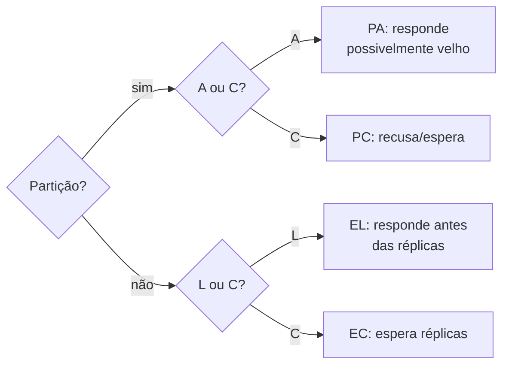
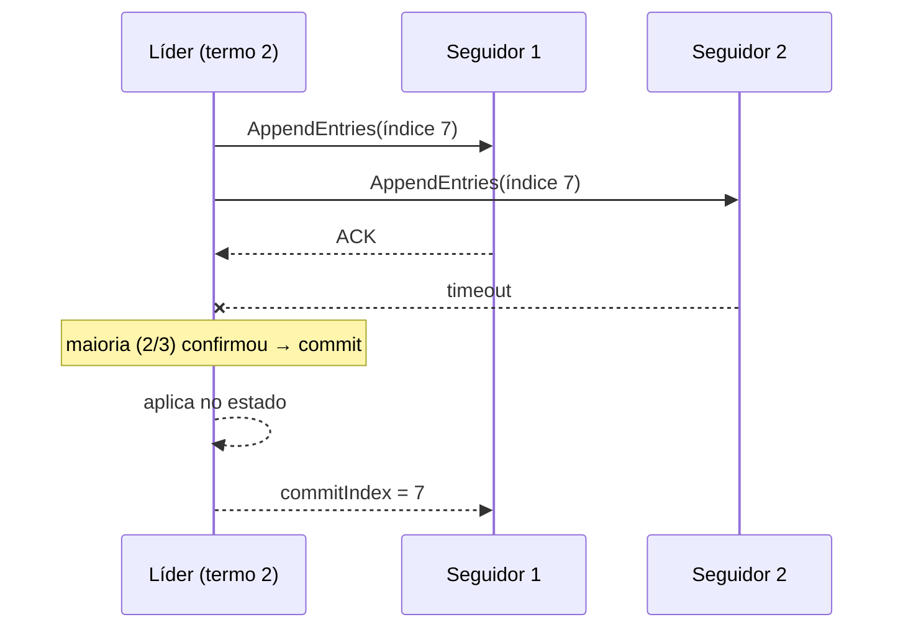
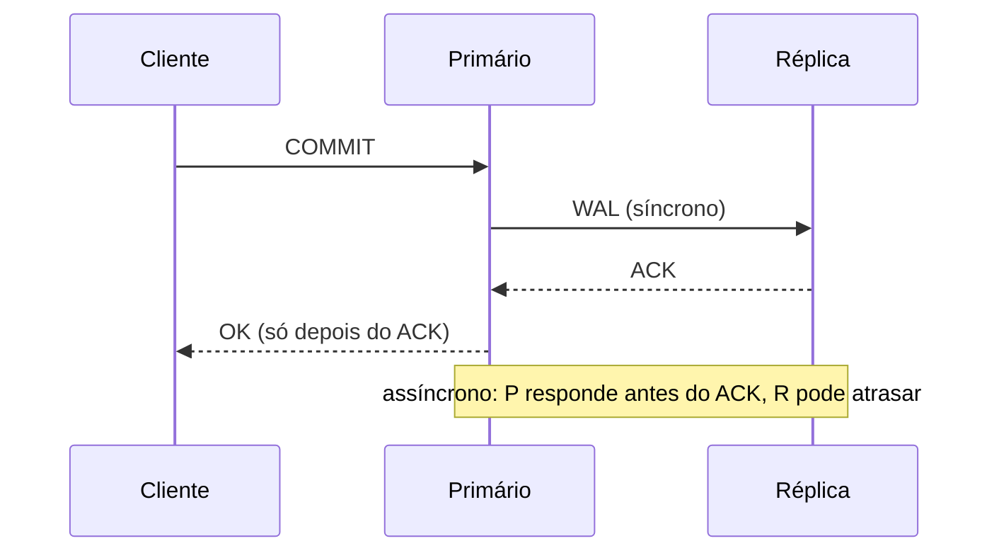
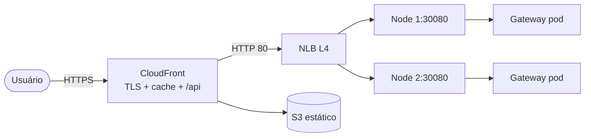

# Sistemas distribuídos

provaprojeto

Em um sistema distribuído, a rede falha, o tempo não é compartilhado e uma parte do sistema pode estar quebrada enquanto outra funciona. Quase todos os padrões deste guia existem para lidar com isso.

!!! quote "Definição de trabalho"
    Um sistema distribuído é um conjunto de computadores independentes que se apresenta ao usuário como um sistema coerente. O preço é que **falhas parciais** passam a ser a regra, e não a exceção.

---

## 1. As oito falácias

| Falácia | Realidade | Onde o projeto sente |
| --- | --- | --- |
| A rede é confiável | Pacotes se perdem, conexões caem | Timeout no Feign, retry limitado |
| A latência é zero | Chamadas custam ms a segundos | Order → Product alonga o checkout; Order → Exchange está previsto |
| A banda é infinita | Payloads e imagens custam | Limite de 5 MiB por imagem; paginação ausente no catálogo |
| A rede é segura | Tráfego interno pode ser interceptado | TLS na borda; mTLS interno não implementado |
| A topologia não muda | Pods nascem e morrem com IPs novos | Descoberta via Service/DNS do Kubernetes |
| Há um administrador | Múltiplas contas, times e permissões | IRSA, OIDC, RBAC, Secrets |
| O custo de transporte é zero | NAT, egress, NLB cobram | ≈ US$ 39 de NAT + ≈ US$ 28 de NLB por mês |
| A rede é homogênea | Versões, MTUs, proxies diferentes | CloudFront → NLB → NodePort → Service |

---

## 2. Os três problemas de raiz

### Falha parcial

Em uma máquina, ou funciona ou não. Em um sistema distribuído, **parte** funciona: o banco responde, o serviço não; o pod está vivo, mas lento; o evento foi gravado, mas não publicado.

O projeto tem um exemplo perfeito: na primeira rodada de carga, dois pods de Product **não subiram** porque o RDS recusou conexões (`remaining connection slots are reserved`). A aplicação estava saudável, o banco estava saudável, mas a combinação falhou — e o sintoma apareceu como indisponibilidade parcial do catálogo.

### Rede não confiável: lento ou morto?

Um nó lento é pior que um nó morto, porque o cliente não consegue distinguir. Sem timeout, a thread fica presa esperando; com timeout, vira erro rápido — e o erro é tratável. É a base de todos os padrões de resiliência do capítulo 9.

### Ausência de relógio global

Dois eventos em máquinas diferentes não têm ordem "natural". Relógios físicos derivam; NTP corrige, mas não de forma monotônica. Consequências:

- **Não use timestamp de aplicação para ordenar eventos entre serviços.**
- Use **relógios lógicos** (Lamport) quando precisar de ordem causal; **relógios vetoriais** quando precisar detectar concorrência.
- Para auditoria, aceite que `occurredAt` é aproximado; para ordenação de negócio, use a chave (ex.: `orderId` no Kafka garante ordem por partição).

!!! tip "No projeto"
    O pedido tem `date` gerada pelo servidor e o banco é a fonte da verdade. Como não há eventos, o problema de ordenação distribuída não aparece — mas apareceria no dia em que um `OrderCreated` fosse consumido por outro serviço.

---

## 3. CAP sem lenda

O teorema diz: em um sistema que **replica dados**, durante uma **partição de rede**, você não consegue garantir simultaneamente **consistência** (linearizabilidade) e **disponibilidade**.

| Letra | Significado exato | Não é |
| --- | --- | --- |
| **C** | Toda leitura vê a última escrita, como se houvesse uma cópia só | O "C" de ACID (respeitar restrições) |
| **A** | Todo nó não falho responde, mesmo com dado velho | "O sistema está no ar" |
| **P** | O sistema continua apesar de partições | Algo opcional |

Partições acontecem; P não é uma opção que se descarta. A escolha real é entre C e A enquanto elas duram.

### CP × AP na prática

| Classe | Durante a partição | Exemplos | Casos de uso |
| --- | --- | --- | --- |
| **CP** | Recusa ou espera em vez de servir dado velho | etcd, ZooKeeper, PostgreSQL síncrono | Dinheiro, autenticação, estoque |
| **AP** | Responde com o melhor dado local e converge depois | Cassandra, DynamoDB, DNS | Catálogo, feed, carrinho |
| **CA** | Só faz sentido sem partição (uma máquina) | PostgreSQL single-node | Desenvolvimento |

### PACELC: o trade-off que existe o tempo todo

Na ausência de partição, a escolha é **latência × consistência**. Réplica de leitura assíncrona = EL: leitura rápida, possivelmente defasada. Réplica síncrona = EC: commit espera, mais lento.

!!! example "O cache é uma decisão AP"
    O Redis provisionado no projeto (mesmo desligado) seria AP: um valor em cache pode estar velho até o TTL. Se um preço muda no Product, um catálogo cacheado pode mostrar o valor antigo por até `CACHE_TTL_SECONDS`. Isso é aceitável para catálogo; não seria para saldo ou autorização.

### Decisão por tipo de dado

| Dado do projeto | Classe desejável | Por quê |
| --- | --- | --- |
| Catálogo / imagens | AP | Preço momentaneamente velho não quebra a loja |
| Carrinho (localStorage hoje) | AP | Converge no checkout |
| Pedido gravado | CP no banco (transação local) | Não pode perder/duplicar item |
| Token/sessão | CP | Token revogado deve valer imediatamente |
| Câmbio exibido | AP com TTL curto | Cotação velha por segundos é aceitável |
| Total do pedido | CP no momento do checkout | Precisa do preço consistente com o catálogo lido |

!!! warning "Cuidado com a resposta fácil"
    "Escolhemos CA" é quase sempre uma resposta errada para sistemas replicados. Dizer "usamos Cassandra porque é AP" ignora que o modo de leitura e escrita (quórum) muda o comportamento. A pergunta útil é outra: o que acontece com as minhas requisições durante uma partição?

---

## 4. Consenso, quóruns e eleição

Sistemas CP precisam concordar sobre um valor mesmo com falhas. É o problema do consenso.

- **FLP**: em um modelo assíncrono, nenhum algoritmo determinístico garante consenso e término com até uma falha não anunciada (crash-stop). Na prática, usamos timeouts e assumimos falhas crash-stop; falhas bizantinas exigem outro modelo (ex.: BFT).
- **Maioria**: com 3 nós, 2 formam quórum; com 5, 3. Por isso clusters de controle têm número **ímpar**.
  - 3 nós toleram 1 falha; 5 toleram 2. Dois nós não toleram nenhuma (empate).
- **Raft**: eleição de líder por termo + replicação do log. O líder recebe escritas, replica para a maioria e só então confirma.
- **Onde aparece no projeto**: o control plane do EKS (etcd) usa consenso; o Kafka moderno usa **KRaft** em vez de ZooKeeper; o RDS gerencia failover internamente.

!!! warning "Consenso não é backup"
    Raft/etcd garantem consistência do **estado de controle**, não dos dados da aplicação. O backup do RDS é outro mecanismo (PITR), com outro RPO/RTO.

---

## 5. Disponibilidade: a conta que importa

$$A = \frac{MTTF}{MTTF + MTTR}$$

| Meta | Por ano | Por 28 dias |
| --- | --- | --- |
| 99% | 3,65 dias | 6,72 h |
| 99,9% | 8,77 h | 40,3 min |
| 99,95% | 4,38 h | 20,2 min |
| 99,99% | 52,6 min | 4,03 min |

**Série** (todos precisam funcionar): multiplica.

$$A_{série} = a_1 \times a_2 \times \cdots \times a_n$$

**Paralelo** (basta um funcionar, falhas independentes): complementa.

$$A_{paralelo} = 1 - (1-a)^n$$

!!! example "Exemplo com os números do projeto"
    Suponha Gateway 99,9% (duas réplicas, mas o serviço é um só), Order 99,9% e Product 99,9%. O caminho de leitura é:

    $$0{,}999^3 \approx 0{,}997 \Rightarrow 99{,}7\%$$

    Em 28 dias, isso são ≈ 2 h de indisponibilidade. Duas réplicas de Gateway a 99% cada dão $1 - 0{,}01^2 = 99{,}99\%$ — mas só se as falhas forem independentes. Duas réplicas no mesmo nó, com o mesmo bug, não são.

  
Quanto error budget (em minutos) um SLO de 99,9% permite em uma janela de 28 dias?

  <input type="number" step="0.1" inputmode="decimal" placeholder="min">
  <button type="button">Conferir</button>
  
0,1% × 28 dias × 24 h × 60 min = 40,32 min. Sempre cite a janela: em um mês de 30,44 dias, o mesmo SLO dá 43,8 min.

---

## 6. Cache: o atalho que cria consistência eventual

Cache troca **frescor** por **latência e carga**. É uma decisão AP: o valor pode estar velho até o TTL ou até uma invalidação. O problema difícil não é guardar, é **invalidar**.

| Padrão | Como funciona | Prós | Contras |
| --- | --- | --- | --- |
| **Cache-aside** | App lê o cache; no miss, lê o banco e popula | Simples, controle total | Duas idas no miss; corrida de invalidação |
| **Read-through** | A biblioteca do cache carrega no miss | Código limpo | Acoplamento ao cache |
| **Write-through** | Escreve cache + banco na mesma operação | Cache sempre fresco | Escrita mais lenta |
| **Write-behind** | Escreve cache e persiste depois | Escrita rápida | Perda de dados se o cache cair |

| Risco | O que é | Mitigação |
| --- | --- | --- |
| **Stale data** | Valor velho após update | TTL curto, invalidar após commit, versionar a chave |
| **Stampede** | Muitos misses na mesma chave | Single-flight/lock, jitter no TTL |
| **Penetração** | Consultas de chaves inexistentes | Cache negativo curto |
| **Avalanche** | Muitas chaves expiram juntas | TTL com jitter, aquecimento |
| **Hot key** | Uma chave concentra tráfego | Réplicas de leitura, key splitting |

!!! warning "A corrida clássica do cache-aside"
    Leitor A dá miss, lê o banco (valor antigo). Escritor B atualiza o banco e invalida o cache. A grava o valor antigo no cache. Resultado: cache velho por um TTL inteiro. Mitigações: invalidar **depois** do commit, usar versão/`updated_at` na chave, ou atrasar a escrita do cache (double delete). Não existe bala de prata — só trade-off.

!!! note "No projeto"
    O Redis está provisionado como endpoint compartilhado, mas **`CACHE_ENABLED=false`** e não há lógica de cache por serviço; o TTL configurado é 60 s. Um cache local por JVM (sem Redis) divergiria entre réplicas, o problema que o cache distribuído resolve. O dashboard **Dependencies** e o alerta de erro de cache existem, mas o cache não está ativo. Resumindo: cache previsto, desligado por escopo; se for ligado, precisa de invalidação e métrica de hit ratio.

---

## 7. Réplicas, failover e pool de conexões

### Por que replicar

| Objetivo | Mecanismo |
| --- | --- |
| Disponibilidade | Réplica/standby assume se o primário falhar |
| Escala de leitura | Réplicas de leitura recebem `SELECT` |
| Latência geográfica | Réplica perto do usuário |
| Recuperação | Backup/PITR (não é réplica) |

### Síncrono × assíncrono

| Modo | Latência do commit | RPO | Uso |
| --- | --- | --- | --- |
| Síncrono | Espera a réplica | ~0 | Dados críticos |
| Assíncrono | Não espera | Pode perder o último trecho | Escala de leitura, DR |
| Semissíncrono | Espera uma réplica | Baixo | Meio-termo |

**Replication lag** é o atraso da réplica. Consequências: leitura desatualizada, violação de *read-your-writes*, relatórios inconsistentes. Em uma réplica assíncrona, o usuário que acabou de escrever pode não ver a própria escrita — a UI precisa tolerar ou ler do primário.

### Failover e split-brain

1. Detectar a falha (heartbeat/timeout).
2. Promover uma réplica em sincronia.
3. Redirecionar clientes (VIP/DNS/service discovery).
4. Reconfigurar as outras réplicas.

O risco é **split-brain**: dois nós se achando primários. Fencing (STONITH), quórum e um único ponto de decisão evitam que ambos aceitem escrita. Failover não é instantâneo: leva segundos a minutos e pode perder transações se a replicação era assíncrona.

| | Multi-AZ | Réplica de leitura |
| --- | --- | --- |
| Propósito | HA/failover | Escala de leitura |
| Recebe tráfego? | Standby, normalmente não | Sim |
| Lag | Baixo (síncrono) | Pode ser alto |
| RPO | ~0 | > 0 |
| Custo | Dobra o banco | Adiciona instância |

!!! warning "Réplica não é backup"
    Se um `DELETE` for replicado, a réplica também perde os dados. Backup/PITR protege contra erro humano e corrupção; réplica protege contra falha de hardware. O projeto tem **backup/PITR** (RTO 1 h, RPO 5 min) e **não tem réplica**.

### Pool de conexões

Cada pod abre um pool (Hikari). O banco tem um limite global (`max_connections`). A conta já apareceu no capítulo 10:

$$pool \le \frac{max\_connections}{serviços \times réplicas}$$

**PgBouncer** (ou um proxy equivalente) multiplexa conexões e permite muitos pods com poucas conexões reais ao banco. O custo é mais um componente e um modo de pooling (transaction pooling quebra recursos de sessão). O projeto não usa PgBouncer; por isso o pool é a alavanca.

!!! note "No projeto"
    RDS `db.t4g.micro` Single-AZ, 112 conexões, sem réplica de leitura; pool de 8 por pod; RTO 1 h/RPO 5 min via PITR. O teste de carga mostrou que o banco não era o gargalo a 300 req/s (52/112, CPU ~15%), mas o pior caso de 3 serviços × 6 réplicas × 8 = 144 estouraria. Multi-AZ reduziria o RTO; uma réplica de leitura exigiria roteamento e tolerância a lag — e o cache desligado manda toda leitura ao primário.

---

## 8. Balanceamento de carga e borda

| Camada | Decide por | Exemplos | No projeto |
| --- | --- | --- | --- |
| **L4 (TCP)** | IP/porta | NLB, HAProxy TCP | NLB → NodePort 30080 |
| **L7 (HTTP)** | path, header, cookie | Nginx, ALB, CloudFront | CloudFront, Nginx local, Ingress |
| **CDN** | cache geográfico | CloudFront | Frontends e `/media` |

| Algoritmo | Como | Quando |
| --- | --- | --- |
| Round-robin | Alterna | Réplicas homogêneas |
| Least connections | Menos conexões ativas | Requisições longas |
| Consistent hash | Mesma chave → mesma instância | Cache local/afinidade |
| Random | Aleatório | Simples, alta escala |

**Health check** remove instâncias do pool; **connection draining** espera requisições terminarem; **sticky session** prende o cliente a uma réplica (evite se puder: use sessão stateless/cookie).

No projeto, o CloudFront termina o TLS e reescreve `/api`; o NLB é L4 e só aceita o prefixo do CloudFront; o Service do Kubernetes distribui entre pods prontos; o Nginx local faz L7 nos três frontends e no Gateway. Como os serviços são **stateless** (sessão no cookie), não há sticky session — qualquer réplica atende qualquer requisição.

!!! warning "TLS interno"
    CloudFront → NLB é **HTTP** dentro da AWS. Isso é documentado como limitação: o tráfego não é criptografado entre a borda e o cluster. A correção seria TLS no NLB/ingress ou mTLS entre serviços; o projeto não implementa.

---

## 9. O projeto à luz de CAP

| Decisão | Leitura correta |
| --- | --- |
| RDS Single-AZ | Não é HA. Um failover de AZ pode causar indisponibilidade; o RTO/RPO documentados são 1 h / 5 min, não zero. |
| Réplicas stateless atrás de Service | A disponibilidade do serviço aumenta, mas a do banco não muda. O elo mais fraco manda. |
| JWT validado localmente pelo Gateway | Escolha CP-ish: token revogado só deixa de valer no vencimento (900 s), a menos que haja introspecção. Trade-off latência × revogação. |
| Cache desligado | Evita o problema de consistência do cache; perde a redução de latência. É uma decisão consciente. |
| Sem eventos | Evita consistência eventual e outbox; concentra tudo no request path. Mais simples, menos resiliente. |
| Sessão em cookie | Estado no cliente, servidor stateless; o cookie é assinado e expira. Escala horizontal sem sessão compartilhada. |

!!! question "Pergunta de prova"
    *"Se o RDS é Single-AZ, como vocês prometem 99,5%?"*
    Resposta: 99,5% é um **SLO interno** de 28 dias para o conjunto de serviços, não uma promessa de zero indisponibilidade. O RDS tem backup e PITR (RTO 1 h, RPO 5 min), e a janela de manutenção/failover consome error budget. Para reduzir o risco, o próximo passo é Multi-AZ — e isso muda o custo.

---

## 10. O que observar em uma arquitetura distribuída

| Sintoma | Causa provável | Sinal |
| --- | --- | --- |
| Latência sobe sem erro | Dependência lenta, pool esgotado | p95/p99, saturação de pool |
| Erros em cascata | Retry amplificado, thread pool compartilhado | 5xx, timeout, filas |
| Dados divergentes | Cache sem invalidação, réplica atrasada | replication lag, TTL |
| Pedido "sumiu" | Falha após commit, sem outbox | Log sem evento, inconsistência |
| Deploy piora tudo | Todas as réplicas reiniciadas juntas | correlação deploy × erro (DORA) |

---

## Checkpoint

  
1. O que CAP realmente permite escolher?

  <ul class="options">
    <li data-key="a">Entre consistência e disponibilidade **durante uma partição**; tolerância a partições não é opcional.</li>
    <li data-key="b">Entre ter ou não partições, escolhendo uma rede confiável.</li>
    <li data-key="c">Entre consistência ACID e disponibilidade em qualquer momento.</li>
    <li data-key="d">Entre latência e throughput, sempre.</li>
  </ul>
  
Partições são um fato. A escolha é C ou A enquanto elas duram. Latência × consistência fora da partição é PACELC.

  
2. Por que um cluster de consenso costuma ter 3 ou 5 nós?

  <ul class="options">
    <li data-key="a">Porque números ímpares são mais rápidos na rede.</li>
    <li data-key="b">Porque cada nó adicional dobra a capacidade de escrita.</li>
    <li data-key="c">Porque 2 nós já formam quórum e 4 são desperdício.</li>
    <li data-key="d">Porque a maioria precisa ser clara: 3 tolera 1 falha, 5 tolera 2; com 2 ou 4, uma falha pode empatar.</li>
  </ul>
  
Quórum = ⌊n/2⌋ + 1. Com n=2, sobra 1 de 2 (não é maioria); com n=4, 2 de 4 também não é maioria estrita. Por isso 3 e 5.

  
3. O Gateway valida o JWT localmente, sem consultar o Auth a cada requisição. Qual é o trade-off?

  <ul class="options">
    <li data-key="a">Ganha revogação imediata e perde latência.</li>
    <li data-key="b">Ganha latência e disponibilidade, mas um token revogado continua válido até expirar.</li>
    <li data-key="c">Não há trade-off: validação local é sempre superior.</li>
    <li data-key="d">Perde a capacidade de verificar a assinatura.</li>
  </ul>
  
Validação local usa a chave pública/segredo e evita um salto de rede. O custo é a janela de revogação: com token de 900 s, um token roubado vale por até 15 min.

  
4. No cache-aside, qual é a corrida clássica que deixa dados velhos?

  <ul class="options">
    <li data-key="a">Dois leitores dando miss ao mesmo tempo.</li>
    <li data-key="b">O cache ficar cheio e remover chaves.</li>
    <li data-key="c">Um leitor lê o valor antigo do banco e o grava no cache depois de um escritor atualizar o banco e invalidar a chave.</li>
    <li data-key="d">O TTL ser maior que a latência da rede.</li>
  </ul>
  
É a ordem leitura→update→população que ressuscita o valor antigo. Mitigações: invalidar após o commit, usar versão na chave ou double delete. Não há solução perfeita; há trade-off.

  
5. Qual é a diferença entre Multi-AZ e uma réplica de leitura?

  <ul class="options">
    <li data-key="a">São sinônimos: ambas recebem tráfego de leitura.</li>
    <li data-key="b">Multi-AZ é standby para failover (RPO ~0, não escala leitura); réplica de leitura recebe SELECT e pode ter lag.</li>
    <li data-key="c">Multi-AZ escala leitura; a réplica só faz backup.</li>
    <li data-key="d">Nenhuma protege contra falha de hardware.</li>
  </ul>
  
Multi-AZ troca custo por disponibilidade com baixo RPO; read replica troca frescor por escala de leitura. Nenhuma substitui backup/PITR.

  
6. Um NLB opera em qual camada e o que ele enxerga?

  <ul class="options">
    <li data-key="a">L4 (TCP); decide por IP/porta e não roteia por path ou header.</li>
    <li data-key="b">L7; roteia por path e cookie.</li>
    <li data-key="c">L4, mas inspeciona o corpo HTTP para escolher a réplica.</li>
    <li data-key="d">Camada de aplicação, porque termina TLS.</li>
  </ul>
  
NLB é L4; o CloudFront e o Nginx fazem L7. No projeto, o CloudFront reescreve `/api` e o NLB só encaminha TCP para o NodePort.

## Checklist

<label class="study-check"><input type="checkbox" data-key="d-cap"> Explico C, A e P sem confundir com ACID.</label>
<label class="study-check"><input type="checkbox" data-key="d-cache"> Explico cache-aside, invalidação, stampede e o Redis desligado do projeto.</label>
<label class="study-check"><input type="checkbox" data-key="d-replica"> Distingo Multi-AZ, read replica e backup.</label>
<label class="study-check"><input type="checkbox" data-key="d-lb"> Distingo balanceamento L4 e L7.</label>
<label class="study-check"><input type="checkbox" data-key="d-pacelc"> Sei dizer o que PACELC acrescenta e dou um exemplo do projeto.</label>
<label class="study-check"><input type="checkbox" data-key="d-quorum"> Calculo quórum e justifico clusters ímpares.</label>
<label class="study-check"><input type="checkbox" data-key="d-avail"> Calculo disponibilidade em série e em paralelo.</label>

!!! info "Continue"
    Se a rede é o problema, o próximo passo é empacotar a aplicação para que ela rode igual em qualquer lugar. [Containers e Compose](03-containers.md).
