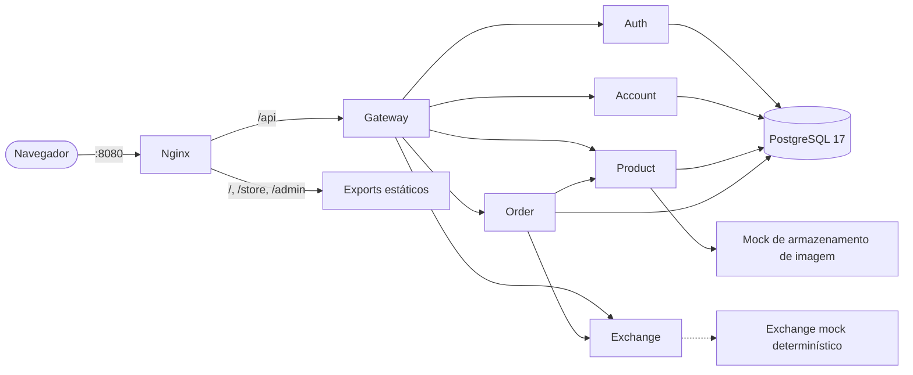

# Containers e Docker Compose

<span class="study-tag prova">prova</span><span class="study-tag projeto">projeto</span>

Container não é "uma VM pequena". É um **processo isolado** por recursos do kernel (namespaces e cgroups) rodando sobre o **mesmo kernel** do host. Entender essa frase resolve metade das perguntas de prova — e a outra metade é saber o que o Compose **não** faz.

---

## 1. VM × container

| Aspecto | Máquina virtual | Container |
| --- | --- | --- |
| Isolamento | Hypervisor + kernel próprio | Namespaces + cgroups no kernel do host |
| Peso | GBs, boot em minutos | MBs, start em segundos |
| Densidade | Dezenas por host | Centenas por host |
| Segurança | Fronteira forte (hypervisor) | Fronteira mais fraca (kernel compartilhado) |
| Artefato | Imagem de disco | Imagem OCI em camadas |
| "Bundle" | SO inteiro + app | App + dependências de userspace |

**Namespaces** isolam *o que você vê*: PID, rede, mount, UTS, IPC, user, cgroup. **Cgroups** limitam *quanto você usa*: CPU, memória, I/O. Um container com `--memory=512m` é um processo cujo cgroup é limitado a 512 MB — se estourar, o OOM killer mata o processo.

!!! warning "Isso explica o projeto"
    Os Deployments declaram `requests: 250m/256Mi` e `limits: 500m/512Mi`. O limite é o teto do cgroup: ao ultrapassar a memória, o pod é **OOMKilled**; ao ultrapassar a CPU, é **throttled**. A HPA usa a *request* de CPU como denominador, não o limite.

---

## 2. Imagem, camadas e cache

Uma imagem é uma pilha de camadas **imutáveis**, cada uma um diff do sistema de arquivos. O Dockerfile gera camadas; o cache é reaproveitado enquanto a instrução e o contexto não mudarem.

```dockerfile
# Multi-stage: compila com Maven, roda só com JRE
FROM maven:3.9-eclipse-temurin-21 AS build
WORKDIR /src
COPY pom.xml .
RUN mvn -q dependency:go-offline        # cacheia dependências
COPY src ./src
RUN mvn -q package -DskipTests

FROM eclipse-temurin:21-jre
RUN useradd -r -u 10001 app
WORKDIR /app
COPY --from=build /src/target/*.jar app.jar
USER 10001
EXPOSE 8080
ENTRYPOINT ["java", "-jar", "app.jar"]
```

| Prática | Por quê |
| --- | --- |
| Multi-stage | A imagem final não carrega Maven, código-fonte nem cache de build |
| Copiar `pom.xml` antes do `src` | Mudança de código não invalida o download de dependências |
| `.dockerignore` | Evita enviar `target/`, `.git/`, `.env` ao contexto de build |
| `USER` não-root | Reduz impacto de comprometimento; combinado com `drop: ALL` no K8s |
| Versão fixa da base | Build reproduzível; `latest` quebra auditoria |
| Uma responsabilidade | Um processo principal por container (12-factor) |

!!! tip "A pergunta 'por que minha imagem tem 1 GB?'"
    Quase sempre é build stage vazando para o runtime, cache de pacotes ou artefatos no contexto. `docker history` e `docker image ls` mostram as camadas; `.dockerignore` resolve o contexto.

---

## 3. Compose: orquestração de um host

Compose descreve **serviços, redes, volumes e dependências** em um YAML. Ele é ótimo para o loop diário e insuficiente para produção multi-nó.

| Conceito | Efeito |
| --- | --- |
| `services` | Um container (ou réplicas) por serviço |
| `networks` | DNS por nome de serviço: `http://account:8080`, nunca `localhost` |
| `volumes` | Persistência gerenciada (`named`) ou pasta do host (`bind`) |
| `depends_on` | **Ordem de start**, não readiness |
| `healthcheck` | Comando que marca o container `healthy`; combine com `condition: service_healthy` |
| `profiles` | Grupos opcionais (ex.: `observability`, `demo`) |
| `env_file` / `environment` | Configuração 12-factor |

Trecho representativo do `compose.yml` do projeto (simplificado):

```yaml
services:
  database:
    image: postgres:17-alpine
    environment:
      POSTGRES_DB: platform
      POSTGRES_USER: admin
      POSTGRES_PASSWORD: ${POSTGRES_PASSWORD}
    volumes:
      - postgres-data:/var/lib/postgresql/data
    healthcheck:
      test: ["CMD-SHELL", "pg_isready -U $${POSTGRES_USER} -d $${POSTGRES_DB}"]
      interval: 5s
      timeout: 5s
      retries: 10

  exchange:
    build: ./api/exchange/
    image: microsserv52-exchange:local
    environment:
      EXCHANGE_PROVIDER_URL: http://exchange-provider-mock:8080
      JWT_SECRET: ${JWT_SECRET}
    depends_on:
      exchange-provider-mock: { condition: service_healthy }
      redis: { condition: service_healthy }

  exchange-provider-mock:
    build: ./mocks/exchange-provider/
    # determinístico; recusa subir com ENV/APP_ENV=prod
```

!!! warning "`depends_on` não é readiness"
    Ele só ordena o start. Se o Auth ainda não estiver ouvindo, o Gateway sobe e falha na primeira chamada. Quem resolve isso é **readiness probe** (Kubernetes) ou `healthcheck` + `condition: service_healthy` (Compose). A documentação do projeto é explícita nesse ponto.

---

## 4. O ambiente local do projeto



| Decisão | Motivo | Limite |
| --- | --- | --- |
| Postgres 17 | Mesma major do manifesto K8s; Flyway cria as tabelas do Product | Volume antigo de outra major exige migração |
| Redis 7.4 | Compatibilidade com ElastiCache | `CACHE_ENABLED=false`; não é usado |
| Mock do Exchange | Desenvolvimento sem chave de provedor | Recusa subir em `prod`; não é dado financeiro |
| Mock de imagem | Testa upload sem S3 | Fluxo AWS exige bucket, IRSA, CORS, CloudFront |
| Nginx na frente | Simula a borda e o path routing | Não é o CloudFront real |
| Imagens `:local` | Build do checkout, não registry | Produção usa SHA imutável |

!!! note "Frontend demo é outro Compose"
    `compose.frontend-demo.yml` sobe apenas os três exports e uma API de fixtures, para validar UI sem Product/Exchange reais. Ele **não prova** integração: os dados são descartáveis e a página deixa isso visível.

---

## 5. 12-factor e por que ele importa para containers

| Fator | No projeto |
| --- | --- |
| Config no ambiente | `AUTH_URL`, `JWT_SECRET`, `SPRING_DATASOURCE_*`, `CACHE_ENABLED` |
| Processos stateless | Serviços sem sessão em memória; sessão no cookie assinado |
| Ports binding | Cada serviço ouve 8080; o Service mapeia |
| Logs como stream | JSON no stdout; Alloy coleta; nada em arquivo local |
| Disposability | `terminationGracePeriodSeconds: 30`; readiness sai antes do kill |
| Dev/prod parity | Mesma imagem em Compose, K8s e EKS |
| Admin processes | `seed_demo.py`, migrations Flyway como one-off |

!!! tip "A ligação com o capítulo de nuvem"
    O mesmo artefato (imagem) roda em Compose, MicroK8s, LocalStack e EKS. É isso que torna a migração uma questão de **deploy**, não de reescrita — o argumento central da aula de modelos de serviço.

---

## 6. O que Compose não resolve

| Necessidade de produção | Compose | Kubernetes/EKS |
| --- | --- | --- |
| Réplicas com auto-healing | Limitado | Deployment + probes |
| Escala automática | Manual | HPA + Cluster Autoscaler |
| Rollout gradual/rollback | Recria containers | RollingUpdate, histórico de ReplicaSets |
| Service discovery multi-nó | DNS local | Service/DNS do cluster |
| Multi-AZ | Não | Node group em subnets privadas |
| Secrets gerenciados | `.env` | Secret + IRSA/Secrets Manager |
| Políticas de rede | Rede do host | NetworkPolicy (se o CNI suportar) |

!!! warning "Não confunda 'roda no meu notebook' com 'está pronto'"
    Compose não tem control plane, não reagenda pods, não faz failover entre nós e não tem PDB. A frase "o Compose é o loop diário; o EKS é o ambiente de entrega" resume a fronteira.

---

## Ordem de um Dockerfile

<div class="study-order" data-items="FROM base AS build|COPY pom.xml e baixar dependências|COPY src e compilar|FROM runtime enxuto|COPY --from=build o artefato|USER não-root|ENTRYPOINT do processo" data-prompt="Ordene as etapas de um Dockerfile multi-stage eficiente:"></div>

---

## Checkpoint

<div data-study-score></div>

<div class="study-quiz" data-answer="b">
  <p class="q">1. O que um container compartilha com o host?</p>
  <ul class="options">
    <li data-key="a">Nada: ele tem kernel próprio, como uma VM.</li>
    <li data-key="b">O kernel; namespaces isolam a visão e cgroups limitam o consumo.</li>
    <li data-key="c">Apenas o sistema de arquivos, mas não a rede.</li>
    <li data-key="d">Somente a CPU; memória é sempre dedicada.</li>
  </ul>
  <p class="explain">Container é processo isolado por namespaces (PID, net, mount, user…) e limitado por cgroups. Não há kernel próprio — daí o boot rápido e a fronteira de segurança diferente da VM.</p>
</div>

<div class="study-quiz" data-answer="c">
  <p class="q">2. No Kubernetes, `requests.cpu: 250m` e `limits.cpu: 500m`. O HPA a 70% usa qual referência?</p>
  <ul class="options">
    <li data-key="a">70% do limite de 500m, ou seja, 350m.</li>
    <li data-key="b">70% da CPU do nó, independentemente do pod.</li>
    <li data-key="c">70% da request de 250m, ou seja, 175m por pod.</li>
    <li data-key="d">A média entre request e limit, 375m.</li>
  </ul>
  <p class="explain">A utilização de CPU do HPA é calculada sobre a request. O limite é o teto do cgroup (throttling), não a base do percentual. Por isso o dimensionamento de request muda o gatilho de escala.</p>
</div>

<div class="study-quiz" data-answer="d">
  <p class="q">3. Qual afirmação sobre `depends_on` no Compose é correta?</p>
  <ul class="options">
    <li data-key="a">Ele espera o healthcheck do serviço dependente ficar saudável.</li>
    <li data-key="b">Ele garante que o serviço dependente está pronto para receber tráfego.</li>
    <li data-key="c">Ele reinicia o dependente se a dependência cair.</li>
    <li data-key="d">Ele apenas ordena a inicialização; readiness exige healthcheck ou probe.</li>
  </ul>
  <p class="explain">Sem `condition: service_healthy`, `depends_on` só espera o container iniciar. É por isso que serviços precisam de health/readiness reais.</p>
</div>

## Checklist

<div data-study-progress></div>

<label class="study-check"><input type="checkbox" data-key="c-ns"> Explico namespaces e cgroups e ligo ao OOMKill/throttling.</label>
<label class="study-check"><input type="checkbox" data-key="c-multi"> Justifico multi-stage e cache de camadas.</label>
<label class="study-check"><input type="checkbox" data-key="c-compose"> Sei o que Compose resolve e o que só o Kubernetes resolve.</label>
<label class="study-check"><input type="checkbox" data-key="c-12f"> Relaciono 12-factor ao projeto (config, stateless, logs, parity).</label>

!!! info "Continue"
    Com a aplicação empacotada, falta o contrato que permite trocar o pacote sem quebrar o vizinho: [APIs e contratos](04-apis.md).
