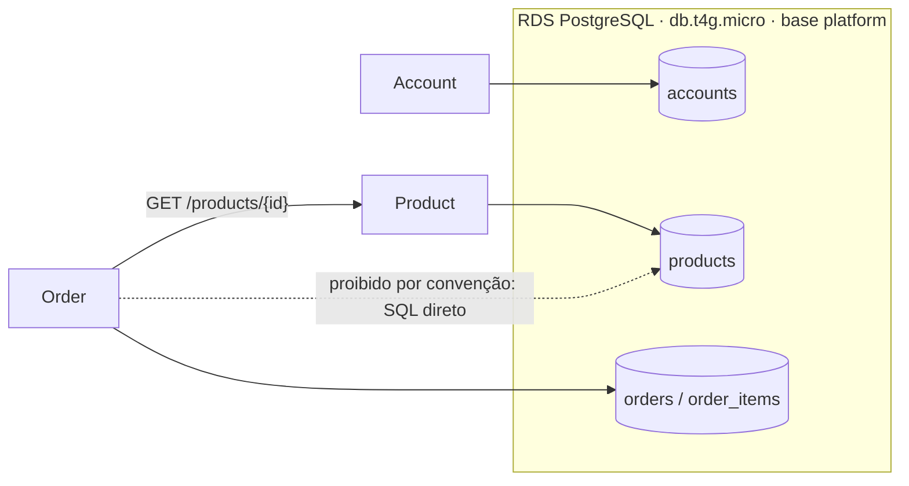
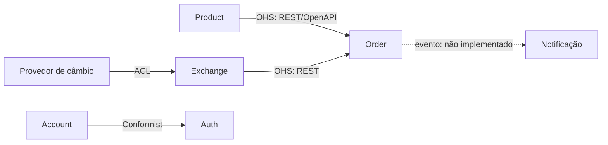

# Microsserviços e DDD

provaprojeto

A pergunta central não é "quantos serviços?". É **"onde cortar para que os pedaços possam mudar sem se arrastar?"**. DDD responde *onde*; a arquitetura de microsserviços responde *como operar* cada pedaço.

!!! quote "A definição que vale citar"
    Microsserviços é um estilo arquitetural que organiza a aplicação como uma coleção de serviços pequenos, autônomos, modelados em torno de uma capacidade de negócio, implantáveis de forma independente e comunicando-se por contratos explícitos.

---

## 1. Monólito, monólito modular, microsserviços

| Dimensão | Monólito | Microsserviços |
| --- | --- | --- |
| Deploy | Uma unidade | Independente por serviço |
| Escala | Aplicação inteira | Apenas o serviço gargalo |
| Desenvolvimento | Rápido no início | Setup lento; rápido em escala |
| Operação | Baixa complexidade | Alta: orquestração, tracing, discovery |
| Dados | Transações ACID | Consistência eventual entre serviços |
| Time | Pequeno e coeso | Vários times com ownership |

**Monólito modular** é o meio-termo subestimado: uma única unidade implantável, módulos com interfaces explícitas e **sem tabelas compartilhadas**. Você pratica as fronteiras antes de pagar o preço da rede. A recomendação da aula é começar por ele e dividir quando a autonomia de deploy/escala virar um problema concreto.

!!! warning "Sintomas de monólito distribuído"
    - Serviços precisam ser implantados juntos ("release train").
    - Dois serviços leem/escrevem as mesmas tabelas.
    - Uma requisição dispara uma cadeia síncrona longa; qualquer elo derruba tudo.
    - Uma biblioteca de domínio compartilhada força todos a atualizar juntos.

    O projeto **não** é um monólito distribuído no papel: cada serviço tem tabelas próprias e contrato. Mas a cadeia síncrona Order → Product (e futuramente Exchange) é um risco real — e é por isso que ela aparece nos testes de carga e nas limitações.

### Lei de Conway

> Organizações que projetam sistemas produzem projetos cuja estrutura copia a estrutura de comunicação da organização.

Consequência prática: as fronteiras dos serviços tendem a espelhar as fronteiras dos times. A **manobra inversa de Conway** organiza os times por capacidade de negócio *antes* para que a arquitetura siga. No projeto, cada serviço tem um dono declarado e um revisor de outra área — governança descentralizada.

---

## 2. Princípios e o tamanho certo

| Princípio | Significado |
| --- | --- |
| Responsabilidade única | Um serviço = uma capacidade de negócio |
| Independência | Desenvolver, implantar e escalar sem coordenação |
| Isolamento de dados | Tabelas próprias; sem acesso direto às do vizinho |
| Governança descentralizada | Cada time escolhe a tecnologia (Java e Python convivem) |
| Isolamento de falhas | Uma falha não propaga em cascata |
| API-first | Contratos explícitos e versionados |
| Observabilidade | Pré-requisito, não extra |

**"Micro" não é linhas de código.** É o tamanho em que um time é dono de ponta a ponta e o serviço pode ser implantado sozinho. Serviços por tabela ("nanosserviços") passam mais tempo conversando do que trabalhando.

---

## 3. Síncrono × assíncrono: a conta que decide

=== "Síncrono (HTTP/gRPC)"

    Quem chama espera. Simples de raciocinar, mas cria **acoplamento temporal**: se o downstream cai, a operação falha ou trava.

    Use quando a resposta é necessária para continuar: autenticar, validar preço, confirmar o checkout.

=== "Assíncrono (broker)"

    O produtor publica e segue. Consumidores processam no próprio ritmo. Elimina o acoplamento temporal e permite absorver picos, ao custo de consistência eventual e complexidade operacional.

    Use quando o efeito pode ser diferido: e-mail, analytics, reserva de estoque, faturamento.

!!! example "A matemática da cadeia síncrona"
    Três serviços a 99,9% em série: $0,999^3 \approx 99,7\%$. Em um ano, isso é ~26 h de indisponibilidade contra ~8,8 h de um serviço isolado. **Cada salto síncrono reduz o teto de disponibilidade e soma latência.** É por isso que o projeto replica serviços, usa timeout e mantém as cadeias curtas — e por que o próximo passo seria mover o pós-pedido para eventos.

### Onde o projeto escolhe cada um

| Interação | Escolha | Justificativa |
| --- | --- | --- |
| Gateway → Auth (validação) | Síncrona | Precisa decidir antes de rotear |
| Order → Product (preço) | Síncrona | O total depende do preço atual |
| Order → Exchange (conversão) | Síncrona (prevista) | A resposta pedida seria o valor convertido; a implementação checada ainda rejeita não-USD |
| Order → notificação/e-mail | **Não existe** | Seria assíncrona; é a lacuna declarada |
| Frontend → API | Síncrona | Requisição do usuário |

---

## 4. Dono dos dados: database-per-service como disciplina

"Banco por serviço" é sobre **propriedade**, não necessariamente sobre um servidor por serviço. O ideal é uma base/schema e credenciais por serviço. O projeto implementa uma versão mais fraca: **um servidor RDS e uma base `platform`**, com tabelas separadas e a regra de que cada serviço só acessa as suas.

| Regra | Consequência |
| --- | --- |
| Só o dono escreve nas suas tabelas | Migrações independentes (Flyway no Product, JPA no Account/Order) |
| Leitura de dados alheios via API | Contrato, autorização e auditoria em um só lugar |
| Transação local por serviço | Sem ACID distribuído; operações multi-serviço exigem saga |
| Servidor/base compartilhados | Custo menor, **limite de conexões compartilhado** |

!!! warning "Propriedade sem isolamento físico"
    Como não há schema ou credencial separada, **nada no banco impede** um `SELECT` na tabela alheia. A garantia é revisão de código, contrato e disciplina — não um mecanismo de infraestrutura. Na prova, diga que `database-per-service` é um **espectro**: o projeto fica no polo "tabelas separadas por convenção", não no polo "base e role por serviço". É uma limitação honesta, e o próximo passo é schema + role por serviço.

!!! warning "O limite que o compartilhamento cobra"
    `db.t4g.micro` permite 112 conexões. Com três serviços de banco e pool de 10 por pod, o teto é $112 / (3 \times 10) \approx 3{,}7$ réplicas por serviço. Na quarta réplica, o banco recusa conexões — foi exatamente o que derrubou dois pods de Product no teste com pool 10.

---

## 5. DDD estratégico: onde cortar

### Subdomínios

| Tipo | Definição | Na loja |
| --- | --- | --- |
| **Core** | Diferencial do negócio | Pedidos, precificação, catálogo |
| **Supporting** | Necessário, mas não diferencial | Notificações, exibição de moeda |
| **Generic** | Problema já resolvido | Autenticação, pagamento, e-mail |

Subdomínios genéricos são candidatos a **comprar** (Keycloak, Auth0, Stripe). O curso constrói auth para aprender; uma empresa real provavelmente não construiria.

### Bounded context

Fronteira onde um modelo é válido. A mesma palavra pode ter modelos diferentes:

- **Catálogo:** produto tem nome, preço atual, unidade, imagem.
- **Pedido:** produto é uma referência (`productId`) + quantidade + total praticado.

Tentar uma única classe `Product` para os dois cria um objeto inchado que não atende bem a nenhum. O projeto evita isso no payload: o item do pedido carrega só o id do produto.

### Linguagem ubíqua

O negócio fala "conta", então o serviço é `account`, o recurso é `/accounts`, as classes são `AccountIn/Out/Service`. O código se lê como o negócio fala. Sem isso, `Customer` vira `USER` no banco e `Person` no código — três traduções, três chances de divergir.

### Mapa de contexto

| Relação | Definição | No projeto |
| --- | --- | --- |
| **Open Host Service + Published Language** | API bem definida e documentada para muitos consumidores | Product expõe REST + OpenAPI para Order e frontend |
| **Conformist** | Downstream adota o modelo upstream como está | Auth consome `AccountIn/AccountOut` |
| **Anti-Corruption Layer** | Tradução para o modelo do upstream não vazar | Exchange isola o JSON do provedor de câmbio |
| **Customer/Supplier** | Necessidades do downstream entram no plano do upstream | Order depende do contrato de Product |
| **Shared Kernel** | Modelo compartilhado por acordo | Evitado; contratos, não bibliotecas de domínio |

!!! tip "ACL é o padrão mais subestimado"
    O Exchange é o único serviço Python. Ele **não deixa** o formato do provedor (campos, datas, rates) vazar para o Order. Se o provedor mudar ou for trocado, só o adapter muda. Em uma prova, cite isso como exemplo de fronteira que protege o domínio de uma dependência volátil.

---

## 6. DDD tático: os blocos

| Bloco | Definição | Exemplo no projeto |
| --- | --- | --- |
| **Entidade** | Tem identidade própria | `Order` (id), `Account` (id) |
| **Objeto de valor** | Definido pelos atributos, imutável | `Money(amount, currency)` |
| **Agregado** | Grupo com uma raiz que protege invariantes | `Order` + `OrderItem`s |
| **Repositório** | Interface de persistência do agregado | `OrderRepository` |
| **Evento de domínio** | Fato passado, imutável | `OrderCreated` (não emitido) |
| **Serviço de domínio** | Operação que não pertence a uma entidade | Cálculo de total com conversão |

Regras de agregado que caem em prova:

1. Referencie outros agregados **por id**, nunca por objeto.
2. Uma transação altera **um** agregado; o resto é eventual.
3. A raiz valida todas as invariantes.
4. Mantenha agregados pequenos: um `Account` com todos os pedidos seria enorme e teria conflito de concorrência.

!!! example "O agregado Order no projeto"
    - Total = soma dos itens; a raiz recalcula ao adicionar item.
    - Quantidade > 0; máximo de itens; moeda do pedido é USD.
    - `OrderItem` guarda `productId`, `quantity`, `total` — não um `Product`.
    - O pedido não conhece o nome atual do produto; isso é catálogo.

---

## 7. Event Storming (como a fronteira nasce)

1. Liste **eventos de domínio** no passado: `OrderPlaced`, `PaymentFailed`, `StockReserved`.
2. Adicione **comandos**: *fazer pedido*, *cobrar cartão*, *reservar estoque*.
3. Agrupe por linguagem ubíqua: o que muda junto pertence ao mesmo contexto.
4. Desenhe o **mapa de contexto** (ACL, OHS, conformist).
5. Um contexto → um serviço **como ponto de partida**; junte/divida por restrição operacional.

Event Storming é colaborativo e revela fronteiras que o banco de dados esconde. Um serviço por tabela é o resultado de olhar o schema em vez do negócio.

---

## 8. Erros comuns (e como a banca os usa)

| Erro | Correção |
| --- | --- |
| Serviço por tabela/substantivo (`OrderItemService`) | Serviço por capacidade com comportamento |
| Modelo anêmico (getters/setters + service com tudo) | Regras na raiz do agregado |
| Modelo gigante compartilhado por biblioteca | Contratos e DTOs por contexto |
| Agregados grandes | IDs entre agregados; transações curtas |
| "Microsserviço" que precisa de deploy conjunto | Fronteira errada ou contrato instável |
| Compartilhar banco "só para facilitar" | Acoplamento escondido; migração impossível |
| Assíncrono em tudo | Complexidade sem necessidade; use onde há desacoplamento real |

!!! warning "O projeto tem uma dívida de DDD?"
    Não exatamente. Ele tem uma **dívida de eventos**: o pedido é gravado, mas não publica `OrderCreated`. Isso não viola DDD; limita a evolução (notificação, analytics, faturamento) e deixa trabalho no request path. A correção seria outbox + consumidor idempotente, não "mais DDD".

---

## 9. Como responder

**"Como vocês decidiram os serviços?"**
> Por capacidade de negócio e contexto: catálogo, pedido, câmbio, identidade, contas e borda. A prova de que a fronteira está certa é que cada um tem tabelas próprias e pode ser implantado sozinho. O contraexemplo seria um serviço por tabela (`order_item`), que não teria comportamento nem deploy independente.

**"Por que não juntar Product e Order?"**
> Porque têm ciclos de mudança e escalas diferentes: catálogo é leitura intensiva e pública; pedido é escrita autenticada e depende de preço. Juntar reduziria uma chamada de rede, mas acoplaria o deploy e a escala dos dois — e o preço praticado no pedido precisa ser congelado de qualquer forma.

**"O que é monolito distribuído e o projeto é um?"**
> É um sistema com muitos processos, mas acoplamento de monólito: deploy conjunto, tabelas compartilhadas, cadeia síncrona longa. O projeto tem uma cadeia curta (Order → Product; Exchange previsto) e contratos, então não é; mas o risco de a cadeia crescer é real, e a resposta é evento/outbox.

---

## Checkpoint

  
1. Qual é a melhor justificativa para separar Order de Product?

  <ul class="options">
    <li data-key="a">Porque cada tabela deve ter um serviço.</li>
    <li data-key="b">Porque Java e Python não podem conviver no mesmo processo.</li>
    <li data-key="c">Porque têm capacidades, ciclos de mudança e perfis de escala diferentes, e o pedido precisa congelar o preço praticado.</li>
    <li data-key="d">Porque o gateway exige um serviço por rota.</li>
  </ul>
  
A fronteira é de negócio e de evolução. O preço atual vem do Product por API; o preço praticado fica no item do pedido. Um serviço por tabela seria um antipadrão.

  
2. O Exchange traduz o JSON do provedor para o modelo da plataforma. Esse padrão é:

  <ul class="options">
    <li data-key="a">Anti-Corruption Layer, porque impede o modelo externo de vazar para o domínio.</li>
    <li data-key="b">Shared Kernel, porque compartilha o modelo do provedor.</li>
    <li data-key="c">Conformist, porque o Exchange aceita o modelo do provedor como está.</li>
    <li data-key="d">Event Sourcing, porque guarda o histórico de cotações.</li>
  </ul>
  
ACL é uma camada de tradução na fronteira. Conformist seria adotar o modelo do upstream sem tradução; Shared Kernel seria compartilhar código/modelo por acordo.

  
3. Por que o item do pedido guarda `productId` e `total`, mas não o objeto `Product` completo?

  <ul class="options">
    <li data-key="a">Para economizar bytes na resposta HTTP.</li>
    <li data-key="b">Porque o Product não tem nome.</li>
    <li data-key="c">Porque o banco não suporta JSON.</li>
    <li data-key="d">Porque agregados se referenciam por id e o pedido precisa preservar o preço praticado, não o preço mutável do catálogo.</li>
  </ul>
  
É a regra de agregados + bounded context: catálogo e pedido têm modelos diferentes para "produto". Copiar o objeto acoplaria os dois e reescreveria o histórico quando o preço mudasse.

## Checklist

<label class="study-check"><input type="checkbox" data-key="m-mono"> Comparo monólito, modular e microsserviços com critérios de time, deploy e dados.</label>
<label class="study-check"><input type="checkbox" data-key="m-conway"> Explico Conway e a manobra inversa.</label>
<label class="study-check"><input type="checkbox" data-key="m-ddd"> Distingo estratégico (fronteiras) de tático (blocos).</label>
<label class="study-check"><input type="checkbox" data-key="m-db"> Defendo database-per-service mesmo com servidor compartilhado.</label>
<label class="study-check"><input type="checkbox" data-key="m-sync"> Calculo o custo de disponibilidade de uma cadeia síncrona.</label>

!!! info "Continue"
    Dentro de cada serviço, como organizar as classes para que o domínio não dependa do framework? [Arquiteturas de software](06-arquiteturas.md).
