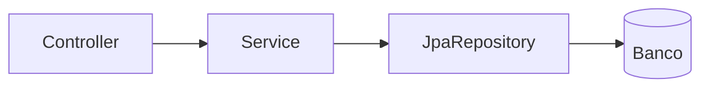
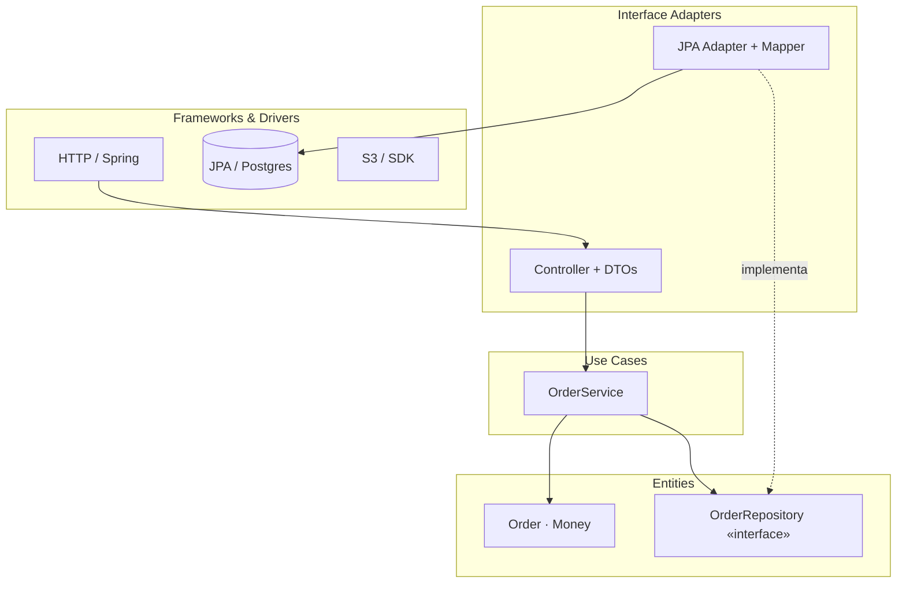

# Arquiteturas de software

<span class="study-tag prova">prova</span><span class="study-tag projeto">projeto</span>

SOLID decide como uma classe deve ser. Clean/Hexagonal decidem **onde ela mora e quem pode importar quem**. A pergunta que une os dois: *se o framework mudar, quantas classes de negócio eu preciso reescrever?*

---

## 1. SOLID em uma página

| Princípio | Ideia | Cheiro de violação |
| --- | --- | --- |
| **S** — Single Responsibility | Uma classe, um motivo para mudar | Classe que valida, persiste e formata resposta |
| **O** — Open/Closed | Aberta para extensão, fechada para modificação | `if/else` crescendo por tipo de pagamento |
| **L** — Liskov | Subtipo substitui o supertipo sem surpresa | `Square extends Rectangle` alterando área |
| **I** — Interface Segregation | Interfaces pequenas e específicas | `Repository` com 30 métodos que ninguém usa |
| **D** — Dependency Inversion | Dependa de abstrações, não de detalhes | Service importando `JpaRepository` diretamente |

!!! example "DIP no projeto"
    O caso de uso declara `OrderRepository` (interface). A implementação JPA/Spring Data vive na infraestrutura. Em tempo de execução a chamada vai para o banco; no código-fonte, a dependência aponta para dentro. É esse cruzamento que permite testar o caso de uso sem banco.

!!! warning "SOLID não é "uma classe por arquivo""
    O princípio é sobre **motivos de mudança** e direção de dependência, não sobre tamanho. Uma classe de 200 linhas coesa pode ser melhor que cinco classes anêmicas que só se chamam.

---

## 2. Em camadas → Clean → Hexagonal

### O ponto de partida: n-tier



Funciona e é fácil de ler. O problema: **o negócio depende da persistência**. Trocar o banco, testar sem Spring ou introduzir outro mecanismo de entrega mexe no serviço.

### Clean Architecture

Camadas concêntricas com a **Regra de Dependência**: o código-fonte só aponta para dentro.

| Camada | Responsabilidade | Exemplos |
| --- | --- | --- |
| **Entities** | Regras de negócio independentes | `Order`, `Money`, `OrderRepository` (interface) |
| **Use Cases** | Orquestração da aplicação | `PlaceOrderService` |
| **Interface Adapters** | Tradução entre casos de uso e mundo externo | Controller, presenter, JPA adapter |
| **Frameworks & Drivers** | Detalhes | Spring, Hibernate, HTTP, S3 |



**Heurística de camada:**

- Muda quando o **negócio** muda → entidade/caso de uso.
- Muda quando a **interface** muda (REST → gRPC) → adaptador.
- Muda quando a **biblioteca** muda (Spring/JPA) → framework.

### Hexagonal (Ports & Adapters)

O hexágono não tem "cima" nem "baixo": tudo que é externo é equivalente. O núcleo define **portas**; o mundo externo pluga **adaptadores**.

| Porta | Direção | Definida por | Implementada por |
| --- | --- | --- | --- |
| Primária (driving) | Fora → app | Núcleo | O próprio núcleo (serviço), chamado pelo controller |
| Secundária (driven) | App → fora | Núcleo | Adaptador (JPA, HTTP client, broker) |

```java
// Porta secundária, no núcleo
public interface ExchangeProvider {
    Rate rate(String from, String to);
}

// Adaptador, na infraestrutura
public class AwesomeApiAdapter implements ExchangeProvider {
    private final HttpClient http; // detalhe externo
    public Rate rate(String from, String to) { /* traduz o JSON */ }
}
```

!!! tip "Clean e Hexagonal são complementares"
    Hexagonal define **como** a fronteira funciona (portas/adaptadores). Clean define **o que** vai dentro (camadas e regra de dependência). A maioria dos serviços modernos combina as duas.

### No projeto

| Serviço | Estilo predominante | Observação |
| --- | --- | --- |
| Account / Product / Order | Camadas pragmáticas (Controller → Service → Repository) | Simples o suficiente; DTOs separados |
| Exchange | Hexagonal no ponto crítico | `ExchangeProvider` isola o provedor externo |
| Gateway | Filtros/rotas | Não tem domínio de negócio; não precisa de Clean |
| Frontend | Camadas por feature (`app`, `components`, `lib`) | Sem Clean cerimonial |

!!! warning "Não over-engineer um CRUD"
    Portas, adaptadores e mappers custam classes e indireção. Um serviço que só armazena e devolve registros pode ficar em camadas. A estrutura extra compensa quando há regra de negócio rica, vida longa ou necessidade real de trocar entrega/armazenamento. **Cada serviço pode escolher seu nível** — isso é uma vantagem de microsserviços.

---

## 3. CQRS: separar leitura de escrita

| Lado | Responsabilidade | Consistência | Escala |
| --- | --- | --- | --- |
| Comando | Valida e altera estado | Forte (transação local) | Vazão de escrita |
| Consulta | Serve visões otimizadas | Eventual | Vazão de leitura |

Graus de CQRS:

1. **Leve:** mesmas tabelas, classes de leitura separadas (DTO/projeção).
2. **Médio:** banco de leitura separado (Redis, índice) sincronizado por evento/CDC.
3. **Pesado:** event store + projeções (combina com Event Sourcing).

!!! warning "CQRS não é padrão universal"
    Adiciona consistência eventual, duplicação de modelos e complexidade operacional. Use onde há assimetria real (catálogo com milhões de leituras e poucas escritas) ou necessidade de auditoria. O projeto **não** usa CQRS: o catálogo lê e escreve nas mesmas tabelas; o volume medido não justificou.

---

## 4. Testabilidade: o verdadeiro ganho

| Arquitetura | Teste de unidade | Teste de integração |
| --- | --- | --- |
| Em camadas | Precisa mockar tipos do framework | Sobe contexto Spring + banco |
| Clean/Hexagonal | Núcleo testado com adaptadores falsos | Adaptadores testados separadamente |
| Projeto | `ProductImageApiTest`, testes de contrato | Compose + smoke, k6 |

A inversão de dependência permite testar a regra de negócio **sem** infraestrutura. Isso reduz o tempo de feedback e torna o teste independente de detalhes (JPA, HTTP). Não é purismo: é velocidade de diagnóstico.

---

## 5. Erros comuns

| Erro | Consequência |
| --- | --- |
| Entidade JPA usada como DTO de resposta | Contrato vaza detalhes e quebra ao mudar schema |
| `@Transactional` no controller | Transação começa antes da validação; fronteira errada |
| Regra de negócio no Gateway | Toda mudança de domínio exige deploy da borda |
| Domínio importando `HttpServletRequest` | Núcleo acoplado ao transporte |
| Mapper em toda parte sem necessidade | Indireção sem ganho |
| Camadas cerimoniais em CRUD | Mais código que regra |
| Ignorar concorrência no agregado | Lost update; precisa de versão/lock otimista |

!!! note "No projeto"
    O item de pedido é a fronteira do agregado; a atualização de preço acontece no Product, não no pedido. O `total` é congelado. Se dois usuários criam pedidos ao mesmo tempo, cada um tem seu agregado — não há conflito entre pedidos, só entre atualizações do mesmo pedido (que não existe no escopo).

---

## 6. Como responder

**"Vocês usam Clean Architecture?"**
> Nos serviços CRUD, ficamos em camadas pragmáticas com DTOs e repositórios separados. No Exchange, usamos a ideia hexagonal no ponto que importa: uma porta `ExchangeProvider` e um adaptador que traduz o provedor. A escolha é proporcional ao risco: cerimônia em um CRUD de produto não pagaria o custo.

**"Qual o benefício real de inverter a dependência?"**
> Testar a regra de negócio sem banco/rede e poder trocar o mecanismo de persistência ou entrega sem tocar no caso de uso. No projeto, isso aparece no adapter do provedor de câmbio: trocar o provedor não muda o modelo `Rate` nem o serviço.

**"Por que não CQRS/Event Sourcing?"**
> O volume e a assimetria não justificavam. CQRS traria consistência eventual e mais infraestrutura; Event Sourcing exigiria versionar eventos para sempre. O catálogo é CRUD com leitura simples. Se o catálogo crescesse para milhões de leituras, um read model seria o próximo passo.

---

## Ordem das camadas

<div class="study-order" data-items="Frameworks & Drivers (HTTP, JPA, SDK)|Interface Adapters (controller, presenter, mapper)|Use Cases (serviço de aplicação)|Entities (domínio e interfaces de repositório)" data-prompt="Ordene da camada mais externa para o núcleo (Clean Architecture):"></div>

---

## Checkpoint

<div data-study-score></div>

<div class="study-quiz" data-answer="b">
  <p class="q">1. O que a Regra de Dependência proíbe?</p>
  <ul class="options">
    <li data-key="a">Que o adaptador JPA implemente uma interface do domínio.</li>
    <li data-key="b">Que uma camada interna importe um tipo de uma camada externa.</li>
    <li data-key="c">Que o controller converta DTO em modelo de domínio.</li>
    <li data-key="d">Que o domínio tenha interfaces.</li>
  </ul>
  <p class="explain">As dependências de código-fonte apontam para dentro. O adaptador pode (e deve) importar a interface do domínio; o contrário é a violação.</p>
</div>

<div class="study-quiz" data-answer="d">
  <p class="q">2. Qual é uma porta **secundária** (driven) no estilo hexagonal?</p>
  <ul class="options">
    <li data-key="a">O controller REST que chama o serviço.</li>
    <li data-key="b">O `main` que inicializa a aplicação.</li>
    <li data-key="c">Um teste que chama o caso de uso.</li>
    <li data-key="d">`ExchangeProvider`, implementada por um adapter HTTP do provedor.</li>
  </ul>
  <p class="explain">Portas secundárias são o que a aplicação precisa do mundo externo (persistência, API externa, broker). O núcleo define a interface; a infraestrutura implementa.</p>
</div>

<div class="study-quiz" data-answer="a">
  <p class="q">3. Por que o projeto **não** aplica CQRS no catálogo?</p>
  <ul class="options">
    <li data-key="a">Porque o volume e a assimetria leitura/escrita não justificam a consistência eventual e a infraestrutura extra.</li>
    <li data-key="b">Porque CQRS exige Kafka, que o projeto não tem.</li>
    <li data-key="c">Porque CQRS é incompatível com REST.</li>
    <li data-key="d">Porque o banco não suporta projeções.</li>
  </ul>
  <p class="explain">CQRS não exige broker (pode ser no mesmo banco), mas adiciona complexidade. A decisão é econômica: o ganho não paga o custo no volume atual.</p>
</div>

## Checklist

<div data-study-progress></div>

<label class="study-check"><input type="checkbox" data-key="ar-solid"> Explico os cinco princípios com um exemplo de violação.</label>
<label class="study-check"><input type="checkbox" data-key="ar-dep"> Desenho a direção das dependências em Clean/Hexagonal.</label>
<label class="study-check"><input type="checkbox" data-key="ar-ports"> Distingo porta primária de secundária e adaptador de entrada/saída.</label>
<label class="study-check"><input type="checkbox" data-key="ar-cqrs"> Explico CQRS e por que ele não é universal.</label>

!!! info "Continue"
    Fronteiras e camadas definem *quem pode falar com quem*. Falta definir *quem pode entrar*: [Segurança e identidade](07-seguranca.md).
