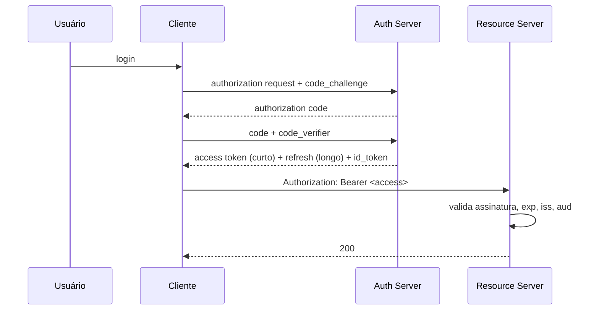
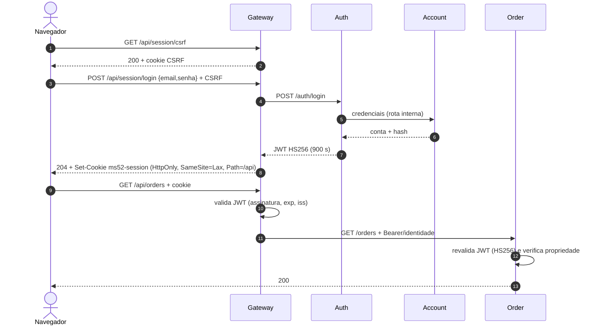

# Segurança e identidade

<span class="study-tag prova">prova</span><span class="study-tag projeto">projeto</span>

Segurança não se resolve em uma camada. O que importa é o caminho inteiro: quem entra, o que pode fazer e o que acontece se um componente for comprometido. Em vez de perguntar apenas "temos JWT?", vale perguntar o que um atacante conseguiria alcançar, ler e falsificar a partir de um pod invadido.

---

## 1. Autenticação × autorização

| | Autenticação (authN) | Autorização (authZ) |
| --- | --- | --- |
| Pergunta | Quem é você? | O que pode fazer? |
| Entrada | Credencial (senha, certificado, token) | Identidade + política (papel, escopo, propriedade) |
| Falha | `401 Unauthorized` | `403 Forbidden` (ou 404, por política) |
| No projeto | Auth valida credenciais; Gateway valida o token | Gateway exige `ROLE_ADMIN`; Order checa dono |

| Conceito | Definição |
| --- | --- |
| **Principal** | Entidade autenticada: usuário (`ada@store.com`) ou workload (`order-service`) |
| **Credencial** | O que prova a identidade: senha, chave privada, token |
| **Token** | String emitida após autenticação, apresentada no lugar da credencial |
| **Bearer token** | Vale para quem o possui, como dinheiro vivo |
| **Claim** | Afirmação dentro do token (`sub`, `roles`, `exp`) |

!!! warning "O erro nº 1 de APIs"
    **Broken Object Level Authorization (OWASP API Security #1)**: o endpoint está autenticado, mas devolve o objeto de outra pessoa. O Gateway sabe que é a conta 42; só o Order sabe se o pedido 123 pertence à conta 42. Autenticar na borda não autoriza o objeto.

---

## 2. JWT sem misticismo

Um JWT tem três partes Base64URL separadas por ponto:

```
header.payload.signature
eyJhbGciOiJIUzI1NiJ9.eyJzdWIiOiI0MiIsInJvbGVzIjpbIlJPTEVfVVNFUiJdLCJleHAiOjE3MDAwMDA5MDB9.<assinatura>
```

| Parte | Conteúdo | Cuidado |
| --- | --- | --- |
| Header | Algoritmo (`alg`) e tipo | Nunca aceite `alg: none`; fixe o algoritmo |
| Payload | Claims (`sub`, `roles`, `exp`, `iss`) | **Não é criptografado**; qualquer um lê |
| Signature | HMAC ou assinatura assimétrica | É o que impede falsificação |

### Simétrico × assimétrico

| | HMAC (HS256) | RSA/ECDSA (RS256/ES256) |
| --- | --- | --- |
| Chave | Uma só, compartilhada | Privada assina; pública verifica |
| Quem valida | Quem tem o segredo | Qualquer um com a chave pública |
| Revogação de chave | Troca o segredo em todos | Rotaciona o par/JWKS |
| No projeto | **HS256** com `JWT_SECRET` compartilhado | Não usado |

O projeto usa HMAC com o **mesmo `JWT_SECRET` distribuído** para Gateway, Auth, Account, Product, Order e Exchange. O Gateway valida na borda; Product e Order configuram um *resource server* JWT (HS256) e **validam de novo** a assinatura e as claims. Isso é defesa em profundidade — um serviço alcançado por dentro ainda rejeita token inválido —, mas aumenta o raio de comprometimento: **qualquer serviço que tenha o segredo pode forjar tokens**. Em produção, RS256/ES256 + JWKS permitiriam validação local sem compartilhar a chave de assinatura.

### Validação local × introspecção

| Estratégia | Como | Latência | Revogação |
| --- | --- | --- | --- |
| Local (assinatura/JWKS) | Verifica assinatura e claims | Baixa | Só na expiração |
| Remota (introspecção) | Chama o provedor a cada request | Alta | Imediata |
| Híbrida | Local + lista de revogação curta | Média | Quase imediata |

O projeto usa validação local no Gateway e token curto (900 s). O custo é a janela de revogação: um token roubado vale por até 15 minutos.

---

## 3. OAuth 2.0 e OIDC

**OAuth 2.0** é um framework de **delegação de autorização**: um cliente obtém acesso limitado a um recurso em nome do usuário, sem receber a senha. **OIDC** é uma camada de identidade sobre OAuth: adiciona o **ID Token** (JWT com claims de identidade) e o endpoint UserInfo.

### Papéis

| Papel | Quem é |
| --- | --- |
| Resource Owner | O usuário |
| Client | A aplicação que pede acesso |
| Authorization Server | Emite tokens (Auth/Keycloak/Auth0) |
| Resource Server | Valida o token e serve o recurso (a API) |

### Grants que importam

| Grant | Uso | Observação |
| --- | --- | --- |
| **Authorization Code + PKCE** | Usuário em SPA/mobile | O código é trocado por token; PKCE impede interceptação |
| **Client Credentials** | Serviço → serviço, sem usuário | Identidade do workload, não do usuário |
| **Refresh Token** | Renovar acesso sem novo login | Rotacionar e proteger; vida longa |
| ~~Implicit~~ | Descontinuado | Token exposto na URL |

!!! tip "PKCE em uma frase"
    O cliente gera um `code_verifier`, envia o hash (`code_challenge`) na autorização e prova o segredo na troca do código. Assim, um código interceptado não pode ser trocado por outra pessoa.

### O ciclo de vida do token



| Token | Vida típica | Onde guardar |
| --- | --- | --- |
| Access | 5–60 min | Memória do cliente / cookie HttpOnly |
| Refresh | dias | Cookie HttpOnly + rotação |
| ID | curta | Usado para identidade, não para autorizar API |

!!! warning "Nunca guarde token em `localStorage`"
    `localStorage` é acessível por qualquer JavaScript da origem: um XSS rouba o token. Cookie `HttpOnly` + `Secure` + `SameSite` não é lido por JS. O preço é CSRF — mitigado com token CSRF e `SameSite`.

---

## 4. O fluxo do projeto



| Decisão | Por quê |
| --- | --- |
| Cookie `HttpOnly`, `Path=/api`, `SameSite=Lax`, `Secure` (exceto HTTP local) | Não exposto a JS; escopo mínimo; CSRF reduzido |
| CSRF token em toda escrita | Cookie é enviado automaticamente pelo navegador |
| Gateway troca cookie por Bearer | Serviços continuam aceitando Bearer; cliente legado não quebra |
| Token de 900 s | Limita a janela de roubo; sem refresh implementado, o usuário reloga |
| `ROLE_ADMIN` para escrita de produto e admin de contas | Princípio do menor privilégio |
| Registro sempre cria `ROLE_USER` | Não há escalada por payload |
| Seed de admin recusa `prod` | Evita conta privilegiada em ambiente real |

### Matriz de autorização (resumo)

| Recurso | Público | Usuário | Admin |
| --- | --- | --- | --- |
| `GET /products` | ✅ | ✅ | ✅ |
| `POST/PUT/DELETE /products` | ❌ | ❌ | ✅ |
| Imagens de produto (mutação) | ❌ | ❌ | ✅ |
| `POST /orders`, `GET /orders` | ❌ | ✅ (próprios) | ✅ (próprios; não há visão de todos) |
| `GET /accounts/me` | ❌ | ✅ | ✅ |
| Listar/remover contas | ❌ | ❌ | ✅ (não a si mesmo) |
| `GET /actuator/health` | ✅ | ✅ | ✅ |

!!! note "Duas camadas de autorização"
    O Gateway aplica a política grosseira (autenticado? admin?). O serviço dono aplica a política fina (é o dono? é o mesmo admin?). Isso é **defesa em profundidade**: um erro de configuração no Gateway não expõe todos os pedidos.

---

## 5. Zero Trust

O modelo de perímetro ("dentro da rede é confiável") falha quando um pod é comprometido: o atacante já está dentro e pode forjar headers, conectar ao banco e alcançar outros pods.

| Princípio | Mecanismo |
| --- | --- |
| Verificar identidade explicitamente | OIDC/JWT, mTLS, SPIFFE |
| Privilégio mínimo | Escopos, RBAC, tokens curtos |
| Presumir a violação | Microssegmentação, criptografia, limite de raio |
| Validação contínua | TTL curto, reautenticação, monitoramento |

### mTLS e SPIFFE

| | TLS | mTLS |
| --- | --- | --- |
| Servidor prova identidade | ✅ | ✅ |
| Cliente prova identidade | ❌ | ✅ |
| Uso | HTTPS público | Serviço → serviço |

**SPIFFE** padroniza a identidade de workload (`spiffe://cluster.local/ns/platform/sa/order`) e o **SVID** é um certificado X.509 curto emitido pelo SPIRE. Um **service mesh** (Istio, Linkerd) injeta sidecars que fazem mTLS sem mudar o código.

!!! warning "mTLS autentica, não autoriza"
    Um certificado válido prova *quem* chamou; a política decide *se pode*. Em Istio, `AuthorizationPolicy` com `principals` faz a autorização; sem política, o mTLS só criptografa.

### NetworkPolicy

O padrão é **negar tudo e liberar fluxos explícitos**:

```yaml
apiVersion: networking.k8s.io/v1
kind: NetworkPolicy
metadata:
  name: default-deny-ingress
  namespace: platform
spec:
  podSelector: {}
  policyTypes: [Ingress]
```

```yaml
apiVersion: networking.k8s.io/v1
kind: NetworkPolicy
metadata:
  name: order-from-gateway
  namespace: platform
spec:
  podSelector:
    matchLabels: { app: order }
  policyTypes: [Ingress]
  ingress:
    - from:
        - podSelector:
            matchLabels: { app: gateway }
      ports:
        - port: 8080
```

!!! danger "NetworkPolicy só funciona se o CNI aplicar"
    A API existe em qualquer cluster, mas o plugin de rede precisa implementá-la. Calico e Cilium aplicam; a rede padrão do minikube ignora silenciosamente. O projeto tem políticas **parciais** (scrape de observabilidade) e reconhece que os serviços ainda são alcançáveis dentro do cluster.

---

## 6. Segredos

| Abordagem | Prós | Contras |
| --- | --- | --- |
| `.env` / variável de ambiente | Simples | Vaza em log, `ps`, imagem; sem rotação |
| Kubernetes Secret | Nativo | **Base64 não é criptografia**; exige RBAC e encryption at rest |
| AWS Secrets Manager | Rotação, auditoria | Lock-in; latência; custo |
| Vault | Segredos dinâmicos, multicloud | Operação complexa |

Um Secret do Kubernetes é apenas base64:

```bash
kubectl get secret platform-secrets -o jsonpath='{.data.JWT_SECRET}' | base64 -d
```

Qualquer um com `get secrets` no namespace (ou que possa criar um pod que o monte) lê o valor. Mitigações: encryption at rest no etcd, RBAC mínimo, External Secrets Operator, rotação.

### No projeto

| Segredo | Onde | Proteção |
| --- | --- | --- |
| `JWT_SECRET` | Kubernetes Secret no runtime | Mesmo valor em todos os serviços que validam; nunca no Git |
| Credenciais do RDS | Secret criado pelo deploy | IRSA não se aplica a senha; armazenar no Secrets Manager/Secret |
| Chave do provedor de câmbio | Secret opcional | Não logada; timeout no adapter |
| Credenciais de admin local | `.env` + seed | Recusa `prod`; senha pública de propósito |
| Acesso AWS do CI | OIDC role | Sem access key de longa duração |
| S3 (Product) | IRSA | Role por service account; bucket privado |

!!! warning "O `.env` de desenvolvimento não é deployável"
    A documentação avisa: `POSTGRES_PASSWORD`, `JWT_SECRET` e `INTERNAL_SERVICE_SECRET` precisam ser trocados antes de expor a stack. O admin local (`1berto52`) é conhecimento público e nunca deve existir em MicroK8s/EKS.

---

## 7. Defesa em profundidade no projeto

| Camada | Ameaça | Controle | Estado |
| --- | --- | --- | --- |
| Borda | DDoS, interceptação | Shield Standard, CloudFront TLS | ✅ |
| Borda | Abuso, injeção | WAF gerenciado + rate limit | ⚠️ preparado, não anexado |
| Identidade | Credencial roubada | Token curto, cookie HttpOnly, CSRF | ✅ |
| Requisição | BOLA | Checagem de dono no serviço | ✅ |
| Entre serviços | Movimento lateral | mTLS + NetworkPolicy | ⚠️ parcial (sem mTLS) |
| Dados | Vazamento em repouso | Criptografia RDS/S3, bucket privado | ✅ |
| Segredos | Vazamento | Secret + IRSA + OIDC | ✅ (rotação manual) |
| Pipeline | Dependência vulnerável | CodeQL, Dependabot, secret scanning | ✅ |

!!! quote "Resposta possível"
    "Não temos mTLS entre serviços; confiamos na rede do cluster e no header de identidade do Gateway. Isso é uma simplificação consciente. O próximo passo é service mesh ou NetworkPolicy default-deny + autorização por service account — e o projeto já documenta essa lacuna."

---

## 8. Como responder

**"JWT é seguro?"**
> JWT é um formato, não uma garantia. A segurança depende de algoritmo fixo, segredo protegido, expiração curta, validação de `iss`/`aud` e de não guardar o token onde JS alcança. Um JWT no `localStorage` com 24 h é uma vulnerabilidade, mesmo assinado.

**"Por que o Gateway valida o token e os serviços validam de novo?"**
> Defesa em profundidade: o Gateway rejeita cedo e aplica a política de borda; o serviço rejeita mesmo que seja alcançado por dentro e aplica a política fina (dono do objeto). O custo é distribuir o segredo HMAC para todos, o que significa que um serviço comprometido pode forjar tokens. A evolução é chave assimétrica + JWKS: cada serviço valida com a pública e só o Auth assina.

**"Por que cookie e não Bearer no frontend?"**
> Porque o frontend é estático e não há BFF. Cookie `HttpOnly` impede leitura por XSS; o custo é CSRF, mitigado com token e `SameSite`. Bearer continua aceito para clientes de API.

**"O que é Zero Trust na prática?"**
> Não confiar no endereço de rede. Cada chamada carrega identidade verificável (token/mTLS) e é autorizada por política. O projeto faz isso na borda (JWT + papéis) e tem a lacuna no leste-oeste (serviço a serviço), onde a rede ainda é o perímetro.

---

## Checkpoint

<div data-study-score></div>

<div class="study-quiz" data-answer="c">
  <p class="q">1. Um usuário autenticado tenta ler o pedido de outro. Qual é o controle que falta se a API devolve 200?</p>
  <ul class="options">
    <li data-key="a">Autenticação, porque ele não provou quem é.</li>
    <li data-key="b">Criptografia do token, porque o JWT estava legível.</li>
    <li data-key="c">Autorização no nível do objeto (ownership), que só o serviço dono pode verificar.</li>
    <li data-key="d">Rate limiting, porque a requisição é abusiva.</li>
  </ul>
  <p class="explain">O usuário está autenticado; falta verificar se o objeto pertence a ele. É BOLA/IDOR — OWASP API #1. O Gateway não tem como saber o dono sem consultar o serviço.</p>
</div>

<div class="study-quiz" data-answer="b">
  <p class="q">2. Qual é a principal vantagem de chaves assimétricas (RS256/ES256) sobre HMAC em uma malha de serviços?</p>
  <ul class="options">
    <li data-key="a">O token fica criptografado e ilegível.</li>
    <li data-key="b">Cada serviço valida com a chave pública, sem compartilhar o segredo de assinatura.</li>
    <li data-key="c">O token nunca expira.</li>
    <li data-key="d">Dispensa validação de claims.</li>
  </ul>
  <p class="explain">Com HMAC, todos que validam precisam do mesmo segredo — e podem assinar. Com RSA/ECDSA + JWKS, só o emissor tem a privada; os demais validam com a pública.</p>
</div>

<div class="study-quiz" data-answer="d">
  <p class="q">3. O que um Kubernetes Secret oferece por padrão?</p>
  <ul class="options">
    <li data-key="a">Criptografia forte com rotação automática.</li>
    <li data-key="b">Um cofre de hardware (HSM) por namespace.</li>
    <li data-key="c">Proteção contra qualquer pod do namespace que o monte.</li>
    <li data-key="d">Apenas base64; proteção real exige encryption at rest, RBAC e um gerenciador externo.</li>
  </ul>
  <p class="explain">Base64 é codificação reversível. Quem pode `get secrets` ou criar pods que os montem consegue ler. O projeto usa Secret + IRSA para o que é AWS, e reconhece que a rotação é manual.</p>
</div>

## Checklist

<div data-study-progress></div>

<label class="study-check"><input type="checkbox" data-key="s-authn"> Distingo authN de authZ e os status 401/403/404.</label>
<label class="study-check"><input type="checkbox" data-key="s-oauth"> Explico Authorization Code + PKCE e Client Credentials.</label>
<label class="study-check"><input type="checkbox" data-key="s-cookie"> Justifico cookie HttpOnly + CSRF em vez de localStorage.</label>
<label class="study-check"><input type="checkbox" data-key="s-zt"> Explico Zero Trust, mTLS e NetworkPolicy, incluindo o que falta no projeto.</label>
<label class="study-check"><input type="checkbox" data-key="s-secret"> Sei por que Secret não é criptografia e como mitigar.</label>

!!! info "Continue"
    Segurança protege o caminho síncrono. O próximo capítulo mostra o outro caminho: comunicação assíncrona e seus padrões de consistência. [Eventos e mensageria](08-eventos.md). Ausências como mTLS, NetworkPolicy completa e WAF estão analisadas em [O que não foi implementado](18-lacunas-e-evolucao.md).
