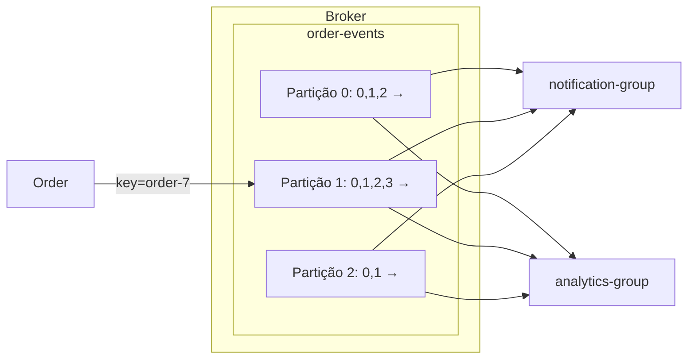
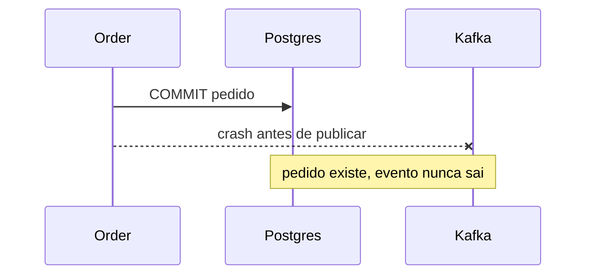
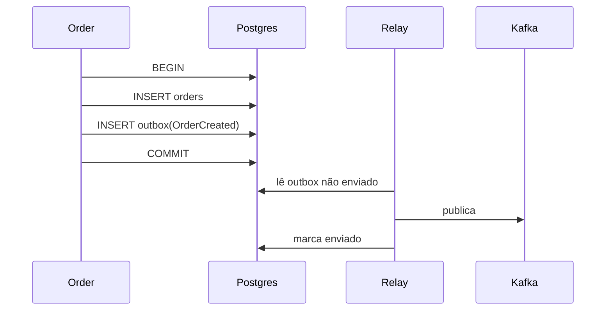
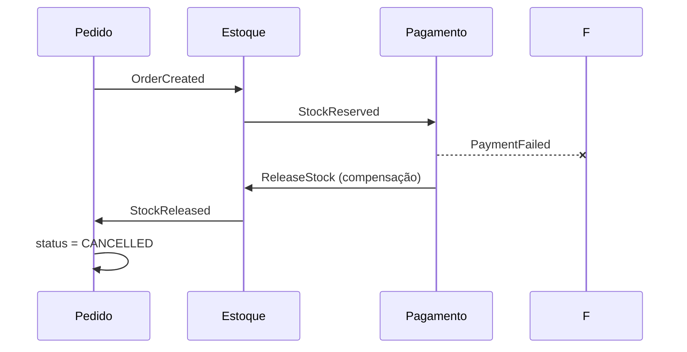

# Eventos e mensageria

<span class="study-tag prova">prova</span><span class="study-tag projeto">projeto</span>

Comunicação síncrona acopla **disponibilidade** e **latência**: se o vizinho está lento, você está lento; se ele cai, você cai. Eventos trocam esse acoplamento por **consistência eventual** e uma nova classe de problemas — duplicatas, ordem, esquema e diagnóstico. Este capítulo ensina o ferramental e depois o usa para analisar a maior lacuna do projeto.

!!! quote "Eventos são fatos"
    Um evento é um registro **imutável** de algo que aconteceu, no passado. Não é um comando ("cobre o cartão") nem um pedido de leitura. É por isso que o log pode ser reprocessado: os fatos não mudam.

---

## 1. Síncrono × assíncrono: o que muda

| Dimensão | Síncrono | Assíncrono |
| --- | --- | --- |
| Acoplamento temporal | Alto | Baixo |
| Consistência | Forte na chamada | Eventual |
| Latência do usuário | Inclui todos os saltos | Só o caminho crítico |
| Falha do consumidor | Falha a operação | Fica na fila/retry |
| Diagnóstico | Trace direto | Precisa de trace + lag + DLQ |
| Complexidade | Baixa | Alta |

O erro comum é achar que evento é "mais moderno". Evento é **mais adequado quando o efeito pode ser diferido**; REST é mais adequado quando a resposta é necessária para continuar.

---

## 2. Vocabulário

| Termo | Definição | Exemplo |
| --- | --- | --- |
| Evento | Fato imutável | `OrderCreated { orderId, customerId, total }` |
| Mensagem | Contêiner genérico | Qualquer payload em uma fila |
| Comando | Instrução que pode ser rejeitada | `ChargePayment` |
| Broker | Servidor que armazena e entrega | Kafka |
| Tópico | Log nomeado, durável e ordenado | `order-events` |
| Partição | Shard do tópico; ordem só dentro dela | partição 1 |
| Chave | Decide a partição | `orderId` |
| Offset | Posição da mensagem | offset 42 |
| Grupo de consumidores | Consumidores que dividem o trabalho | `notification-group` |

---

## 3. Kafka: log, não fila

| Fila clássica (RabbitMQ) | Log (Kafka) |
| --- | --- |
| Mensagem removida após ACK | Mensagem fica até a retenção |
| Consumidor compete pela mensagem | Cada grupo tem seu offset |
| Ordem difícil | Ordem por partição |
| Replay não é natural | Replay é trivial (mover offset) |



### Chave e ordem

O produtor calcula `hash(key) % partições`. Mesma chave → mesma partição → ordem preservada. Sem chave, mensagens se espalham e não há ordem entre eventos relacionados.

!!! warning "Cuidados com a chave"
    - Chave de baixa cardinalidade (`country`) cria partições quentes.
    - Adicionar partições muda o mapeamento e pode quebrar ordem temporariamente; dimensione desde o início.
    - O paralelismo máximo de um grupo é o número de partições.

### Durabilidade

| `acks` | Confirma quando | Risco |
| --- | --- | --- |
| `0` | Enviou | Perde se o broker não receber |
| `1` | Líder gravou | Perde se o líder morrer antes da réplica |
| `all` | Todas as ISR gravaram | Mais lento; sobrevive à perda de um broker |

Com `acks=all` e `min.insync.replicas ≥ 2`, um cluster de 3 brokers sobrevive à perda de um. O produtor idempotente (`enable.idempotence=true`) evita duplicatas causadas por retry do próprio produtor.

**Retenção** por tempo (`retention.ms`), tamanho (`retention.bytes`) ou compactação (`cleanup.policy=compact`, mantém a última mensagem por chave). Replay usa a retenção; se o evento expirou, não há mágica.

---

## 4. Padrões de mensageria

| Padrão | Como funciona | Uso |
| --- | --- | --- |
| **Pub/Sub** | Todos os grupos recebem uma cópia | Notificação + analytics + auditoria |
| **Competing consumers** | Consumidores do mesmo grupo dividem partições | Escalar processamento |
| **Event Sourcing** | Estado = replay de eventos | Auditoria, histórico, time travel |
| **CQRS** | Escrita e leitura separadas | Assimetria de carga |

### Garantias de entrega

| Garantia | Commit do offset | Falha significa | Uso |
| --- | --- | --- | --- |
| At-most-once | Antes de processar | Perde mensagem | Métricas tolerantes a lacuna |
| At-least-once | Depois de processar | Reprocessa | **Padrão** |
| Exactly-once | Transação Kafka | Nada, mas só Kafka→Kafka | Streams |

!!! danger "Exactly-once não atravessa a fronteira"
    O Kafka não "desenvia" e-mail nem desfaz um `INSERT` no Postgres. Na prática: **at-least-once + consumidor idempotente**. Formas de idempotência:
    - tabela de mensagens processadas na mesma transação do efeito;
    - operação naturalmente idempotente (`UPSERT`, "status = PAID");
    - restrição de unicidade no banco.

---

## 5. O problema da escrita dupla



E o inverso: publica e o commit falha → consumidores reagem a um pedido inexistente.

### Transactional outbox



A transação local garante "pedido ou evento, nunca um sem o outro". O relay pode republicar após falha → consumidor idempotente é obrigatório. Alternativa: **CDC** (Debezium) lendo o log do banco.

### Sagas

Uma operação de negócio que atravessa serviços não tem transação ACID. Ela vira uma sequência de transações locais com **compensações**:

| Estilo | Coordenação | Prós | Contras |
| --- | --- | --- | --- |
| **Coreografia** | Cada serviço reage a eventos | Desacoplado | Fluxo espalhado, difícil de rastrear |
| **Orquestração** | Um orquestrador comanda e espera | Fluxo explícito | Mais um serviço para operar |



!!! warning "Saga não é transação"
    Saga abre mão do isolamento: estados intermediários são visíveis. Modele `PENDING`, `CONFIRMED`, `CANCELLED` e torne cada passo e cada compensação idempotentes.

---

## 6. Dead Letter Queue e esquema

Uma mensagem que falha sempre (JSON inválido, produto inexistente) não pode bloquear a partição. Após N tentativas, ela vai para uma **DLQ**, onde é investigada e reprocessada.

```yaml
@RetryableTopic(backOff = @BackOff(delay = 1000, multiplier = 2))
@KafkaListener(topics = "order-events", groupId = "invoice-group")
public void onOrderCreated(OrderCreatedEvent event) { ... }

@DltHandler
public void onDeadLetter(OrderCreatedEvent event) { ... }
```

**Evolução de esquema:** consumidores que você não conhece leem seus eventos. Só adicione campos **opcionais**; nunca renomeie/remova sem uma nova versão (`OrderCreatedV2`). Um schema registry (Avro/Protobuf) impõe compatibilidade.

---

## 7. Quando usar (e quando não)

| Cenário | Melhor opção | Motivo |
| --- | --- | --- |
| Login / emissão de token | REST | Resposta necessária |
| E-mail de confirmação | Evento | Usuário não espera |
| Fraude que precisa bloquear | REST | Decisão antes de prosseguir |
| Log de auditoria | Evento | Fan-out, fire-and-forget |
| Pagamento | Depende | Evento com idempotência ou REST + saga |
| Analytics | Evento | Volume e consumidores lentos |
| Health check | REST | Síncrono por natureza |

!!! warning "Custo operacional"
    Um fluxo com 5 serviços e 3 tópicos é mais difícil de depurar que REST. Só adote eventos quando o acoplamento/latência síncrona for um problema **concreto**, não por moda.

---

## 8. O projeto: a lacuna consciente

**Não há Kafka.** O repositório não tem broker, tópico, produtor, consumidor, tabela outbox, relay ou dependência de cliente. O que isso significa:

| Fluxo | Comportamento atual | Risco |
| --- | --- | --- |
| Criação de pedido | Valida, lê preço, grava no Postgres, responde | Nenhum efeito pós-commit é executado |
| Notificação | Não existe | Não há e-mail/evento |
| Imagens | Upload e validação síncronos | Sem fila de variantes/worker |
| Carrinho | `localStorage`, sem serviço | Sem evento de abandono |
| Redis | Provisionado, `CACHE_ENABLED=false` | Não é transporte nem cache ativo |

### O que a ausência resolve e o que ela custa

| Ganho | Custo |
| --- | --- |
| Menos infraestrutura (sem MSK, sem schema registry) | Trabalho pós-pedido fica no request path |
| Sem consistência eventual para depurar | Falha após commit não é reprocessada |
| Sem consumer lag/DLQ para operar | Notificação/analytics exigiriam acoplamento síncrono |
| Menos custo fixo | Cadeia síncrona maior se novos serviços entrarem |

!!! example "Como seria a evolução correta"
    1. `orders` + `outbox` na mesma transação.
    2. Relay/publicador lê a outbox e publica `OrderCreated` com chave `orderId`.
    3. `notification-service` consome com idempotência (tabela de mensagens processadas) e envia e-mail.
    4. DLQ + `@RetryableTopic` para falhas permanentes.
    5. Métricas: lag por grupo, tentativas, DLQ size; trace com `traceparent` no header do evento.
    6. Schema versionado; começar com campo opcional.

    Nada disso exige reescrever o Order: o outbox entra na transação existente e o relay é um processo separado.

### Kafka no Kubernetes?

Se fosse implementado, as opções seriam **Amazon MSK** (gerenciado, caro), **Strimzi** (operador no cluster, você opera) ou **Redpanda** (compatível, mais leve). Para o volume do projeto, MSK não se pagaria; Strimzi adicionaria operação. Isso reforça a decisão de escopo — e é uma boa resposta de "por que não".

---

## Ordem do outbox

<div class="study-order" data-items="BEGIN no banco do serviço|INSERT do estado de negócio|INSERT do evento na tabela outbox|COMMIT da transação local|Relay lê linhas não publicadas|Relay publica no tópico com chave|Relay marca a linha como enviada" data-prompt="Ordene o fluxo de transactional outbox:"></div>

---

## Checkpoint

<div data-study-score></div>

<div class="study-quiz" data-answer="c">
  <p class="q">1. Por que at-least-once é o padrão em vez de exactly-once?</p>
  <ul class="options">
    <li data-key="a">Porque o Kafka não suporta transações.</li>
    <li data-key="b">Porque o consumidor nunca falha.</li>
    <li data-key="c">Porque exactly-once cobre só Kafka→Kafka; efeitos externos exigem idempotência no consumidor.</li>
    <li data-key="d">Porque at-least-once garante ordem global.</li>
  </ul>
  <p class="explain">O commit do offset depois do processamento pode duplicar. Transações do Kafka não desfazem e-mail, S3 ou Postgres. A solução prática é entrega at-least-once + consumidor idempotente.</p>
</div>

<div class="study-quiz" data-answer="a">
  <p class="q">2. O que o transactional outbox garante?</p>
  <ul class="options">
    <li data-key="a">Que o estado de negócio e o registro do evento sejam commitados atomicamente na mesma transação local.</li>
    <li data-key="b">Que o evento seja entregue exatamente uma vez.</li>
    <li data-key="c">Que o consumidor não precise ser idempotente.</li>
    <li data-key="d">Que a ordem global entre todos os pedidos seja preservada.</li>
  </ul>
  <p class="explain">O outbox elimina a escrita dupla. O relay pode republicar após falha, então duplicatas continuam possíveis; ordem é por partição/chave, não global.</p>
</div>

<div class="study-quiz" data-answer="d">
  <p class="q">3. Qual é a crítica correta à ausência de eventos no projeto?</p>
  <ul class="options">
    <li data-key="a">O sistema não funciona sem Kafka.</li>
    <li data-key="b">A API não consegue criar pedidos.</li>
    <li data-key="c">O Postgres não suporta transações.</li>
    <li data-key="d">Efeitos pós-pedido ficam no request path e uma falha após o commit não é reprocessada; a correção é outbox + consumidor idempotente.</li>
  </ul>
  <p class="explain">O fluxo principal funciona. O que falta é desacoplar efeitos futuros (notificação, analytics) e garantir que o evento acompanhe o commit. É uma lacuna de escopo, não um bug do caminho atual.</p>
</div>

## Checklist

<div data-study-progress></div>

<label class="study-check"><input type="checkbox" data-key="e-kafka"> Explico log × fila, partição, chave e offset.</label>
<label class="study-check"><input type="checkbox" data-key="e-delivery"> Distingo at-most/at-least/exactly-once e sei por que idempotência é obrigatória.</label>
<label class="study-check"><input type="checkbox" data-key="e-outbox"> Desenho o outbox e explico o que ele **não** garante.</label>
<label class="study-check"><input type="checkbox" data-key="e-saga"> Comparo coreografia e orquestração, com compensação.</label>
<label class="study-check"><input type="checkbox" data-key="e-proj"> Explico por que o projeto não tem Kafka e o que faria primeiro.</label>

!!! info "Continue"
    Agora que os modos de falha estão claros, como medi-los e prometer disponibilidade? [Confiabilidade e SLOs](09-confiabilidade.md). O custo e o caminho de adoção de Kafka/outbox estão em [O que não foi implementado](18-lacunas-e-evolucao.md).
