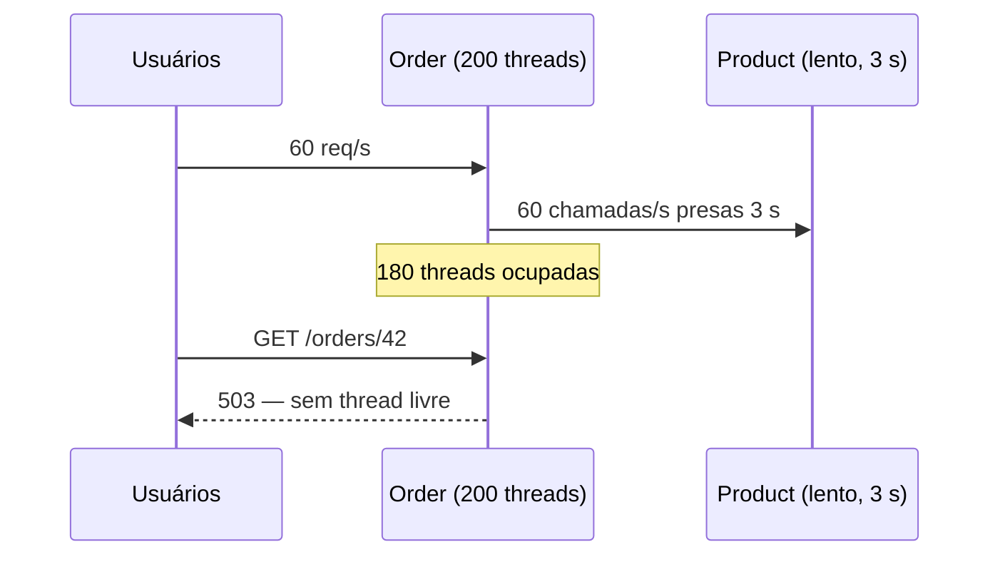
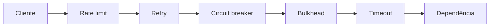
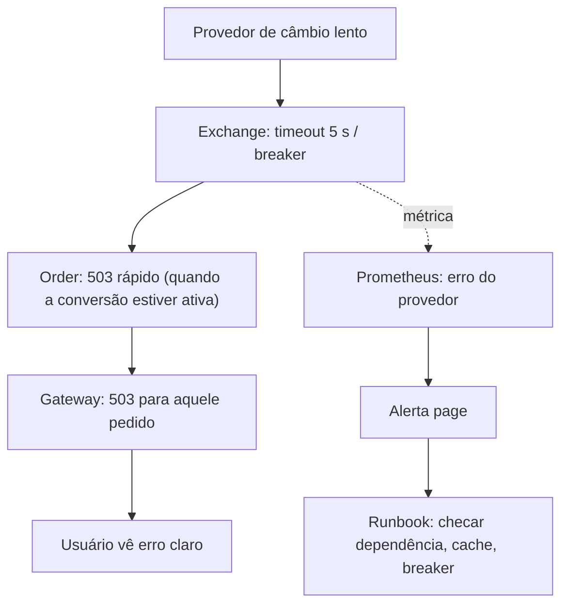

# Confiabilidade e SLOs

provaprojeto

Confiabilidade precisa de números. SRE organiza isso em três camadas: SLI (medida), SLO (meta) e SLA (contrato). Em volta delas, padrões de resiliência evitam que uma falha local derrube o sistema inteiro.

---

## 1. Disponibilidade: a base

$$A = \frac{MTTF}{MTTF + MTTR}$$

Melhorar disponibilidade tem duas alavancas: **falhar menos** (↑ MTTF) ou **recuperar mais rápido** (↓ MTTR). A segunda costuma ser mais barata.

!!! example "Reiniciar vale mais que nunca falhar"
    Um serviço que cai a cada 30 dias e leva 2 h para voltar tem $720/(720+2) = 99{,}72\%$. Se o Kubernetes reinicia o pod em 1 min, a disponibilidade vai a $720/720{,}017 \approx 99{,}998\%$. O ganho veio do MTTR.

| Meta | Por ano | Por 28 dias | Por semana |
| --- | --- | --- | --- |
| 99% | 3,65 dias | 6,72 h | 1,68 h |
| 99,9% | 8,77 h | 40,3 min | 10,1 min |
| 99,95% | 4,38 h | 20,2 min | 5,04 min |
| 99,99% | 52,6 min | 4,03 min | 1,01 min |

**Sempre cite a janela.** 99,9% em 28 dias ≠ 99,9% em um mês de calendário (43,8 min).

### Composição

| Arranjo | Fórmula | Efeito |
| --- | --- | --- |
| Série | $a_1 \times a_2 \times \cdots$ | Pior que o pior elo |
| Paralelo | $1-(1-a)^n$ | Melhor, se falhas independentes |

O projeto tem série no caminho (Gateway → Order → Product) e paralelo nas réplicas. O banco é elo único: RDS Single-AZ. Replicar serviços não resolve a disponibilidade do banco.

---

## 2. SLI, SLO, SLA

| Termo | Natureza | Pergunta | Exemplo do projeto |
| --- | --- | --- | --- |
| **SLI** | Métrica | Qual a proporção de bons eventos? | `non-5xx / total` |
| **SLO** | Meta interna | Quão bom precisa ser, em qual janela? | 99,5% em 28 dias |
| **SLA** | Contrato | O que acontece se violar? | Créditos (não há SLA formal no projeto) |

$$SLI = \frac{\text{eventos bons}}{\text{eventos válidos}} \times 100\%$$

"Válidos" permite excluir o que não é culpa do serviço (ex.: 4xx de cliente). "Bons" depende do objetivo: non-5xx para disponibilidade, "resposta < 300 ms" para latência.

### Categorias de SLI

| Categoria | Medida | Exemplo |
| --- | --- | --- |
| Disponibilidade | sucesso / total | non-5xx |
| Latência | fração abaixo de um limiar | p95 < 300 ms |
| Erro | 5xx / total | < 1% |
| Durabilidade | leituras recuperáveis / tentadas | backup restaurável |
| Atualidade | idade do último dado | cache refresh |

!!! warning "Métricas de vaidade"
    CPU, heap e GC não são SLIs. Um serviço a 95% de CPU pode estar perfeito; um a 10% pode estar fora do ar. SLI mede a experiência do usuário; CPU é causa, não sintoma.

### Os SLOs documentados

| Serviço / fluxo | SLI | SLO (28 d) | Error budget |
| --- | --- | --- | --- |
| API pública | respostas bem-sucedidas / total | **99,5%** | 3 h 22 min |
| Leitura de produto | `GET /products*` < 300 ms | **p95 < 300 ms** | 5% das requisições |
| Escrita de pedido | pedido bem-sucedido < 800 ms | **p95 < 800 ms** | 5% |
| Taxa de erro | 5xx / total | **< 1%** | 5% |
| Provedor de câmbio | chamadas ok / total | **99%** | 1% |
| Readiness | pods prontos / desejados | **≥ 99%** | 1% |
| Recuperação | restore PITR | **RTO 1 h, RPO ≤ 5 min** | — |

!!! note "SLO não é SLA"
    O projeto não tem cliente pagante nem SLA jurídico. O 99,5% é um **compromisso interno** que orienta alertas e decisões. Um SLA público seria mais frouxo (ex.: 99%) para dar margem — se SLO e SLA forem iguais, qualquer incidente vira penalidade.

---

## 3. Error budget e burn rate

$$Error\ Budget = 1 - SLO$$

Para 99,5% em 28 dias: $0,005 \times 40\,320 = 201{,}6$ min ≈ **3 h 22 min**.

| Orçamento intacto | Orçamento esgotado |
| --- | --- |
| Deploys frequentes, experimentos | Congelar deploys não essenciais |
| Aceitar risco controlado | Priorizar confiabilidade |
| Dívida técnica planejada | Investigar causa-raiz |

$$Burn\ Rate = \frac{\text{taxa de erro observada}}{1 - SLO}$$

Com SLO 99,5%, uma taxa de erro de 0,5% queima a 1× (o orçamento dura a janela). 5% de erro queima a 10× e esgota em ~2,8 dias.

### Alertas multi-janela

Uma janela longa detecta queima lenta; uma curta confirma que ainda está queimando e silencia rápido após a correção.

| Severidade | Janela longa | Janela curta | Burn rate | Orçamento gasto |
| --- | --- | --- | --- | --- |
| Page | 1 h | 5 min | > 14,4× | ~2% |
| Page | 6 h | 30 min | > 6× | ~5% |
| Ticket | 3 dias | 6 h | > 1× | ~10% |

O stack local do projeto implementa regras mais simples e legíveis:

| Alerta | Condição | Severidade |
| --- | --- | --- |
| Disponibilidade fast burn | < 99% por 5 min | page |
| Disponibilidade slow burn | < 99,5% por 30 min | ticket |
| p95 acima de 1 s | > 1 s por 10 min | ticket |
| Target down | `up == 0` por 2 min | page |
| Probe sintética falhando | `probe_success == 0` por 2 min | page |
| Pool Hikari saturado | > 90% por 5 min | ticket |
| Erro do provedor de câmbio | > 0,1/s por 5 min | page |
| Erro de cache do Product | > 0 por 10 min | ticket |
| Falha em trace entre serviços | > 0 por 10 min | ticket |
| p95 de span entre serviços | > 1 s por 10 min | ticket |

!!! tip "Alerte sobre sintomas, não causas"
    "CPU > 80%" não é emergência se o usuário está bem atendido. "Error budget queimando a 14,4×" é. Alertas acionáveis evitam fadiga de alerta.

  
Um serviço com SLO de 99,5% observa 5% de erro. Qual é o burn rate?

  <input type="number" step="0.1" inputmode="decimal" placeholder="burn">
  <button type="button">Conferir</button>
  
5% ÷ 0,5% = 10×. O orçamento de 28 dias seria consumido em 28/10 = 2,8 dias se a taxa se mantivesse.

---

## 4. Modos de falha

| Classe | Característica | Tratamento |
| --- | --- | --- |
| Transitória | Some sozinha (rede) | Retry com backoff |
| Intermitente | Vai e volta (GC, leak) | p99, alertas de anomalia |
| Permanente (crash-stop) | Para e não volta | Health check + failover |
| Lenta | Responde tarde | Timeout + breaker + bulkhead |
| Bizantina | Responde errado | Consenso, checksum, validação |

!!! warning "A falha mais comum é lentidão"
    Um nó morto recusa conexão na hora; um nó lento prende threads. Sem timeout, a indisponibilidade de um dependente vira a sua.

### Falhas em cascata e a Lei de Little

$L = \lambda W$: requisições em andamento = taxa × tempo.

Com 60 pedidos/s e 100 ms por chamada, ~6 threads esperam. Com 3 s por chamada, ~180 threads — quase todo o pool de 200 do Tomcat. Rotas não relacionadas passam a falhar por falta de thread. É o cenário que os padrões abaixo interrompem.

---

## 5. Os padrões, em camadas

| Padrão | Pergunta | Protege contra |
| --- | --- | --- |
| Timeout | Quanto espero? | Chamada travada |
| Retry + backoff + jitter | Vale repetir? | Falha transitória |
| Circuit breaker | Devo tentar? | Dependência sabidamente fora |
| Fallback | O que respondo? | Perda total de uma função |
| Bulkhead | Quanto da capacidade uma dependência ocupa? | Esgotamento de recursos |
| Rate limit | Quanto tráfego aceito? | Picos e abuso |
| Health checks | O tráfego deve chegar aqui? | Instância quebrada |

### Timeout

Sempre **connect** e **read**, por dependência. O timeout interno precisa caber no externo:

$$
tentativas \times timeout + esperas \le prazo\ do\ chamador
$$

Se o Gateway espera 3 s e o Order faz 3 tentativas de 1 s com 0,5 s + 1 s de espera, o pior caso é 4,5 s — o Gateway já desistiu e o trabalho é desperdiçado.

### Retry

Só para falhas transitórias e operações **idempotentes**. Backoff exponencial + **full jitter** evita a manada sincronizada:

$$wait_n = random\big(0, \min(c \cdot 2^n, max)\big)$$

| Resposta | Retry? |
| --- | --- |
| Timeout, conexão recusada | Sim |
| 503, 429 | Sim, respeitando `Retry-After` |
| 500 | Talvez uma vez |
| 400, 401, 403, 404, 422 | Não |

!!! danger "Amplificação"
    Três camadas com 3 tentativas = 27 chamadas por clique em um serviço já frágil. Faça retry em **uma** camada e pare quando o breaker estiver aberto.

### Circuit breaker

Estados: **Closed** (passa) → **Open** (falha rápido) → **Half-open** (testa) → Closed/Open.

| Parâmetro | Valor típico | Efeito |
| --- | --- | --- |
| failure rate | 50% | Abre acima disso |
| janela | 10–20 chamadas | Amostra mínima |
| slow call | abaixo do timeout, 50% | Abre por lentidão |
| espera Open | 10–60 s | Tempo de recuperação |
| testes Half-open | 3–5 | Cautela |

Um detalhe importante: o limiar de chamada lenta deve ser **menor** que o read timeout; caso contrário, o breaker nunca vê uma chamada "lenta" (ela vira timeout). E o fallback fica na camada **externa** ao retry, senão cada tentativa executa o fallback.

### Bulkhead

Isola recursos por dependência. Um pool de 10 para o câmbio impede que ele consuma as 200 threads do serviço. O custo é capacidade não compartilhada.

### Rate limiting

Token bucket: taxa de reposição = vazão média; capacidade = burst. `429` + `Retry-After`. No projeto, o WAF/rate rule está **preparado**, não anexado; o Nginx local não impõe limite por padrão.

### Health checks

| Probe | Pergunta | Falha → |
| --- | --- | --- |
| **Startup** | Terminou de iniciar? | Reinicia (após tolerance) |
| **Liveness** | Está travado? | Reinicia |
| **Readiness** | Pode receber tráfego? | Remove do Service |

!!! danger "Nunca dependência externa na liveness"
    Se a liveness consulta o banco e ele oscila, o Kubernetes reinicia **todas** as réplicas juntas — transformando 10 s de banco em minutos de indisponibilidade. Readiness pode incluir dependência com cautela; liveness, nunca.

### Defesa em profundidade

A ordem importa: retry fora do breaker (para o breaker contar cada tentativa), bulkhead por dependência, timeout por tentativa.

---

## 6. Chaos engineering

Confiabilidade não se prova só com teste feliz. Chaos engineering é experimentação controlada:

| Princípio | Prática |
| --- | --- |
| Comece pelo comportamento normal | Meça o baseline |
| Varie eventos reais | Latência, erro, pod kill, zona |
| Produção é o melhor ambiente | Com blast radius mínimo |
| Automatize | Experimentos contínuos |
| Minimize o raio | Um serviço, uma zona, % de tráfego |

**Ciclo:** hipótese → baseline → injeção → observação → conclusão → correção.

| Ferramenta | Uso |
| --- | --- |
| Chaos Monkey / Simian Army | Netflix; derruba instâncias |
| LitmusChaos | Kubernetes |
| Chaos Mesh | Kubernetes, latência/rede |
| Toxiproxy | Proxy com latência/erro |
| GameDay | Exercício organizacional |

!!! note "No projeto"
    O **teste de falha do provedor de câmbio não foi executado**; é uma limitação declarada. Um GameDay mínimo seria: injetar latência no mock do Exchange, verificar o breaker/fallback e confirmar que o Order não pendura. Observabilidade primeiro: sem métrica e trace, o experimento não ensina nada.

---

## 7. O caminho de uma falha no projeto

O que não deve acontecer: retry infinito, threads presas, fallback que devolve total inventado, 200 com dado errado. A regra do projeto é falhar explicitamente.

---

## 8. Como responder

**"Qual o SLO e o que acontece se violar?"**
> 99,5% em 28 dias para disponibilidade, com error budget de 3 h 22 min. Burn rate alto paga plantão; queima lenta abre ticket. O projeto não tem SLA jurídico; se tivesse, o SLO seria mais estrito que o SLA para dar margem.

**"Como vocês evitam falha em cascata?"**
> Timeout em toda chamada, retry só idempotente e em uma camada, breaker com limiar de lentidão abaixo do timeout, bulkhead por dependência e fallback seguro. Na prática, o projeto tem timeout e réplicas; o breaker é a evolução necessária para o Exchange.

**"Vocês fazem chaos engineering?"**
> Ainda não. Sabemos qual seria o primeiro experimento: latência no provedor de câmbio, porque é a dependência externa e o fluxo de conversão não foi testado sob falha. Sem métrica/trace, não faria sentido.

---

## Checkpoint

  
1. Qual é a diferença central entre SLO e SLA?

  <ul class="options">
    <li data-key="a">SLO é público e SLA é interno.</li>
    <li data-key="b">SLO é meta interna; SLA é contrato com consequência jurídica/financeira.</li>
    <li data-key="c">SLA é sempre mais estrito que SLO.</li>
    <li data-key="d">São sinônimos, mas SLA usa percentil.</li>
  </ul>
  
O SLO orienta a engenharia; o SLA define compensação. A boa prática é SLO mais estrito que SLA, para que o incidente consuma orçamento antes de virar crédito.

  
2. Um alerta de burn rate de 14,4× em 1 h + 5 min significa aproximadamente:

  <ul class="options">
    <li data-key="a">Que o serviço está 14,4% mais lento.</li>
    <li data-key="b">Que faltam 14,4% do orçamento.</li>
    <li data-key="c">Que 2% do orçamento de 28 dias foi consumido em 1 h; é hora de acionar alguém.</li>
    <li data-key="d">Que o SLO deve ser aumentado.</li>
  </ul>
  
14,4 × 1 h / (28 × 24 h) ≈ 2,1%. A janela curta confirma que a queima continua. É o par recomendado pelo SRE Workbook.

  
3. Por que colocar o banco na liveness probe é perigoso?

  <ul class="options">
    <li data-key="a">Uma oscilação do banco reinicia todas as réplicas simultaneamente, ampliando a indisponibilidade.</li>
    <li data-key="b">Porque o banco não aceita HTTP.</li>
    <li data-key="c">Porque a liveness só pode ser TCP.</li>
    <li data-key="d">Porque o Kubernetes ignora liveness de serviços Java.</li>
  </ul>
  
Liveness é "o processo está travado?". Dependência externa pertence à readiness (com cuidado) — e readiness falhando remove o pod do balanceador, sem reiniciar.

## Checklist

<label class="study-check"><input type="checkbox" data-key="r-slo"> Calculo error budget e burn rate para 99,5% em 28 dias.</label>
<label class="study-check"><input type="checkbox" data-key="r-alerts"> Explico alertas multi-janela e por que alertar sobre sintomas.</label>
<label class="study-check"><input type="checkbox" data-key="r-patterns"> Empilho timeout, retry, breaker, bulkhead e fallback na ordem correta.</label>
<label class="study-check"><input type="checkbox" data-key="r-cascade"> Explico falha em cascata com Little e threads.</label>
<label class="study-check"><input type="checkbox" data-key="r-chaos"> Descrevo o ciclo de um experimento de caos e o primeiro do projeto.</label>

!!! info "Continue"
    SLO é uma promessa; Kubernetes é o mecanismo que tenta cumpri-la. [Kubernetes e HA](10-kubernetes-ha.md) explica o que ele garante — e o que não garante. Breaker, caos e Multi-AZ ausentes: [O que não foi implementado](18-lacunas-e-evolucao.md).
