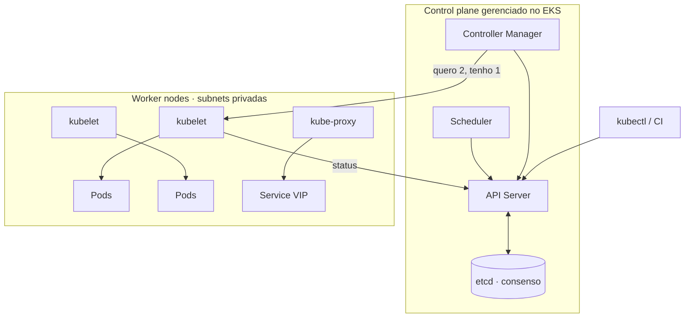
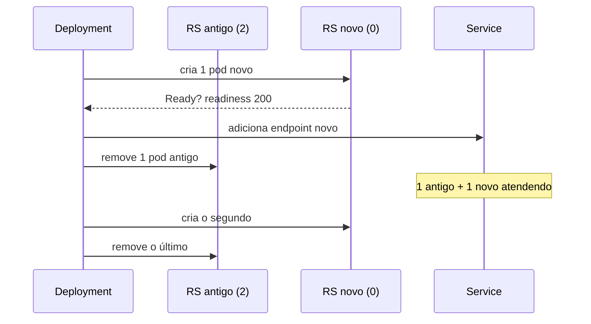
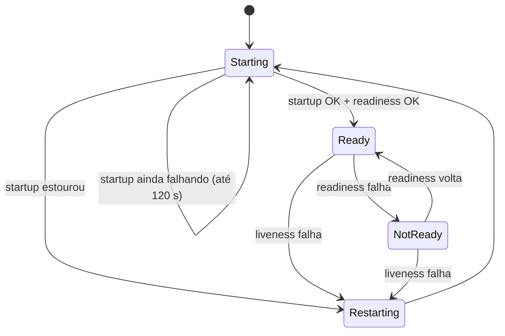
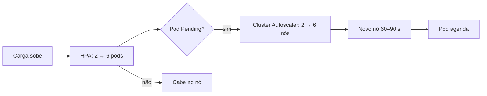
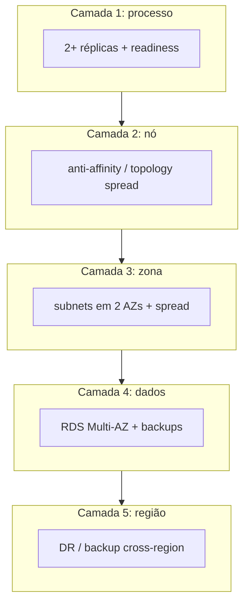

# Kubernetes e alta disponibilidade

<span class="study-tag prova">prova</span><span class="study-tag projeto">projeto</span>

Kubernetes não deixa um sistema disponível. Ele **reconcilia estado desejado** e oferece primitivas para que você construa disponibilidade — réplicas, probes, rollout, orçamento de interrupção, autoscaling. A diferença entre "tem Deployment" e "tem HA" está nos detalhes: quantas réplicas, em quantas zonas, com qual orçamento, contra qual ponto único de falha.

!!! quote "A ideia central"
    Você declara **o que quer** (`replicas: 2`, imagem X, readiness em `/health`). O control plane compara com **o que existe** e age para convergir. Toda a operação é um loop de reconciliação.

---

## 1. O modelo de controle



| Componente | Papel | No EKS |
| --- | --- | --- |
| **API Server** | Porta de entrada declarativa | Gerenciado |
| **etcd** | Estado do cluster, consenso Raft | Gerenciado |
| **Scheduler** | Escolhe nó para cada pod | Gerenciado |
| **Controller Manager** | Reconcilia Deployments, ReplicaSets, HPAs | Gerenciado |
| **kubelet** | Executa e monitora pods no nó | Você (node group) |
| **kube-proxy / CNI** | Rede do Service, políticas | Você/add-on |
| **metrics-server** | Métricas de CPU/memória para HPA | Instalado pelo deploy |

No EKS, o control plane é gerenciado (SLA da AWS), mas **nós, add-ons e workloads são seus**. O `metrics-server` foi instalado pelo `deploy-aws.sh`; sem ele, o HPA não recebe métricas e fica em `<unknown>`.

---

## 2. Objetos que importam

| Objeto | Para que serve | No projeto |
| --- | --- | --- |
| **Pod** | Menor unidade: um ou mais containers | Efêmero; nunca criado à mão em produção |
| **ReplicaSet** | Mantém N pods idênticos | Gerenciado pelo Deployment |
| **Deployment** | Rollout versionado + histórico | 6 serviços |
| **Service** | IP/DNS estável + balanceamento L4 | ClusterIP por serviço |
| **Ingress** | Roteamento HTTP L7 | `/api` → gateway |
| **ConfigMap** | Configuração não secreta | URLs, flags, TTL |
| **Secret** | Dados sensíveis (base64) | `platform-secrets` |
| **HPA** | Escala pods por métrica | 2–6 a 70% de CPU |
| **PDB** | Orçamento de interrupção voluntária | `minAvailable: 1` |
| **ServiceAccount** | Identidade do pod | IRSA do Product |
| **NetworkPolicy** | Firewall L3/L4 | Parcial (observabilidade) |
| **Namespace** | Isolamento lógico + PSA | `platform`, `observability` |

### Deployment, ReplicaSet e Pod

```yaml
apiVersion: apps/v1
kind: Deployment
metadata: { name: account, namespace: platform }
spec:
  replicas: 2
  revisionHistoryLimit: 3
  strategy:
    type: RollingUpdate
    rollingUpdate: { maxUnavailable: 1, maxSurge: 1 }
  selector:
    matchLabels: { app: account }
  template:
    metadata: { labels: { app: account } }
    spec:
      terminationGracePeriodSeconds: 30
      securityContext:
        seccompProfile: { type: RuntimeDefault }
      containers:
        - name: account
          image: microsserv52-account:local
          imagePullPolicy: IfNotPresent
          ports: [{ containerPort: 8080 }]
          securityContext:
            allowPrivilegeEscalation: false
            capabilities: { drop: ["ALL"] }
          envFrom:
            - configMapRef: { name: platform-config }
            - secretRef: { name: platform-secrets }
          env:
            - name: SPRING_DATASOURCE_HIKARI_MAXIMUM_POOL_SIZE
              value: "8"
            - name: SPRING_DATASOURCE_HIKARI_CONNECTION_TIMEOUT
              value: "5000"
          startupProbe:
            httpGet: { path: /actuator/health, port: 8080 }
            failureThreshold: 60
            periodSeconds: 2
          livenessProbe:
            httpGet: { path: /actuator/health, port: 8080 }
            periodSeconds: 10
            timeoutSeconds: 3
          readinessProbe:
            httpGet: { path: /actuator/health, port: 8080 }
            periodSeconds: 5
            timeoutSeconds: 3
          resources:
            requests: { cpu: 250m, memory: 256Mi }
            limits: { cpu: 500m, memory: 512Mi }
```

!!! warning "Detalhe que vale nota: endpoint agregado nas três probes"
    O manifesto aponta startup, liveness e readiness para `/actuator/health`. No Spring Boot, esse endpoint **agrega** todos os health indicators, inclusive o banco. O ideal é usar `/actuator/health/liveness` e `/actuator/health/readiness` (grupos do Actuator): assim a liveness não reinicia a JVM quando o banco apenas oscila. O Exchange expõe `/health/live`, `/health/ready` e aliases `/actuator/health*`. **Esta é uma melhoria concreta e barata que a banca pode pedir.**

### Service e Ingress

```yaml
apiVersion: v1
kind: Service
metadata: { name: gateway, namespace: platform }
spec:
  selector: { app: gateway }
  ports:
    - { name: http, port: 8080, targetPort: 8080 }
```

O Service dá um **nome DNS estável** (`gateway.platform.svc.cluster.local`) e balanceia entre pods prontos. `ClusterIP` não é acessível de fora; o Ingress faz L7:

```yaml
apiVersion: networking.k8s.io/v1
kind: Ingress
metadata:
  name: platform
  namespace: platform
  annotations:
    nginx.ingress.kubernetes.io/rewrite-target: /$2
    nginx.ingress.kubernetes.io/proxy-body-size: 10m
spec:
  ingressClassName: nginx
  rules:
    - http:
        paths:
          - path: /api(/|$)(.*)
            pathType: ImplementationSpecific
            backend: { service: { name: gateway, port: { number: 8080 } } }
```

No **AWS**, o caminho público não usa o Ingress: o overlay cria um `Service` NodePort:

```yaml
apiVersion: v1
kind: Service
metadata: { name: gateway-public, namespace: platform }
spec:
  type: NodePort
  selector: { app: gateway }
  ports:
    - { name: http, port: 80, targetPort: 8080, nodePort: 30080 }
```

O Terraform cria um **NLB** apontando para `30080` em todos os nós; o CloudFront usa o NLB como origem. Por isso o NLB é internet-facing, mas o security group só aceita o prefixo do CloudFront.

!!! note "ClusterIP × NodePort × LoadBalancer"
    **ClusterIP**: só dentro do cluster. **NodePort**: abre a mesma porta em todos os nós (30000–32767); simples, mas expõe o nó. **LoadBalancer**: pede um LB ao provedor (na AWS, normalmente via controller). O projeto usa NodePort + NLB criado fora do cluster para ter controle e custo previsível.

---

## 3. Rollout: como um deploy não derruba o serviço

Com `replicas: 2`, `maxUnavailable: 1` e `maxSurge: 1`:

1. O Deployment cria um **novo ReplicaSet** com a imagem nova.
2. Sobe **1 pod novo** (surge) e espera ficar **Ready** (readiness).
3. Remove **1 pod antigo** (unavailable permitido).
4. Repete até trocar as duas réplicas.
5. Se a nova versão nunca ficar Ready, o rollout **para** — e o antigo continua atendendo.



| Comando | Efeito |
| --- | --- |
| `kubectl rollout status deploy/gateway -n platform` | Acompanha |
| `kubectl rollout undo deploy/gateway -n platform` | Volta ao ReplicaSet anterior |
| `kubectl set image deploy/product product=...:sha` | Atualiza imagem |
| `kubectl describe pod ...` | Eventos, probes, OOM |

!!! danger "Rollout sem readiness é roleta"
    Sem readiness, o Kubernetes considera o pod pronto assim que o container inicia — antes de a JVM abrir a porta. O Service manda tráfego para um processo que ainda não responde e o usuário vê 502/503 durante o deploy. Readiness é o que separa "processo vivo" de "pode atender".

### Graceful shutdown

`terminationGracePeriodSeconds: 30` dá tempo para terminar requisições, mas o pod é removido dos endpoints de forma **assíncrona**. Sem `preStop` (sleep curto) ou sem esperar o drain, ainda podem chegar requisições nos últimos milissegundos. O risco é baixo com 2 réplicas, mas existe.

---

## 4. Probes: o que cada uma realmente faz

| Probe | Pergunta | Ação em falha | Config do projeto |
| --- | --- | --- | --- |
| **Startup** | Terminou de iniciar? | Mata e reinicia | 60 × 2 s = 120 s |
| **Liveness** | Está travado? | Mata e reinicia | 10 s, timeout 3 s |
| **Readiness** | Pode receber tráfego? | Remove endpoints | 5 s, timeout 3 s |



### Regras de ouro

1. **Liveness nunca depende de serviço externo.** Banco oscilou? Reiniciar todas as réplicas piora.
2. **Readiness pode depender (com cautela).** Se todas as réplicas dependem do mesmo banco, todas saem juntas — o serviço "desaparece" em vez de retornar erro.
3. **Startup para JVM lenta.** Sem ela, a liveness mata o pod antes de o Spring subir.
4. **Timeouts menores que o período.** `timeoutSeconds` > `periodSeconds` gera sobreposição e resultados estranhos.
5. **Probe barata.** Não faça query pesada; health check não é teste de carga.

!!! example "Por que 60 × 2 s?"
    Spring Boot + Hibernate + Flyway podem levar dezenas de segundos. 120 s de tolerância evita reinício em cascata durante um deploy ou um nó lento. O custo é detectar um pod travado no boot por até 2 min — aceitável.

---

## 5. Recursos, QoS e agendamento

| Campo | Efeito |
| --- | --- |
| `requests.cpu/memory` | Reserva para o scheduler; base do HPA |
| `limits.cpu` | Teto de CPU (throttling) |
| `limits.memory` | Teto de memória (OOMKill) |
| `requests == limits` | QoS **Guaranteed**; mais estável, menos elástico |
| `requests < limits` | QoS **Burstable**; o projeto usa |

O projeto reserva `250m/256Mi` e limita `500m/512Mi` por pod. Com 6 serviços × 2 réplicas = 12 pods, a reserva é **3,0 vCPU** e **3 GiB**. Dois `t3.medium` têm ~3,86 vCPU alocáveis; sistema (kube-system, ingress, metrics-server, CA) consome ~0,8 vCPU. O baseline fica quase cheio — por isso uma terceira réplica por serviço fica `Pending` até o Cluster Autoscaler adicionar um nó.

!!! warning "HPA usa request, não limit"
    `averageUtilization: 70` significa 70% de `250m` = 175m por pod. Se você diminuir a request para caber mais pods, o HPA dispara mais cedo (e pode escalar sem necessidade). Request é **capacidade planejada**, não um número para "caber no nó".

### Onde os pods caem?

O scheduler considera requests, afinidade, taints e topologia. O projeto **não** declara `podAntiAffinity` nem `topologySpreadConstraints`, então nada garante que as duas réplicas fiquem em nós/zonas diferentes. Em um cluster de 2 nós, o scheduler tende a espalhar, mas "tende" não é garantia.

```yaml
# Melhoria recomendada: espalhar por zona
topologySpreadConstraints:
  - maxSkew: 1
    topologyKey: topology.kubernetes.io/zone
    whenUnsatisfiable: ScheduleAnyway
    labelSelector:
      matchLabels: { app: product }
```

!!! tip "A pergunta de HA que separa candidatos"
    "Duas réplicas no mesmo nó sobrevivem à queda de uma zona?" Não. Réplica é redundância de **processo**; multi-AZ é redundância de **infraestrutura**. As duas são necessárias e nenhuma substitui a outra.

---

## 6. HPA e Cluster Autoscaler: duas camadas



| Camada | Métrica | Reação | Limite |
| --- | --- | --- | --- |
| **HPA** | CPU (ou custom) | 15 s de avaliação; sobe; desce após 5 min | `maxReplicas` |
| **Cluster Autoscaler** | Pod Pending | ~10 s detecta; nó em 60–90 s | `node_max_size` |
| **metrics-server** | CPU/mem | Scrape do kubelet | Precisa existir |

```yaml
apiVersion: autoscaling/v2
kind: HorizontalPodAutoscaler
metadata: { name: product, namespace: platform }
spec:
  scaleTargetRef: { apiVersion: apps/v1, kind: Deployment, name: product }
  minReplicas: 2
  maxReplicas: 6
  metrics:
    - type: Resource
      resource:
        name: cpu
        target: { type: Utilization, averageUtilization: 70 }
  behavior:
    scaleDown:
      stabilizationWindowSeconds: 300
```

### O que o HPA **não** resolve

- **Banco**: mais pods = mais conexões. O teto do RDS chega antes do teto de CPU.
- **Latência de dependência**: se o Product (ou o Exchange, quando a conversão for ativada) está lento, escalar o chamador só cria mais threads esperando.
- **Cold start**: novo pod Spring leva 20–40 s; um pico curto pode passar antes de a capacidade chegar.
- **Custo idle**: `minReplicas: 2` em seis serviços mantém 12 pods mesmo sem tráfego.
- **Escala a zero**: HPA de CPU não suporta `minReplicas: 0`; e sem pods não há métrica.

!!! example "A linha do tempo medida"
    No teste de 21/11: 02:54 Product em 4 réplicas; 02:55 em 5; 02:55:45 em 6; Gateway foi de 2 para 3. O node count ficou em 3 — o autoscaler não precisou adicionar nó, porque já havia um terceiro desde o rollout. Produto ficou preso em 6/6 e o p95 subiu a 1,25 s: **o HPA atingiu o teto antes do banco**. É a diferença entre "escalou" e "escalou o suficiente".

### Capacidade: a conta

| Recurso | Cálculo | Resultado |
| --- | --- | --- |
| Reserva do baseline | 6 serviços × 2 réplicas × 250m | 3,0 vCPU |
| Alocável em 2 × t3.medium | 2 × 1,93 | 3,86 vCPU |
| Sobra para sistema | 3,86 − 3,0 | ~0,86 vCPU (apertado) |
| Gatilho do HPA | 2 × 6 × 175m | 2,1 vCPU |
| Conexões RDS (pool 8) | 112 ÷ (3 × 8) | ~4,7 réplicas/serviço de BD |
| Conexões RDS (pool 10) | 112 ÷ (3 × 10) | ~3,7 réplicas/serviço de BD |

!!! warning "A conta que derruba a arquitetura"
    Com HPA máximo de 6 em **três** serviços que usam banco e pool 8, o pior caso é $6 \times 3 \times 8 = 144$ conexões — acima de 112. O projeto mediu 52/112 no cenário real porque o Hikari abre conexões sob demanda e nem todos os serviços estavam no máximo. **Dimensionar o pool por `max_connections ÷ (serviços × maxReplicas)` é obrigatório antes de subir o HPA.**

---

## 7. PDB: interrupção voluntária

Um **PodDisruptionBudget** limita quantos pods podem sair ao mesmo tempo em operações **voluntárias**: drain de nó, upgrade de cluster, manutenção.

```yaml
apiVersion: policy/v1
kind: PodDisruptionBudget
metadata: { name: product, namespace: platform }
spec:
  minAvailable: 1
  selector:
    matchLabels: { app: product }
```

| Cenário | PDB ajuda? |
| --- | --- |
| `kubectl drain` de um nó | ✅ Bloqueia se violar `minAvailable` |
| Upgrade do control plane | ✅ |
| Pod morto por OOM | ❌ Não é voluntário |
| Nó perdido (AZ) | ❌ Não é voluntário |
| Deploy com `maxUnavailable` | ❌ O Deployment já governa |

!!! danger "PDB mal configurado bloqueia manutenção"
    `minAvailable: 2` com 2 réplicas impede qualquer drain — o cluster nunca atualiza. Com 2 réplicas, `minAvailable: 1` é o correto. Em staging (1 réplica), o overlay troca para `maxUnavailable: 1`.

---

## 8. Alta disponibilidade de verdade: camadas e pontos únicos



| Camada | O projeto tem | Falta |
| --- | --- | --- |
| Processo | 2 réplicas, probes, PDB | Probes separadas; preStop |
| Nó | Scheduler em 2 nós | Anti-affinity explícita |
| Zona | Node group em 2 AZs (Terraform) | `topologySpreadConstraints`; nada garante spread |
| Dados | RDS com backup/PITR | **Single-AZ** (sem failover automático) |
| Região | — | Sem DR cross-region |
| Borda | CloudFront + NLB | NLB é regional; CloudFront absorve |
| Dependência externa | Adapter + timeout | Circuit breaker/fallback completos |

### Simulação de falhas

| Falha | O que acontece hoje | SLI afetado | Mitigação |
| --- | --- | --- | --- |
| Pod morre (OOM) | ReplicaSet recria; readiness gate | Breve perda de 1 réplica | Requests/limits realistas |
| Nó drenado | PDB mantém 1; pods realocam | Latência durante remoção | PDB + capacidade livre |
| Nó perdido | Pods do nó somem; recriam se houver espaço | Indisponibilidade parcial | CA + 3 nós |
| AZ cai | Se as 2 réplicas estavam na AZ, serviço cai | Indisponibilidade total | Spread + multi-AZ |
| RDS falha | Single-AZ: restore/failover manual | Catálogo/pedido/contas | Multi-AZ |
| Deploy ruim | Rollout para se readiness falhar; rollback | Erros só na fração nova | Readiness + SHA + undo |
| Pico de tráfego | HPA 2→6; CA se Pending | p95 sobe até capacidade | HPA + CA + pool |
| Exchange lento | Hoje o Order rejeita não-USD; com a integração ativa, timeout e sem breaker completo | p95 do checkout (quando ativo) | Breaker + fallback |

!!! note "O que o EKS garante"
    O **control plane** gerenciado tem SLA e é multi-AZ pela AWS. Isso não se estende aos seus pods, ao RDS, ao NAT ou ao NLB. A disponibilidade do **seu sistema** é a composição — e o elo mais fraco manda.

---

## 9. Segurança e configuração no cluster

| Mecanismo | No projeto |
| --- | --- |
| Namespace + Pod Security Admission | `baseline` enforce, `restricted` warn |
| `runAsNonRoot` / UID | Não declarado explicitamente; `allowPrivilegeEscalation: false`, `drop: ALL` |
| `readOnlyRootFilesystem` | Não usado |
| `seccompProfile` | `RuntimeDefault` |
| ServiceAccount | `product` com IRSA para S3 |
| ConfigMap | URLs internas, flags, TTL, cookie path |
| Secret | `platform-secrets`; nenhum valor no Git |
| NetworkPolicy | Parcial; default-deny recomendado |
| Image tag | SHA imutável em produção; `:local` no Compose |

!!! warning "Secret em variável de ambiente"
    `envFrom.secretRef` expõe o segredo no ambiente do processo: qualquer RCE lê. Alternativas: montar como arquivo, External Secrets, Vault Agent. O projeto usa env por simplicidade e documenta que a rotação é manual.

---

## 10. Kustomize: um base, quatro ambientes

```text
k8s/base/                 # 6 Deployments, Services, HPA, PDB, Ingress, ConfigMap
k8s/overlays/
  microk8s/               # Postgres/Redis locais, ingress
  localstack/             # EKS emulado, Traefik, mock do Exchange
  aws/                    # NodePort do Gateway, IRSA
  staging/                # 1 réplica, HPA fixo, cookie inseguro, sem probe externa
```

| Overlay | Mudança principal |
| --- | --- |
| `aws` | Adiciona `gateway-public` NodePort 30080; força SSL redirect |
| `staging` | `replicas: 1`; HPA min=max=1; PDB `maxUnavailable: 1`; `deployment.environment=staging`; cookie sem Secure |
| `localstack` | Toleration do nó único; 1 réplica; endpoint S3 local |
| `microk8s` | Postgres/Redis no cluster; ingress local |

```yaml
# staging: reduz réplicas sem duplicar manifests
patches:
  - target: { group: apps, version: v1, kind: Deployment }
    patch: |-
      - op: replace
        path: /spec/replicas
        value: 1
```

!!! tip "Por que Kustomize e não Helm?"
    O projeto precisa de **variações pequenas** sobre um base estável (réplicas, env, NodePort), não de parametrização de terceiros. Kustomize é nativo do `kubectl`, sem templating. Helm seria melhor para distribuir um produto a muitos clientes; aqui o chart seria mais cerimônia que ganho.

---

## 11. Como o Kubernetes eleva o SLI (com números)

O SLO do projeto é **99,5% em 28 dias** = 201,6 min de error budget. Cada mecanismo ataca uma parcela diferente:

| Mecanismo | O que melhora | Efeito estimado/observado |
| --- | --- | --- |
| 2 réplicas + Service | Disponibilidade de processo | Se um pod tem $a=0{,}99$, o par tem $1-(1-a)^2=99{,}99\%$ — mas só com falhas independentes |
| Readiness | Evita tráfego para pod que ainda sobe | Elimina 5xx de startup no rollout; sem ela, o Service manda tráfego antes da JVM abrir a porta |
| Startup probe | Evita restart em cascata | 120 s de tolerância; sem ela, JVM lenta entra em CrashLoop |
| RollingUpdate | Deploy sem queda | Sempre ≥ 1 réplica pronta; o rollout para se a nova falhar |
| PDB | Manutenção sem queda total | `minAvailable: 1` com 2 réplicas; drain espera |
| HPA + CA | Absorve picos | 2→6 pods; nó em 60–90 s; p95 sobe até a capacidade chegar |
| Graceful shutdown | Corta 5xx de cauda | `terminationGracePeriodSeconds: 30`; ideal + `preStop` |
| Multi-AZ (falta) | Remove SPOF de zona | Sem isso, duas réplicas na mesma AZ caem juntas |
| RDS Multi-AZ (falta) | Remove SPOF de dados | Hoje: restore/PITR (RTO 1 h), não failover |

### Quanto custa em budget?

| Incidente | Conta | Consumo do budget |
| --- | --- | --- |
| 5 min de indisponibilidade total | 5 / 201,6 | ≈ 2,5% |
| 30 min com 10% de erro | 3 min equivalentes / 201,6 | ≈ 1,5% |
| 1 h com 1% de erro | 0,6 min / 201,6 | ≈ 0,3% |
| Um dia inteiro fora | 1.440 / 201,6 | 714% — estoura o SLO muitas vezes |

!!! tip "A ligação que a banca quer"
    Não basta listar HPA/PDB/probes. Explique **qual parcela do SLI** cada um protege: readiness e rollout protegem contra erros de deploy; réplicas e multi-AZ contra falhas de processo/infra; HPA/CA contra saturação; RDS Multi-AZ contra falha de dados. O projeto cobre bem o primeiro grupo, parcialmente o segundo e **não cobre** o terceiro.

!!! example "O que os números medidos dizem"
    No teste de carga, Product foi de 2 → 6 réplicas e o p95 chegou a 1,25 s a ~300 req/s: o HPA funcionou, mas o teto de 6 e a CPU dos nós impediram o SLO de 300 ms. Isso mostra que **escalar não é o mesmo que cumprir latência** — e que o SLI de latência é o que estava queimando, não a disponibilidade (0% de erro).

---

## 12. Diagnóstico: os comandos que contam uma história

```bash
kubectl -n platform get deploy,pods -o wide
kubectl -n platform get hpa
kubectl -n platform describe pod product-xxxxx      # eventos, probes, OOM
kubectl -n platform logs deploy/product --tail=100
kubectl -n platform rollout status deploy/product
kubectl -n platform top pods
kubectl -n kube-system get deploy metrics-server cluster-autoscaler
kubectl get nodes -L topology.kubernetes.io/zone
kubectl -n platform get pdb
kubectl -n platform get events --sort-by=.lastTimestamp
```

| Sintoma | Primeiro comando | Hipótese |
| --- | --- | --- |
| Pod `Pending` | `describe pod` | Sem CPU/memória; CA não subiu; taint |
| `CrashLoopBackOff` | `logs --previous` | Config/segredo, migração, porta |
| `Running` mas `0/1 Ready` | `describe` | Readiness falhando (DB, path) |
| 503 no Gateway | `get endpoints` | Nenhum pod Ready |
| Latência alta | `top pods`, HPA | CPU throttling, pool |
| Reinícios | `describe` | Liveness matando, OOMKilled |

---

## 13. Anti-padrões de HA (decore cinco)

| Anti-padrão | Por que é ruim | Correção |
| --- | --- | --- |
| `replicas: 1` em produção | Qualquer restart é indisponibilidade | ≥ 2 + PDB |
| Duas réplicas no mesmo nó/AZ | Falha de infra derruba ambas | anti-affinity/topology spread |
| Liveness consultando o banco | Reinício em massa | Liveness local; readiness com dependência |
| HPA sem `requests` | Métrica indefinida | Definir requests realistas |
| HPA max > capacidade do banco | Conexões estouram | Pool dimensionado; RDS maior |
| `minAvailable` = réplicas | Drain bloqueado | `minAvailable: 1` |
| `latest` em produção | Rollback ambíguo | SHA imutável |
| PDB sem HPA/replicas | Não protege nada | Combinar |
| Sem `terminationGracePeriod` | Requisições cortadas | 30 s + preStop |
| Sem NetworkPolicy | Movimento lateral | default-deny + allow |

---

## 14. Como responder

**"O que garante alta disponibilidade no projeto?"**
> Três camadas: duas réplicas por serviço com readiness, PDB preservando uma durante drain e node group em duas AZs. Mas HA real é limitada por RDS Single-AZ, ausência de anti-affinity explícita e um único NAT/NLB. É HA de processo e de nó, não de zona/região completa.

**"Como vocês escalam?"**
> HPA de 2 a 6 a 70% da request de CPU, com metrics-server; Cluster Autoscaler de 2 a 6 nós quando há pod Pending. A latência de resposta é 15 s do HPA + 20–40 s do pod + 60–90 s do nó, então um pico leva 1,5–3 min para ser absorvido. E o banco limita antes da CPU: 112 conexões.

**"Rolling update derruba?"**
> Com `maxUnavailable: 1` e `maxSurge: 1`, há sempre uma réplica atendendo; o rollout para se a nova não ficar Ready. O risco residual é o endpoint demorar a remover o pod antigo; um `preStop` com sleep e um grace period maior fecham essa janela.

**"O que você mudaria primeiro?"**
> Probes separadas (`/actuator/health/liveness` e `/readiness`), `topologySpreadConstraints`, RDS Multi-AZ e um pool calculado por `max_connections / (serviços × réplicas)`. Depois, NetworkPolicy default-deny e breaker no cliente do Exchange.

---

## Ordem de um rollout

<div class="study-order" data-items="Novo ReplicaSet é criado com a imagem nova|Um pod novo sobe (maxSurge=1)|Readiness do pod novo responde 200|Service adiciona o pod novo aos endpoints|Um pod antigo é removido (maxUnavailable=1)|Rollout continua até todas as réplicas novas|Se readiness falhar, o rollout para e o antigo atende" data-prompt="Ordene um rolling update com 2 réplicas:"></div>

<div class="study-calc" data-answer="5" data-tolerance="0.6" data-unit="réplicas (aprox.)">
  <p class="q">Com 3 serviços que usam o banco, pool de 8 por pod e RDS com 112 conexões, quantas réplicas por serviço cabem antes de estourar o limite?</p>
  <input type="number" step="0.1" inputmode="decimal" placeholder="réplicas">
  <button type="button">Conferir</button>
  <p class="explain">112 ÷ (3 × 8) = 4,67. Na quinta réplica por serviço, o pior caso é 120 conexões e o RDS recusa. Com pool 10, o teto cai para 3,7.</p>
</div>

---

## Checkpoint

<div data-study-score></div>

<div class="study-quiz" data-answer="c">
  <p class="q">1. Duas réplicas de um Deployment rodam no mesmo nó. O que acontece se o nó falhar?</p>
  <ul class="options">
    <li data-key="a">O Service redistribui para o outro nó automaticamente, sem perda.</li>
    <li data-key="b">O PDB impede a falha do nó.</li>
    <li data-key="c">As duas réplicas caem; o ReplicaSet recria em outro nó, mas há indisponibilidade até isso ocorrer.</li>
    <li data-key="d">O HPA cria um nó novo instantaneamente.</li>
  </ul>
  <p class="explain">Réplica no mesmo nó é redundância de processo, não de infraestrutura. A recuperação depende de capacidade e do scheduler; até lá, o serviço fica fora. Anti-affinity/topology spread evita o cenário.</p>
</div>

<div class="study-quiz" data-answer="b">
  <p class="q">2. Por que `minAvailable: 2` com 2 réplicas é um problema?</p>
  <ul class="options">
    <li data-key="a">Porque o Kubernetes não aceita `minAvailable` maior que 1.</li>
    <li data-key="b">Porque qualquer drain voluntário violaria o orçamento e ficaria bloqueado para sempre.</li>
    <li data-key="c">Porque impede o HPA de escalar.</li>
    <li data-key="d">Porque aumenta o custo do Cluster Autoscaler.</li>
  </ul>
  <p class="explain">O PDB protege contra interrupção voluntária. Exigir todos os pods disponíveis torna drain/upgrade impossível. Com 2 réplicas, use `minAvailable: 1`.</p>
</div>

<div class="study-quiz" data-answer="d">
  <p class="q">3. Qual é a ordem correta de resposta a um pico de tráfego?</p>
  <ul class="options">
    <li data-key="a">Cluster Autoscaler adiciona nó → HPA cria pods → readiness libera tráfego.</li>
    <li data-key="b">HPA adiciona nós → Cluster Autoscaler cria pods.</li>
    <li data-key="c">O PDB escala os pods antes do HPA.</li>
    <li data-key="d">HPA aumenta pods → se ficarem Pending, o Cluster Autoscaler adiciona nó → pods agendam e ficam Ready.</li>
  </ul>
  <p class="explain">O HPA reage à métrica do pod; o CA reage a pods Pending. Sem CA, o pod extra fica pendurado. A capacidade efetiva só chega quando o nó sobe e o pod fica Ready.</p>
</div>

<div class="study-quiz" data-answer="a">
  <p class="q">4. O que o EKS gerencia e o que continua sendo responsabilidade do time?</p>
  <ul class="options">
    <li data-key="a">Gerencia o control plane (API, etcd, scheduler); nós, add-ons, workloads, RDS e rede são do time.</li>
    <li data-key="b">Gerencia tudo, inclusive os pods e o RDS.</li>
    <li data-key="c">Gerencia apenas os nós; o control plane é seu.</li>
    <li data-key="d">Gerencia o RDS, mas não o Kubernetes.</li>
  </ul>
  <p class="explain">EKS é CaaS/K8s gerenciado: o control plane tem SLA da AWS, mas node groups, add-ons (metrics-server, CA, ingress), manifests, banco e custos são seus.</p>
</div>

## Checklist

<div data-study-progress></div>

<label class="study-check"><input type="checkbox" data-key="k-objs"> Explico Deployment → ReplicaSet → Pod → Service e o loop de reconciliação.</label>
<label class="study-check"><input type="checkbox" data-key="k-probes"> Distingo startup, liveness e readiness e sei por que liveness não olha o banco.</label>
<label class="study-check"><input type="checkbox" data-key="k-rollout"> Narro um rolling update e o papel da readiness.</label>
<label class="study-check"><input type="checkbox" data-key="k-hpa"> Explico HPA + CA, latências e o teto do banco.</label>
<label class="study-check"><input type="checkbox" data-key="k-pdb"> Sei o que PDB protege e o que não protege.</label>
<label class="study-check"><input type="checkbox" data-key="k-ha"> Listo os pontos únicos de falha do projeto e a ordem de correção.</label>

!!! info "Continue"
    K8s gera um volume enorme de sinais. O próximo capítulo mostra como transformá-los em diagnóstico: [Observabilidade](11-observabilidade.md). Multi-AZ, mTLS, spread e DR estão detalhados em [O que não foi implementado](18-lacunas-e-evolucao.md).
