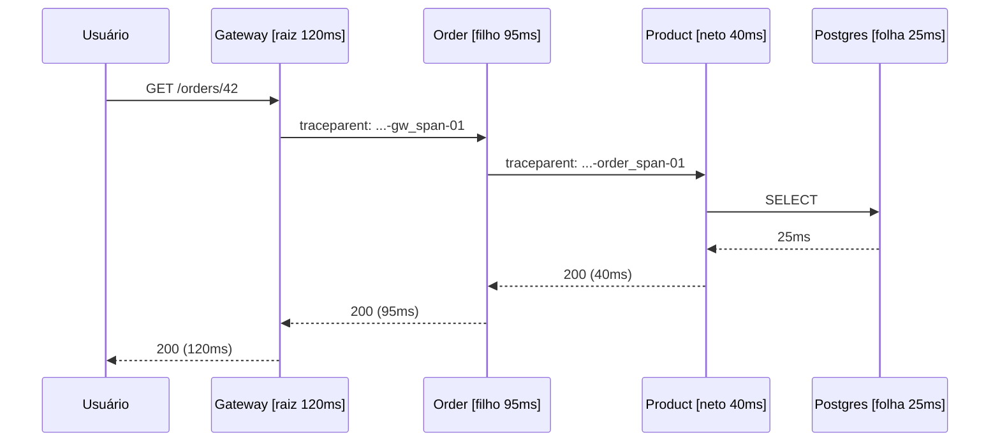
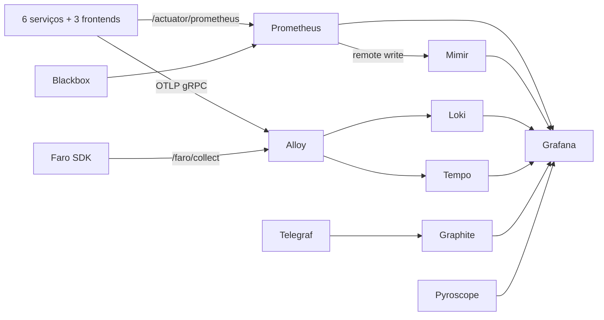
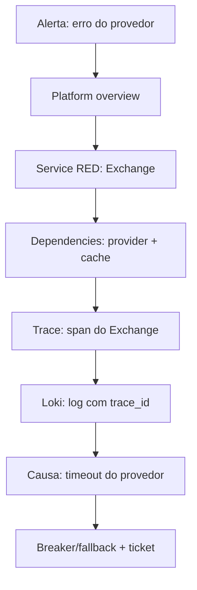

# Observabilidade

<span class="study-tag prova">prova</span><span class="study-tag projeto">projeto</span>

Monitoramento responde perguntas conhecidas: a taxa de erro está abaixo de 1%? Observabilidade permite investigar as que você não previu: por que 7% das requisições de clientes móveis em São Paulo deram timeout nesta terça? Em um sistema com seis serviços, três frontends, banco e provedor externo, a segunda pergunta é a que aparece no plantão.

---

## 1. Os três pilares

| Pilar | Responde | Ferramenta | Retenção | Custo |
| --- | --- | --- | --- | --- |
| **Métricas** | Algo mudou? Quanto? | Prometheus/Mimir | semanas–meses | baixo por série |
| **Logs** | O que aconteceu, em que ordem? | Loki | dias–semanas | alto por volume |
| **Traces** | Onde, em qual serviço, demorou? | Tempo | dias | alto por span |
| Perfis | Onde o CPU/memória é gasto? | Pyroscope | dias | amostragem |

Os três descrevem o mesmo evento por ângulos diferentes. Um `POST /orders` que falha gera:

- um incremento em `http_server_requests_seconds_count{status="500"}`;
- uma linha `{"level":"ERROR","trace_id":"...","route":"/orders"}`;
- um trace com spans de Gateway, Order, Product e Exchange, um marcado como erro.

!!! tip "Uma pergunta para cada pilar"
    Métrica diz **que** algo mudou; log diz **o quê**; trace diz **onde**. Perfil diz **por que** o CPU está alto. Sem correlação (um ID comum), você tem três ferramentas, não observabilidade.

---

## 2. Métricas e PromQL

### Modelo de dados

Uma série temporal = nome + labels:

```
http_server_requests_seconds_count{application="order", uri="/orders/{id}", method="GET", status="200"} 4823
```

| Tipo | Comportamento | Exemplo |
| --- | --- | --- |
| Counter | Só cresce | requisições, erros |
| Gauge | Sobe e desce | conexões ativas, heap |
| Histogram | Buckets de distribuição | latência |
| Summary | Quantis pré-calculados | menos flexível |

**Cardinalidade** é o inimigo: cada combinação de labels é uma série. Nunca coloque `userId`, `orderId`, e-mail ou URL completa em label. O Spring já usa o **template** da rota (`/orders/{id}`), não o id. O projeto exige labels `application`, `service`, `method`, `uri`, `status`, `outcome` — e proíbe identificadores.

### Consultas que caem em prova

```promql
# taxa de requisições por segundo (média de 5 min)
rate(http_server_requests_seconds_count[5m])

# proporção de erros 5xx (SLI de disponibilidade)
sum(rate(http_server_requests_seconds_count{status=~"5.."}[5m]))
/
sum(rate(http_server_requests_seconds_count[5m]))

# p95 de latência (histograma)
histogram_quantile(0.95,
  sum by (le) (rate(http_server_requests_seconds_bucket[5m])))

# total na última hora
increase(http_server_requests_seconds_count[1h])
```

| Regra | Por quê |
| --- | --- |
| `rate()`/`increase()` em counter **antes** de somar | Trata reset do contador quando o pod reinicia |
| `sum by (le)` nos buckets | `histogram_quantile` precisa do label `le` |
| Percentis, não médias | 99 requisições de 50 ms + 1 de 5 s = média 100 ms, mas 1% espera 5 s |
| Janela explícita | `[5m]` muda o resultado; documente |

!!! warning "Média esconde a cauda"
    Uma página web faz dezenas de chamadas; se 1% tem 5 s, muitos usuários encontram a cauda. Use p95/p99 ou "fração abaixo de X" — que é a forma de SLI.

### Pull, não push

Prometheus **raspa** (`scrape`) o endpoint `/actuator/prometheus` (Spring/Micrometer) ou `/metrics` (Exchange) a cada 15 s. A aplicação só expõe o estado atual. Vantagens: controle de carga, detecção de alvo down (`up == 0`), sem agente. Desvantagem: jobs curtos exigem pushgateway ou outro modelo.

### RED, USE e Golden Signals

| Método | Para | Métricas |
| --- | --- | --- |
| **RED** | Serviços/APIs | Rate, Errors, Duration |
| **USE** | Recursos | Utilization, Saturation, Errors |
| **Golden Signals** | Sistemas voltados ao usuário | latência, tráfego, erros, saturação |

Use RED nos dashboards de serviço e USE nos de infraestrutura. O projeto segue essa divisão: **Service RED** e **Platform overview** para serviços; **Pod resources** (Graphite/Telegraf) para CPU/memória/rede.

### Alertas

```yaml
- alert: OrderHighErrorRatio
  expr: |
    sum(rate(http_server_requests_seconds_count{application="order", status=~"5.."}[5m]))
    /
    sum(rate(http_server_requests_seconds_count{application="order"}[5m])) > 0.05
  for: 5m
  labels: { severity: page }
```

Além do limiar, use **burn rate** (capítulo 9): alerta sobre o consumo do error budget, não sobre CPU. O projeto tem 10 regras, cobrindo disponibilidade, latência, alvo down, probe, pool, provedor, cache e traces.

---

## 3. Logs

| | Não estruturado | Estruturado (JSON) |
| --- | --- | --- |
| Exemplo | `2024-01-15 ERROR Order 42 failed` | `{"level":"ERROR","orderId":42,"trace_id":"abc","msg":"..."}` |
| Busca | regex/grep | campos |
| Agregação | difícil | Loki/Kibana |
| Custo | baixo esforço, alto caos | alto esforço inicial, alto valor |

O projeto exige JSON com timestamp UTC, serviço, request/trace ID, rota e status. **Nunca** logar senha, token, cookie, API key, URL assinada ou dado pessoal.

### Correlation ID e MDC

O `trace_id` é o correlation ID natural. Com o agente OTel, ele entra no MDC automaticamente e o padrão de log o imprime:

```
%d{ISO8601} %-5level [trace_id=%X{trace_id} span_id=%X{span_id}] %logger - %msg%n
```

`MDC.put` manual serve para contexto de negócio (`customerId`) e deve ser removido (`putCloseable`) — threads são reaproveitadas e uma chave esquecida vaza para a próxima requisição. Em código reativo/`@Async`, o MDC não propaga sozinho.

### Loki

Loki indexa **labels**, não o texto, o que o torna muito mais barato que Elasticsearch. Consulta por `{service="order"} |= "ERROR"`. O projeto usa Alloy para coletar logs de containers (Docker) e pods (Kubernetes) e enviar ao Loki.

!!! warning "Log não é métrica"
    Contar erros por log funciona, mas é caro e lento. Se você precisa agregar, exporte um counter. Use log para o **detalhe** de um evento, não para o dashboard principal.

---

## 4. Traces distribuídos

Um trace é uma árvore de **spans** — um por operação (HTTP, SQL, cache, chamada externa).

| Campo | Exemplo |
| --- | --- |
| `traceId` | `4bf92f3577b34da6a3ce929d0e0e4736` (128 bits) |
| `spanId` | `00f067aa0ba902b7` |
| `parentSpanId` | span que disparou |
| name | `GET /orders/{id}` |
| duration | 45 ms |
| status | OK / ERROR |
| attributes | `http.status_code=500`, `db.system=postgresql` |

### W3C `traceparent`

```
traceparent: 00-4bf92f3577b34da6a3ce929d0e0e4736-00f067aa0ba902b7-01
             versão  trace-id (128b)          parent-span (64b)  flags
```

Cada serviço mantém `traceId` e `flags` e troca o `parentSpanId` pelo seu próprio span. É assim que o trace atravessa fronteiras sem ninguém conhecer o todo.



### Amostragem

| Estratégia | Como | Trade-off |
| --- | --- | --- |
| Head | Decide no primeiro span (`parentbased_traceidratio`) | Barata; perde erros raros |
| Tail | Collector espera o trace completo | Mantém erros/lentos; memória |
| Rate limit | N traces/s | Custo previsível; descarta no pico |

O projeto usa **head sampling de 20% localmente** (`OTEL_TRACES_SAMPLER_ARG=0.2`). Para produção, a recomendação é head alto + tail no Collector para manter todos os erros. Head e tail se aplicam em sequência: o que o head descarta, o tail não recupera.

---

## 5. OpenTelemetry

| Componente | Papel |
| --- | --- |
| API | Interfaces por linguagem |
| SDK | Implementação, sampling, exporters |
| Collector | Recebe, processa e exporta |
| OTLP | Protocolo (gRPC 4317 / HTTP 4318) |

O **agente Java** instrumenta Spring, JDBC, HTTP clients e Logback por bytecode, sem mudar código:

```bash
java -javaagent:/otel/opentelemetry-javaagent.jar -jar app.jar
```

```yaml
env:
  - name: OTEL_SERVICE_NAME
    valueFrom: { fieldRef: { fieldPath: "metadata.labels['app']" } }
  - name: OTEL_EXPORTER_OTLP_ENDPOINT
    value: http://alloy.observability.svc.cluster.local:4317
  - name: OTEL_EXPORTER_OTLP_PROTOCOL
    value: grpc
  - name: OTEL_METRICS_EXPORTER
    value: none
  - name: OTEL_LOGS_EXPORTER
    value: none
  - name: OTEL_TRACES_SAMPLER
    value: parentbased_traceidratio
  - name: OTEL_TRACES_SAMPLER_ARG
    value: "0.2"
```

!!! warning "Protocolo e porta precisam combinar"
    Desde o agente 2.x, o padrão é **HTTP/protobuf na 4318**. Se você aponta para `:4317`, precisa definir `OTEL_TRACES_EXPORTER=otlp` e `OTEL_EXPORTER_OTLP_PROTOCOL=grpc`. Incompatibilidade silenciosa = zero traces, só erro no log.

Por que desabilitar exporters de métricas/logs no agente? Porque o Micrometer já expõe métricas no Prometheus e o Alloy já coleta logs; habilitar tudo duplicaria dados e custo.

### Spans manuais

Quando a instrumentação automática não vê a regra de negócio:

```java
Span span = tracer.spanBuilder("calculateTotal").startSpan();
try (Scope scope = span.makeCurrent()) {
    span.setAttribute("order.items", items.size());
    return calculate();
} catch (Exception e) {
    span.recordException(e);
    span.setStatus(StatusCode.ERROR, e.getMessage());
    throw e;
} finally {
    span.end();
}
```

---

## 6. A stack do projeto (LGTM + extras)



| Componente | Papel no projeto |
| --- | --- |
| Prometheus | Scrape, recording rules, retenção local 15 dias |
| Mimir | Métricas de longo prazo (remote write) |
| Loki | Logs de containers/pods |
| Tempo | Traces; gera service graph e span metrics |
| Pyroscope | Perfis (nenhum agente carregado) |
| Graphite + Telegraf | CPU/memória/rede de containers e pods |
| Alloy | Coleta, OTLP, Faro |
| Blackbox | Probes HTTP sintéticas |
| Grafana | Dashboards + alertas unificados |

### Números verificados (21/11, stack local)

```text
Prometheus: 12 alvos up, 0 unhealthy
Grafana 13.3.1, database ok; datasources Prometheus, Mimir, Loki, Tempo, Pyroscope
Mimir: /ready e remote-write ok
Dashboards: Platform overview, Service RED, SLO/error budget,
            Synthetic health, Dependencies, Pod resources,
            Frontend/Faro, Trace service graph
Alert rules provisionadas (8 no log de verificação; 10 condições na tabela do runbook)
Recording rules: 13 saudáveis
Probes sintéticas: 5/5 (landing, store, admin, catalog, health)
Loki: logs recebidos; Tempo: spans de gateway, auth, account, order, product
Faro: preflight 204; POST /faro/collect 202
```

| Dashboard | Pergunta que responde |
| --- | --- |
| Platform overview | O tráfego está saudável? Quem está queimando? |
| Service RED | Rate, erros e duração de um serviço |
| SLO / error budget | Disponibilidade de 28 dias, burn rate, budget restante |
| Synthetic health | A borda e o catálogo respondem de fora? |
| Dependencies | Hikari, cache e provedor de câmbio |
| Pod resources | CPU/memória/rede/restarts por container |
| Frontend/Faro | Spans de browser, exceções, Web Vitals |
| Trace service graph | Taxa, falhas e p95 entre serviços |

!!! note "Uma distinção importante"
    Os **Java** serviços carregam o agente OTel e exportam **apenas traces**; as métricas continuam no `/actuator/prometheus`. O **Exchange** (Python) exporta métricas e logs, mas **não tem traces** — lacuna documentada. Nenhum serviço carrega agente de profiling. Frontends usam **Faro**, com redação de query string e dados privados.

---

## 7. Do sinal à decisão



O runbook do projeto tem essa sequência: overview → RED → dependências → synthetic → logs → Hikari (`active` vs `max`, pool 8) → registrar incidente com o intervalo do dashboard.

### Métricas DORA

| Métrica | O que mede | Elite |
| --- | --- | --- |
| Deployment Frequency | Frequência de entrega | sob demanda |
| Change Lead Time | Commit → produção | < 1 dia |
| Change Failure Rate | % de deploys que exigem correção | ~5% |
| Failed Deployment Recovery Time | Tempo de recuperação | < 1 h |

Sem observabilidade não há DORA: a taxa de falha exige correlacionar deploy com erro; o MTTR exige início/fim do incidente. O projeto tem deploy manual e histórico de SHA, mas não mede DORA formalmente — outra lacuna honesta.

---

## 8. Armadilhas

| Armadilha | Efeito | Correção |
| --- | --- | --- |
| Label com ID de usuário/pedido | Explosão de cardinalidade | IDs em log/trace |
| Logar tudo em INFO/DEBUG | Custo e ruído | Níveis por ambiente; amostragem |
| Logar segredo/token | Vazamento | Redaction; nunca logar headers |
| Trace sem propagação | Trace partido em dois | `traceparent` em todo cliente |
| Alerta de CPU como page | Fadiga de alerta | Alertar sintoma/burn rate |
| Dashboard sem owner | Ninguém olha | Owner por painel/alerta |
| Retenção infinita | Custo | Mimir/Loki com retenção e amostragem |
| Métrica de negócio ausente | Só infra, não produto | Ex.: pedidos criados/min |

---

## 9. Como responder

**"Qual a diferença entre monitoramento e observabilidade?"**
> Monitoramento verifica hipóteses conhecidas; observabilidade permite investigar o desconhecido a partir de sinais correlacionados. Na prática: um alerta de dashboard é monitoramento; entrar do erro para o trace e daí para o log com o mesmo `trace_id` é observabilidade.

**"Como vocês encontram a causa de um checkout lento?"**
> O trace mostra os spans por salto (Gateway, Order, Product, Exchange). O span mais longo aponta o serviço; o p95 do RED confirma se é sistêmico; o dashboard de dependências mostra Hikari/provider; o log com `trace_id` dá o detalhe. Se o p95 sobe em todos os pods, o problema é downstream ou banco.

**"Por que 20% de amostragem?"**
> Custo de armazenamento e overhead. Head sampling de 20% é suficiente para tendências; erros raros podem escapar. A evolução é head alto + tail sampling no Collector para manter 100% dos traces com erro.

**"O que falta?"**
> Traces no Exchange, Pyroscope com agentes, verificação do stack no EKS (os manifests estão preparados, não aplicados) e métricas de negócio (pedidos/min, conversão). Também não há SLO dashboard com dados de produção AWS.

---

## Ordem de uma investigação

<div class="study-order" data-items="Alerta de disponibilidade dispara|Abrir Platform overview e identificar o serviço|Conferir Service RED (rate, erro, p95)|Checar Dependencies (Hikari, provider, cache)|Abrir trace lento/errado no Tempo|Buscar logs com o trace_id no Loki|Registrar incidente com o intervalo do dashboard" data-prompt="Ordene o runbook de investigação:"></div>

---

## Checkpoint

<div data-study-score></div>

<div class="study-quiz" data-answer="b">
  <p class="q">1. Por que `userId` não pode ser label de métrica?</p>
  <ul class="options">
    <li data-key="a">Porque o Prometheus não aceita strings.</li>
    <li data-key="b">Porque cada valor distinto cria uma série e a cardinalidade explode, derrubando o Prometheus.</li>
    <li data-key="c">Porque labels só aceitam números.</li>
    <li data-key="d">Porque o Grafana não renderiza.</li>
  </ul>
  <p class="explain">Cardinalidade = produto dos valores dos labels. 100 mil usuários × endpoints × status = milhões de séries. IDs pertencem a logs e traces, onde a busca é por campo.</p>
</div>

<div class="study-quiz" data-answer="c">
  <p class="q">2. O que o cabeçalho `traceparent` carrega entre serviços?</p>
  <ul class="options">
    <li data-key="a">O token JWT do usuário.</li>
    <li data-key="b">O corpo da requisição.</li>
    <li data-key="c">Versão, traceId, parentSpanId e flags de amostragem.</li>
    <li data-key="d">A lista de todos os spans do trace.</li>
  </ul>
  <p class="explain">Cada serviço cria seu span e substitui o parentSpanId; o traceId e as flags viajam. Nenhum serviço precisa conhecer o trace inteiro.</p>
</div>

<div class="study-quiz" data-answer="a">
  <p class="q">3. Qual combinação descreve corretamente o projeto?</p>
  <ul class="options">
    <li data-key="a">Java: agente OTel só para traces, métricas no Micrometer; Exchange: métricas/logs sem traces.</li>
    <li data-key="b">Todos os serviços exportam os três sinais via OTLP.</li>
    <li data-key="c">Exchange tem traces, mas não métricas.</li>
    <li data-key="d">O frontend envia traces direto ao Tempo sem passar pelo Alloy.</li>
  </ul>
  <p class="explain">O agente Java exporta traces para o Alloy; métricas ficam no Actuator. Exchange não tem instrumentação OTel. Faro vai ao receiver do Alloy.</p>
</div>

<div class="study-quiz" data-answer="d">
  <p class="q">4. Um alerta de `up == 0` para o Product significa:</p>
  <ul class="options">
    <li data-key="a">Que o Product está lento.</li>
    <li data-key="b">Que o usuário não consegue logar.</li>
    <li data-key="c">Que o banco está sem conexões.</li>
    <li data-key="d">Que o Prometheus não conseguiu raspar o alvo; pode ser pod down, rede ou endpoint errado.</li>
  </ul>
  <p class="explain">`up` mede a coleta, não a qualidade do serviço. É um sinal de disponibilidade do alvo, que exige investigar pod, Service, rede e endpoint.</p>
</div>

## Checklist

<div data-study-progress></div>

<label class="study-check"><input type="checkbox" data-key="o-pillars"> Explico os três pilares e qual pergunta cada um responde.</label>
<label class="study-check"><input type="checkbox" data-key="o-promql"> Escrevo PromQL para taxa, erro e p95 sem esquecer `le`.</label>
<label class="study-check"><input type="checkbox" data-key="o-card"> Explico cardinalidade e onde colocar IDs.</label>
<label class="study-check"><input type="checkbox" data-key="o-trace"> Desenho a propagação de `traceparent` e a amostragem head/tail.</label>
<label class="study-check"><input type="checkbox" data-key="o-stack"> Sei o papel de Prometheus, Mimir, Loki, Tempo, Alloy, Graphite e Faro no projeto.</label>

!!! info "Continue"
    Observar é metade; a outra é onde tudo roda e quanto custa. [Nuvem, deploy e custos](12-nuvem-custos.md). O que falta para fechar a observabilidade (EKS, Exchange, profiling, Faro) está em [O que não foi implementado](18-lacunas-e-evolucao.md).
