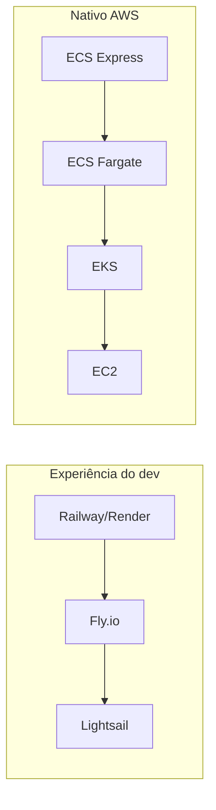
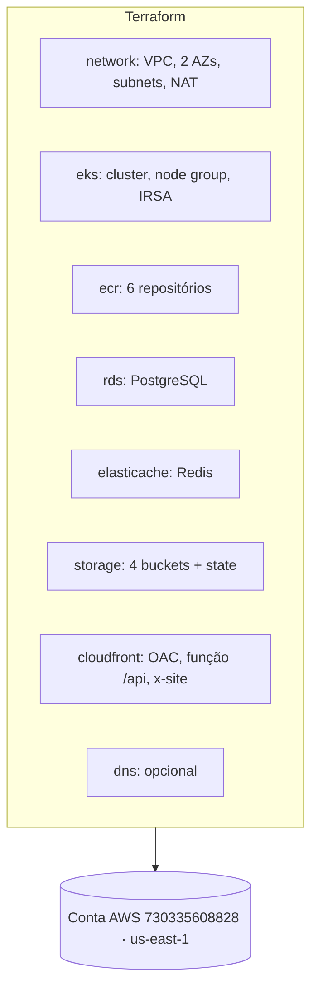
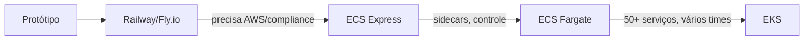

# Nuvem, deploy e custos

<span class="study-tag prova">prova</span><span class="study-tag projeto">projeto</span>

Nuvem é um modelo operacional, não apenas um servidor alugado. Ele tem cinco características do NIST, uma matriz de responsabilidades e um custo que continua correndo quando ninguém usa o sistema. Três perguntas ajudam a organizar o assunto: quem opera o quê, quanto custa o idle e por que não escolher a opção mais simples.

---

## 1. O que faz um serviço ser "nuvem"

| Característica (NIST) | Significado | No projeto |
| --- | --- | --- |
| Autoatendimento sob demanda | Provisiona sem falar com humano | `terraform apply` cria RDS/EKS |
| Amplo acesso pela rede | Protocolos padrão | HTTPS no CloudFront; API |
| Pool de recursos | Multi-tenant, isolado | Nós EKS compartilhados com outros tenants da AWS |
| Elasticidade rápida | Sobe/desce rápido | HPA 2–6; CA 2–6 nós |
| Serviço medido | Cobra por uso | vCPU-hora, GB, requisições |

**CapEx × OpEx:** comprar servidor é pagamento antecipado para o pico esperado; nuvem é pagamento pelo uso. OpEx não é automaticamente mais barato: carga máxima 24/7 por anos pode custar mais na nuvem. A vantagem é não apostar capacidade.

!!! info "Modelo de serviço ≠ modelo de implantação"
    Serviço (IaaS/PaaS/SaaS) diz **quanto você opera**. Implantação (pública/privada/híbrida/comunitária) diz **quem compartilha** a infraestrutura. Não confunda os eixos.

---

## 2. A pilha de responsabilidade

| Camada | On-prem | IaaS | CaaS | PaaS | FaaS | SaaS |
| --- | --- | --- | --- | --- | --- | --- |
| Dados e acesso | você | você | você | você | você | você |
| Aplicação | você | você | você | você | você | provedor |
| Middleware | você | você | você | provedor | provedor | provedor |
| SO | você | você | provedor | provedor | provedor | provedor |
| Virtualização | você | provedor | provedor | provedor | provedor | provedor |
| Hardware | você | provedor | provedor | provedor | provedor | provedor |

Três leituras que valem nota:

1. **A linha de dados nunca sai do cliente.** A AWS chama isso de segurança *da* nuvem (provedor) versus segurança *na* nuvem (cliente). Bucket público, banco aberto e chave vazada são falhas do cliente.
2. **CaaS e PaaS diferem em uma camada: middleware.** No CaaS, o JDK está na sua imagem; no PaaS, a plataforma o fornece.
3. **PaaS e FaaS têm a mesma matriz**; muda o tamanho da unidade (aplicação × função).

!!! example "Quem age quando algo acontece?"
    - Disco falha: provedor em IaaS/CaaS/PaaS/FaaS/SaaS.
    - Falha no JDK: você em CaaS; provedor em PaaS.
    - Bug na aplicação: você em todos, exceto SaaS.
    - Chave vaza: você em todos.

---

## 3. Os modelos na prática

| Modelo | Você entrega | Exemplos | Escolha quando | Evite quando |
| --- | --- | --- | --- | --- |
| **IaaS** | VM, SO, runtime | EC2, Lightsail | Controle total, custo fixo | Não quer patch de SO |
| **CaaS** | Imagem | ECS/Fargate, EKS, Cloud Run | Já tem containers; portabilidade | Quer esquecer infra |
| **PaaS** | Código | Railway, Render, Beanstalk, App Service | MVP, time pequeno | Precisa de software específico |
| **FaaS** | Função | Lambda, Cloud Functions | Eventos esporádicos, curto | Latência estável, tráfego alto |
| **SaaS** | Uso | GitHub, Grafana Cloud, Datadog | Commodity | Precisa de controle/portabilidade |

### FaaS: cold start e o ponto de equilíbrio

| Prós | Contras |
| --- | --- |
| Escala a zero, paga por invocação | Cold start (segundos com Spring) |
| Sem servidor para operar | Limite de execução (15 min no Lambda) |
| Ótimo para eventos esporádicos | Caro em tráfego alto e constante |

A aula mostra o ponto de equilíbrio: com 1 M req/mês, 100 ms, 512 MB, o FaaS custa ~US$ 1 enquanto duas tasks Fargate custam ~US$ 36 e duas VMs ~US$ 61. O FaaS deixa de ser mais barato por volta de **34,9 M req/mês** (≈ 13,3 req/s). Em 1 B req/mês, FaaS ~US$ 1.033 × Fargate ~US$ 216 × VMs ~US$ 91. **A unidade mais barata vence em escala alta e constante.**

### Containers "serverless"

Cloud Run e Azure Container Apps escalam a zero e cobram por uso, mas rodam qualquer imagem. "Serverless" descreve o **modelo de operação**, não apenas funções.

---

## 4. O espectro de deploy



| Plataforma | Esconde | Você gerencia | Ideal |
| --- | --- | --- | --- |
| Railway/Render | quase tudo | env, domínio | protótipo, time pequeno |
| Fly.io | infra, regiões | Dockerfile, máquinas | apps globais |
| Lightsail | hardware | SO/runtime | orçamento fixo, primeiro deploy |
| ECS Express | LB, escala, rede | imagem, env, roles | serviço stateless na AWS |
| ECS Fargate | nós | task definition, escala | produção média |
| **EKS** | control plane | node groups, add-ons, rede | vários times, 50+ serviços |
| EC2 | nada | tudo | controle/custo extremo |

!!! warning "EKS em time pequeno é passivo"
    Só o control plane custa **US$ 0,10/h ≈ US$ 73/mês**; com 2 nós, NLB e NAT, chega-se a ≈ US$ 180/mês **antes de tráfego**. A aula é explícita: para 1–5 devs e < 10 serviços, Railway/Render/Lightsail/ECS Express são melhores. O projeto usa EKS **para aprender**, e isso deve ser dito — não justificado como eficiência.

### Add-ons de um EKS "de verdade"

| Add-on | Função |
| --- | --- |
| **Karpenter** | Provisiona o tipo de nó certo para pods Pending |
| **Cluster Autoscaler** | Alternativa ao Karpenter (usada no projeto) |
| **AWS Load Balancer Controller** | Cria ALB/NLB a partir de Ingress/Service |
| **Argo CD** | GitOps: cluster reconcilia do Git |
| **External Secrets Operator** | Sincroniza Secrets Manager/Vault |
| **metrics-server** | Habilita HPA |

No projeto: metrics-server + Cluster Autoscaler instalados; NLB criado por Terraform (não pelo controller); GitOps não usado; deploy shell-first. São escolhas conscientes, não desconhecimento.

---

## 5. A infraestrutura do projeto



| Recurso | Configuração | Observação |
| --- | --- | --- |
| VPC | 2 AZs, subnets públicas/privadas, 1 NAT | NAT é custo fixo e ponto único |
| EKS | 1.35, node group `t3.medium` 2–6 | 3 nós durante rollout |
| RDS | `db.t4g.micro`, 112 conexões, Single-AZ | backups 7 dias; PITR |
| ElastiCache | `cache.t4g.micro` | sem réplica/failover |
| S3 | mídia + 3 frontends + state | buckets privados, OAC |
| CloudFront | 1 distribuição, `PriceClass_100` | hostname público; sem domínio |
| NLB | internet-facing, HTTP 80 | SG só com prefixo do CloudFront |
| ECR | 6 repositórios | scan on push |

### Terraform: por que não console

| Prática | Efeito |
| --- | --- |
| Estado remoto em S3 + locking nativo | Time não sobrescreve estado |
| Módulos (`network`, `eks`, `rds`, `ecr`, `storage`, `cloudfront`, `dns`) | Reuso e revisão |
| `protect_state = true` | RDS deletion protection, snapshot final, buckets não vazios |
| IRSA | Pod assume role sem chave estática |
| Ambientes separados (`aws`, `staging`, `localstack`) | Mesmo código, parâmetros diferentes |

```bash
terraform -chdir=terraform/environments/aws init \
  -backend-config="bucket=platform-tfstate-<account>" \
  -backend-config="key=platform/aws.tfstate"
terraform -chdir=terraform/environments/aws plan
terraform -chdir=terraform/environments/aws apply
```

!!! warning "Apply não é deploy"
    Terraform cria VPC, EKS, RDS, ECR, S3 e CloudFront. **Workloads, HPAs, add-ons e Secrets** são aplicados depois por `kubectl`/script. Essa fronteira é explícita na documentação: IaC não é o mesmo que GitOps de aplicação.

### LocalStack e staging

| Modo | O que emula/prova | Limite |
| --- | --- | --- |
| LocalStack | Terraform + EKS (k3s) + ECR + RDS + ElastiCache + S3 + CloudFront | Rede não é real; sem HA; precisa token Student |
| Staging AWS | VPC própria, EKS 1 nó SPOT, RDS/ElastiCache/S3 privados, 1 réplica | Sem borda pública; não prova HA; manual |

Staging existe para **aceitação de versão** com dados sintéticos e telemetria separada (`deployment.environment=staging`), não para capacidade.

---

## 6. Custos: a conta que importa

Premissas: `us-east-1`, on-demand, 730 h/mês, sem créditos, novembro/2026.

| Recurso | Configuração | US$/mês |
| --- | --- | ---: |
| EKS control plane | 1 cluster | 73 |
| Worker nodes | 2 × `t3.medium` | 61 |
| Volumes dos nós | 2 × 20 GB gp3 | 3 |
| NAT gateway | 1 + IPv4 + 50 GB | 39 |
| RDS PostgreSQL | `db.t4g.micro` Single-AZ, 20 GB | 14 |
| ElastiCache Redis | `cache.t4g.micro` | 12 |
| NLB | 1, ~1 LCU | 28 |
| CloudFront | 50 GB + 1 M req (free tier) | 0–5 |
| S3 | ~5 GB | 1 |
| ECR | ~5 GB | 2 |
| CloudWatch Logs | ~5 GB | 3 |
| Route 53 + ACM | opcional | 1 |
| **Total** | | **≈ 240** |

**≈ US$ 7,90/dia.** Mais da metade é custo fixo que roda sem tráfego: EKS + NAT + NLB ≈ US$ 140; nós ≈ US$ 64.

| Cenário | Nós | US$/mês |
| --- | ---: | ---: |
| Demo / baseline | 2 | ≈ 240 |
| Pico com 6 nós | 6 | ≈ 365 |
| Spot, 2 nós | 2 | ≈ 205 |
| Spot, 6 nós | 6 | ≈ 255 |
| Staging (1 × t3.xlarge SPOT) | 1 | ≈ 180–190 |
| Agendado 10 h × 5 dias | 2 | ≈ 80 |
| + observabilidade completa | 3 | ≈ 280 |

!!! danger "Orçamento de US$ 150 × run-rate de US$ 240"
    O budget alerta, não desliga. O run-rate contínuo cruza o limite em ~19 dias. Opções: operar agendado (~US$ 80), destruir após a demo ou usar Spot. Um pico de 6 nós consome o orçamento em ~12 dias. A conta é de **horas**, não de requisições.

### O que "escala para zero" não resolve

- EKS não tem stop: control plane, NAT, NLB, RDS e Redis continuam cobrando (~US$ 175 antes de compute).
- HPA de CPU não aceita `minReplicas: 0`; sem pod, não há métrica.
- Mesmo com zero pods, CoreDNS/ingress/autoscaler mantêm um nó vivo.
- NLB cobra enquanto o ingress existir.

**Zero de verdade = destroy** (ou snapshot final). Autoscaling compra elasticidade, não ociosidade.

### Armadilhas de billing

| Armadilha | Detalhe |
| --- | --- |
| Free tier não cobre EKS/NAT/NLB/IPv4/ECR/Route 53 | Nunca espere zero |
| EKS extended support | US$ 0,60/h (~US$ 438/mês) após o fim do suporte padrão |
| Egress | US$ 0,09/GB; NAT processing US$ 0,045/GB |
| RDS parado | Reinicia após 7 dias e continua cobrando storage/backups |
| ElastiCache | Não tem stop; delete/recreate |
| Snapshot final | ~US$ 0,095/GB-mês |
| Observabilidade | +70 GiB EBS, ~1,5–2 vCPU, provável terceiro nó |

!!! tip "FinOps em uma frase"
    Em demo, o custo é **hora ligada**, não tráfego. Em produção, é a soma de capacidade ociosa + egress + armazenamento. A decisão de arquitetura (EKS × Fargate × Railway) muda o **piso**, não só o teto.

---

## 7. Migração e decisão



| Sinal | Resposta |
| --- | --- |
| < 10 serviços, 1–5 devs | Railway/Render/Lightsail/ECS Express |
| Precisa de AWS, sem time de plataforma | ECS Fargate |
| Vários times, CRDs, Helm, GitOps | EKS |
| Carga esporádica e evento curto | FaaS |
| Carga alta e constante | Container/VM |

!!! warning "Portabilidade"
    O fechamento do App Runner para novos clientes (2026) mostra que produtos gerenciados mudam. Mantenha o artefato portável: container, variáveis de ambiente, Postgres, API padrão do Kubernetes. O projeto faz isso — a mesma imagem roda em Compose, MicroK8s, LocalStack e EKS.

---

## 8. Como responder

**"Por que EKS e não ECS/Railway?"**
> Porque o objetivo era aprender Kubernetes e operar a stack completa (HPA, PDB, probes, add-ons, IRSA). Para um produto real de 2–3 pessoas, ECS Fargate ou Railway seria mais barato e simples: o piso do EKS é ~US$ 73 + nós + NAT + NLB. A escolha é didática, e o custo está documentado.

**"Por que a conta é US$ 240 se o tráfego é mínimo?"**
> Porque 60% é custo fixo: control plane (73), NAT (39), NLB (28), RDS (14), Redis (12) e nós (61). Requisição quase não pesa; horas ligadas pesam. Por isso o budget de 150 exige agendar ou destruir.

**"O que é IRSA e por que importa?"**
> IAM Roles for Service Accounts: o pod assume uma role via token OIDC da service account, sem access key no container. O Product acessa o bucket de mídia com least privilege. É a versão Kubernetes de "credencial de workload", alinhada a Zero Trust.

**"Vocês usam GitOps?"**
> Não. O deploy é shell-first com Terraform + kubectl; os workflows manuais chamam o mesmo script via OIDC. GitOps (Argo CD) é o próximo passo para reconciliação contínua e auditoria, mas adicionaria um componente e um modelo operacional.

---

## Ordem de uma decisão de plataforma

<div class="study-order" data-items="Quantos serviços e quantos devs?|Precisa de AWS por compliance/créditos?|Há time dedicado de plataforma?|Carga é constante ou esporádica?|Qual o custo fixo mensal aceitável?|Escolher o menor modelo que atende|Migrar quando o problema for real" data-prompt="Ordene o roteiro de decisão de plataforma:"></div>

<div class="study-calc" data-answer="210" data-tolerance="2" data-unit="US$/mês">
  <p class="q">Qual é o custo fixo mensal aproximado de EKS + 2 nós + NAT + NLB + RDS + Redis (sem tráfego)?</p>
  <input type="number" step="1" inputmode="decimal" placeholder="US$">
  <button type="button">Conferir</button>
  <p class="explain">73 + 61 + 39 + 28 + 14 + 12 = 227; com volumes/armazenamento chega-se a ≈ 240. O número de referência do projeto é ≈ US$ 240/mês, ≈ US$ 7,90/dia.</p>
</div>

---

## Checkpoint

<div data-study-score></div>

<div class="study-quiz" data-answer="b">
  <p class="q">1. No CaaS, quem é responsável por aplicar patch no JDK?</p>
  <ul class="options">
    <li data-key="a">O provedor, porque ele gerencia o runtime.</li>
    <li data-key="b">Você, porque o JDK está dentro da sua imagem; o provedor cuida do SO dos hosts.</li>
    <li data-key="c">Ninguém: containers não têm JDK.</li>
    <li data-key="d">O Kubernetes, automaticamente.</li>
  </ul>
  <p class="explain">CaaS e PaaS diferem no middleware. No CaaS (EKS/ECS), a imagem inclui runtime e bibliotecas; patches dela são seus. O provedor gerencia host/OS.</p>
</div>

<div class="study-quiz" data-answer="d">
  <p class="q">2. Por que autoscaling não zera a conta do projeto?</p>
  <ul class="options">
    <li data-key="a">Porque o HPA não funciona sem PDB.</li>
    <li data-key="b">Porque o CloudFront cobra por pod.</li>
    <li data-key="c">Porque o RDS escala junto com os pods.</li>
    <li data-key="d">Porque EKS, NAT, NLB, RDS e Redis cobram por hora mesmo sem tráfego; zero exige destroy.</li>
  </ul>
  <p class="explain">HPA/CA ajustam pods e nós, mas o piso fixo (~US$ 175) permanece. EKS não tem stop; RDS/ElastiCache não têm stop persistente.</p>
</div>

<div class="study-quiz" data-answer="a">
  <p class="q">3. Quando o FaaS deixa de ser mais barato que containers sempre ligados?</p>
  <ul class="options">
    <li data-key="a">Em tráfego alto e constante, porque ele cobra por invocação e por GB-segundo, enquanto o container tem custo fixo.</li>
    <li data-key="b">Nunca: FaaS é sempre mais barato.</li>
    <li data-key="c">Quando o número de funções passa de 10.</li>
    <li data-key="d">Quando se usa Postgres.</li>
  </ul>
  <p class="explain">A aula calcula o cruzamento em ~34,9 M req/mês para 100 ms/512 MB. Acima disso, a unidade fixa (container/VM) dilui o custo; abaixo, o FaaS vence.</p>
</div>

<div class="study-quiz" data-answer="c">
  <p class="q">4. O que o Terraform do projeto não faz?</p>
  <ul class="options">
    <li data-key="a">Cria VPC, subnets e NAT.</li>
    <li data-key="b">Cria EKS, RDS, ECR e CloudFront.</li>
    <li data-key="c">Aplica Deployments, HPAs e add-ons no cluster.</li>
    <li data-key="d">Cria roles IRSA.</li>
  </ul>
  <p class="explain">A fronteira é explícita: infraestrutura no Terraform; workloads, HPA, metrics-server, CA e Secrets via kubectl/script. Isso não é GitOps.</p>
</div>

## Checklist

<div data-study-progress></div>

<label class="study-check"><input type="checkbox" data-key="n-stack"> Desenho a matriz de responsabilidade para IaaS/CaaS/PaaS/FaaS.</label>
<label class="study-check"><input type="checkbox" data-key="n-cost"> Recito os maiores itens de custo e por que o idle domina.</label>
<label class="study-check"><input type="checkbox" data-key="n-eks"> Justifico EKS × ECS × Railway por time, escala e custo.</label>
<label class="study-check"><input type="checkbox" data-key="n-tf"> Distingo Terraform, kubectl e GitOps.</label>
<label class="study-check"><input type="checkbox" data-key="n-stage"> Explico o que staging prova e o que não prova.</label>

!!! info "Continue"
    Custo e capacidade se encontram no teste de carga. [Performance e gargalos](13-performance-gargalos.md) conta a história com números. GitOps, WAF, DR e shutdown agendado estão em [O que não foi implementado](18-lacunas-e-evolucao.md).
