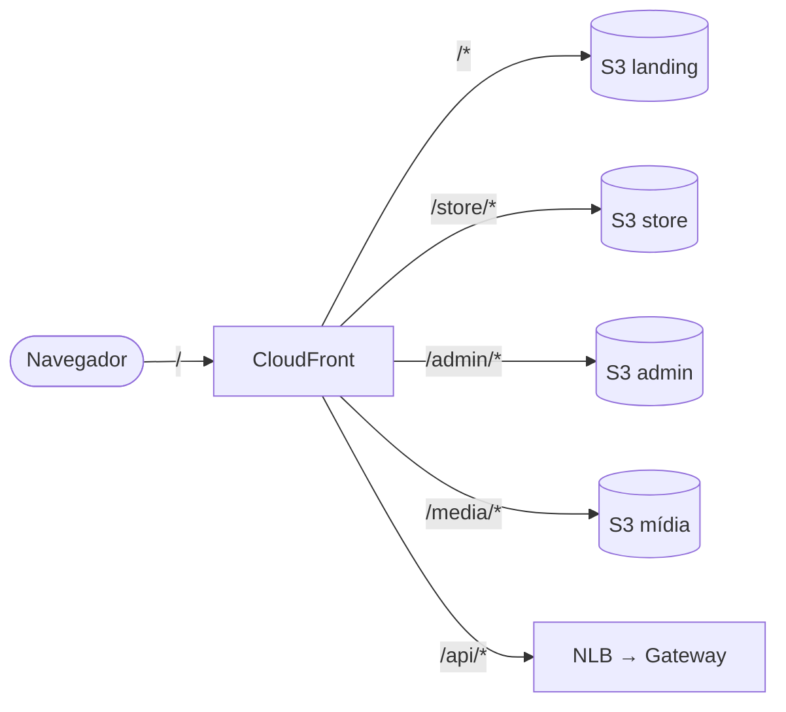

# Frontend e entrega

<span class="study-tag prova">prova</span><span class="study-tag projeto">projeto</span>

Três aplicações Next.js independentes são exportadas como estáticas e servidas no mesmo domínio, em caminhos diferentes. Não há servidor Next.js em produção, BFF nem sessão no frontend. A simplicidade operacional vem com renúncias: SSR, sessão no servidor e segredos no cliente.

---

## 1. Três apps, um domínio

| App | Caminho | Experiência |
| --- | --- | --- |
| **Landing** | `/` | Apresentação, catálogo em destaque, privacidade |
| **Store** | `/store/` | Catálogo, detalhe, carrinho, login, pedidos demo |
| **Admin** | `/admin/` | Visão restrita, produtos, contas, links de observabilidade |

Cada app é um repositório/submodule com seu `package.json`, lockfile, testes, Dockerfile e CI. Não há monorepo JavaScript nem module federation: a integração é por **convenção de rotas e contrato de API**.



### Static export

`output: 'export'`, `trailingSlash: true`, imagens não otimizadas. O build gera HTML/CSS/JS; não há server actions, route handlers de sessão nem SSR em runtime.

| Ganho | Custo |
| --- | --- |
| CDN global, cache, custo quase zero | Sem SSR/SEO dinâmico por request |
| Cluster não serve HTML | Build por ambiente (variáveis `NEXT_PUBLIC_*` são congeladas) |
| Superfície de ataque menor | Sessão precisa ser cookie do backend |
| Deploy independente por app | Roteamento por path exige regra de borda |

!!! warning "Variável pública é congelada no build"
    `NEXT_PUBLIC_API_BASE_URL`, `NEXT_PUBLIC_FARO_URL`, `NEXT_PUBLIC_APP_VERSION` entram no bundle. Mudou? Rebuild e re-sync. E nunca coloque segredo em `NEXT_PUBLIC_*`.

---

## 2. Roteamento por caminho e o bug do cache

O CloudFront precisa distinguir `/`, `/store/*` e `/admin/*`. Cada app tem `basePath` fixo e assets sob seu prefixo.

Um detalhe importante: os três apps reescrevem rotas desconhecidas para `/index.html`. Sem distinguir a origem, o CloudFront serviria **o mesmo cache entry** para os três. A solução foi uma **CloudFront Function** que:

1. remove o prefixo `/api` antes de encaminhar ao NLB;
2. adiciona o header `x-site` (`landing`, `store`, `admin`);
3. inclui `x-site` na **cache key**.

```js
// função de borda (resumo conceitual)
function handler(event) {
  var req = event.request;
  var uri = req.uri;
  if (uri.startsWith('/api/')) {
    req.uri = uri.replace(/^\/api/, '');
    return req;
  }
  var site = uri.startsWith('/store/') ? 'store'
           : uri.startsWith('/admin/') ? 'admin' : 'landing';
  req.headers['x-site'] = { value: site };
  return req;
}
```

!!! tip "Lição de arquitetura"
    Cache key é parte do contrato. Um header que não entra na chave é invisível para o cache; um que entra divide o cache. O bug "todo mundo vê o primeiro site" é um caso claro de **estado compartilhado acidental** na borda.

### API e CORS

O navegador chama `/api/*` na mesma origem, então **não há CORS** no caminho normal. CORS aparece no upload direto para o S3 (URL pré-assinada), configurado para a origem do CloudFront e os headers `PUT`, `Content-Type`, `If-None-Match`. A borda remove `/api`; o Gateway espera `/products`, `/auth/login` etc.

---

## 3. Sessão: o backend é dono

| Endpoint | Função |
| --- | --- |
| `GET /session/csrf` | Emite token CSRF + cookie |
| `POST /session/login` | Autentica, seta cookie HttpOnly, 204 sem token no corpo |
| `GET /session` | Valida token e devolve perfil |
| `DELETE /session` | Limpa cookie (sem prometer revogação) |

| Atributo | Valor | Por quê |
| --- | --- | --- |
| Nome | `ms52-session` | Host-only |
| `HttpOnly` | sim | JS não lê |
| `SameSite` | `Lax` | Reduz CSRF sem quebrar navegação |
| `Path` | `/api` | Escopo mínimo |
| `Secure` | sim (exceto HTTP local) | Só TLS |

O Gateway troca cookie por `Authorization: Bearer` internamente. Clientes de API com Bearer continuam funcionando. O frontend nunca vê o JWT.

!!! warning "CSRF não é opcional com cookie"
    O navegador envia o cookie automaticamente em qualquer site que faça a requisição. Sem token CSRF e `SameSite`, uma página maliciosa pode criar pedidos em nome do usuário. Toda mutação busca o token primeiro.

!!! note "Por que não guardar no localStorage?"
    Porque qualquer XSS lê `localStorage`. Cookie `HttpOnly` não é acessível por JS. O preço (CSRF) é menor e mais controlável que o preço de um token roubado.

---

## 4. Autorização no frontend é cosmética

O route guard do admin **não é segurança**: é UX. A autorização real acontece no Gateway (papel) e no serviço (propriedade). Se o guard falhar, a API ainda deve retornar 401/403.

| Recurso | Gateway | Serviço |
| --- | --- | --- |
| Escrita de produto | `ROLE_ADMIN` | Product também exige |
| Listar/remover contas | `ROLE_ADMIN` | Account valida; não permite autoexclusão nem remover admin |
| Pedidos | autenticado | Order valida dono (404) |
| Perfil | autenticado | Account `/accounts/me` |

!!! danger "Nunca confie no cliente"
    Esconder um botão não é autorização. Vale manter essa distinção: **UI guard = apresentação; policy = backend**.

---

## 5. Estado, carrinho e dados

| Tema | Decisão | Motivo |
| --- | --- | --- |
| Data fetching | TanStack Query | Cache, retry limitado, cancelamento |
| Validação | Zod (schemas) | Resposta de API não confiável |
| Formulários | React Hook Form | Menos re-render |
| Tabelas | TanStack Table | Ordenação/paginação explícitas |
| Carrinho | `localStorage` `ms52-cart-v1` | Sem Cart service; sobrevive ao reload |
| Busca | local no array | Catálogo pequeno; sem endpoint de busca |
| Paginação | local, 10 linhas | Sem contrato de paginação no backend |

**Carrinho:** guarda apenas IDs e quantidades positivas. No checkout, o Order recebe IDs/quantidades e calcula o preço autoritativo. O carrinho não é fonte de preço. Se a resposta do pedido é incerta, a UI orienta olhar o histórico antes de repetir — porque não há chave de idempotência.

!!! warning "Carrinho local não é checkout offline"
    O PWA é **online-only**: não há service worker, cache de resposta privada nem replay de escrita. O carrinho sobrevive ao reload, mas o pedido exige rede e sessão. Colocar dados privados em cache de service worker seria um risco de segurança.

---

## 6. PWA, telemetria e privacidade

| Item | Decisão |
| --- | --- |
| Manifest | `/store/manifest.webmanifest`, start/scope `/store/` |
| Service worker | Não |
| Instalação | Ação do navegador; sem botão enganoso |
| Faro | Inicializa se `NEXT_PUBLIC_ENABLE_TELEMETRY=true` e URL existe |
| Umami | Script oficial, após interactive; eventos demo |
| Opt-out / DNT | Respeitados |
| Source maps | Não enviados |

### Redação

Antes de enviar, o hook do Faro remove query strings, metadados de usuário, contexto de medição e mensagens cruas de erro. Rotas privadas e buscas com UUID são ignoradas; navegação privada normaliza para `/store/private`. Console capture desligado.

| Evento Umami | Quando |
| --- | --- |
| `demo_store_opened` | Abertura da loja |
| `demo_cart_item_added` | Item adicionado |
| `demo_order_created` | **Após** 201 da API |
| `demo_order_failed` | Falha |

Só o nome da aplicação vai como propriedade. Não são eventos financeiros.

!!! tip "Observabilidade de frontend é diferente"
    Faro mede spans de browser, Web Vitals e exceções. A **propagação de trace** para o backend é limitada ao catálogo público, porque rotas privadas exigem revisão de CORS/privacidade. Dizer isso mostra maturidade: telemetria não pode vazar dado privado.

---

## 7. Dois modos de teste

| Modo | O que sobe | Prova | Não prova |
| --- | --- | --- | --- |
| **Real services** | Compose completo + Nginx | Fluxo integrado real | Nuvem, CDN |
| **Fixture demo** | `compose.frontend-demo.yml` + API de fixtures | UI, estados, formulários | Integração, segurança, S3 |

O modo fixture é visivelmente rotulado e descartável. Ele nunca deve ser citado como evidência de integração — a documentação é explícita.

### Prerequisitos ainda abertos

| Item | Limite |
| --- | --- |
| Product real | GET anônimo, permissão de escrita, payload, `/media/` |
| Order | Retorna `productId`; rejeita não-USD |
| Exchange | Rota diverge entre doc e Gateway |
| Idempotência | Não documentada; UI previne duplo clique |
| Admin | Sem edição de conta/produto, estoque, relatórios |

---

## 8. Como responder

**"Por que static export e não SSR?"**
> Porque o conteúdo é catálogo público e o estado privado vem de API autenticada. Static + CDN elimina servidor de frontend, reduz custo e superfície de ataque, e simplifica o deploy. O custo é não ter SSR/SEO dinâmico nem BFF; para uma loja demo, não se paga.

**"Onde fica a sessão?"**
> Em um cookie HttpOnly emitido pelo Gateway, com CSRF e `SameSite=Lax`. O frontend não lê o token; o Gateway o traduz para Bearer. Isso evita XSS de token e mantém clientes de API funcionando.

**"Como os três apps não se misturam no cache?"**
> Cada um tem base path e buckets separados; uma função de borda adiciona `x-site` e o header entra na cache key. Sem isso, o rewrite para `/index.html` fazia os três compartilharem a mesma entrada.

**"O PWA funciona offline?"**
> Não. É um manifest instalável, sem service worker. Cachear respostas privadas e reenviar escritas offline seria um risco; o escopo é online-only, e a documentação diz isso.

---

## Checkpoint

<div data-study-score></div>

<div class="study-quiz" data-answer="c">
  <p class="q">1. Qual é o papel do header `x-site` na borda?</p>
  <ul class="options">
    <li data-key="a">Autenticar o usuário no Gateway.</li>
    <li data-key="b">Compactar a resposta.</li>
    <li data-key="c">Distinguir landing/store/admin na cache key, evitando que o rewrite para `/index.html` compartilhe a mesma entrada.</li>
    <li data-key="d">Definir o idioma da página.</li>
  </ul>
  <p class="explain">Sem um discriminador na cache key, os três sites disputam a mesma entrada e o primeiro cacheado vence para todos.</p>
</div>

<div class="study-quiz" data-answer="b">
  <p class="q">2. Por que o token não fica no `localStorage`?</p>
  <ul class="options">
    <li data-key="a">Porque o localStorage é lento.</li>
    <li data-key="b">Porque qualquer XSS pode lê-lo; cookie HttpOnly não é acessível por JS.</li>
    <li data-key="c">Porque o Next.js não suporta localStorage.</li>
    <li data-key="d">Porque o token expira mais rápido.</li>
  </ul>
  <p class="explain">O cookie HttpOnly troca o risco de XSS-token pelo de CSRF, mitigado com token CSRF e SameSite. É um trade-off controlável.</p>
</div>

<div class="study-quiz" data-answer="d">
  <p class="q">3. O route guard do `/admin` é suficiente para autorizar?</p>
  <ul class="options">
    <li data-key="a">Sim, porque o bundle é privado.</li>
    <li data-key="b">Sim, desde que use HTTPS.</li>
    <li data-key="c">Sim, se o usuário não souber a URL.</li>
    <li data-key="d">Não: é UX. A autorização real é no Gateway e no serviço dono.</li>
  </ul>
  <p class="explain">Qualquer cliente pode chamar a API diretamente. O guard apenas evita renderizar uma tela que a API negaria; a policy precisa existir no backend.</p>
</div>

## Checklist

<div data-study-progress></div>

<label class="study-check"><input type="checkbox" data-key="f-static"> Explico static export, base path e o papel do CDN.</label>
<label class="study-check"><input type="checkbox" data-key="f-cache"> Conto o bug do x-site e por que cache key é contrato.</label>
<label class="study-check"><input type="checkbox" data-key="f-session"> Desenho o fluxo cookie/CSRF e justifico contra localStorage.</label>
<label class="study-check"><input type="checkbox" data-key="f-limits"> Distingo fixture de integração real e listo o que falta.</label>

!!! info "Continue"
    Hora de juntar tudo: [Estudo de caso ponta a ponta](15-estudo-de-caso.md). Cart server-side, SSR/BFF e admin completo estão em [O que não foi implementado](18-lacunas-e-evolucao.md).
