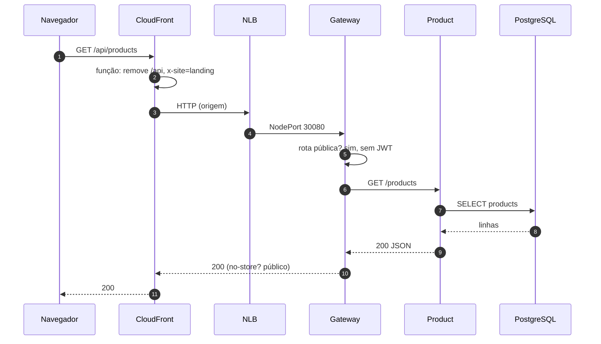
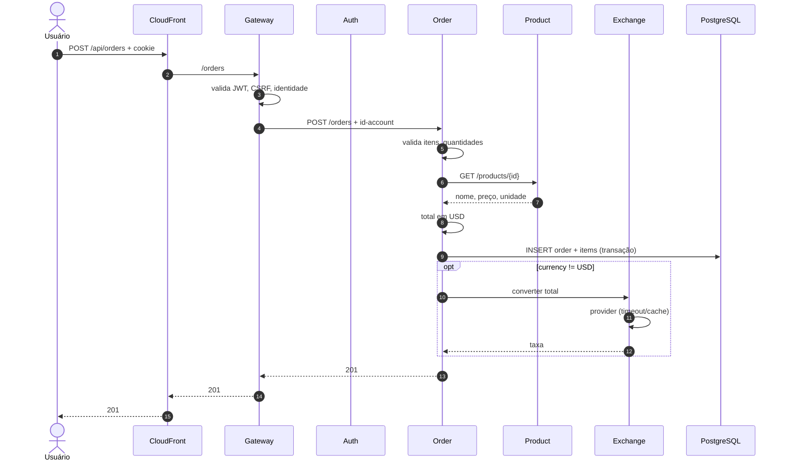

# Estudo de caso ponta a ponta

provaprojeto

Este capítulo junta as peças e mostra como elas se sustentam em conjunto. Não basta repetir a documentação em ordem; o que se espera é navegar entre decisões: se mudar isso, o que quebra? Quanto custa? Como você mede?

---

## 1. O sistema em um parágrafo

Um navegador acessa o CloudFront, que serve três frontends estáticos de buckets privados e encaminha `/api/*` para um NLB restrito ao prefixo do CloudFront. O NLB entrega ao Gateway (NodePort), única porta de entrada da aplicação. O Gateway valida o JWT, aplica CSRF e autorização de papel e roteia para Auth, Account, Product, Order ou Exchange — todos ClusterIP, com duas réplicas, probes, HPA e PDB. Auth lê credenciais via Account; Order lê preços no Product. A conversão via Exchange está prevista no contrato, mas a implementação checada ainda rejeita moeda ≠ USD (422); o Exchange isola o provedor externo. Todos os serviços de banco usam o mesmo RDS e a mesma base `platform`, com tabelas de cada serviço (propriedade por convenção). Métricas vão ao Prometheus/Mimir, logs ao Loki, traces ao Tempo via Alloy, e o Grafana alerta sobre SLOs. Tudo é provisionado por Terraform; o deploy é shell-first com imagens imutáveis.

---

## 2. Dois caminhos, passo a passo

### Leitura de catálogo (anônima)

| Etapa | O que pode falhar | Sinal | Mitigação |
| --- | --- | --- | --- |
| CloudFront | Config/edge | 5xx na borda | Terraform + invalidação |
| NLB | SG/origem | timeout | SG só CloudFront; health |
| Gateway | CPU, auth | p95, 5xx | 2 réplicas, HPA |
| Product | pool, CPU | Hikari, p95 | pool 8, HPA 6 |
| RDS | conexões, CPU | `DatabaseConnections` | tuning/RDS maior |

### Criação de pedido (autenticada; conversão prevista)

!!! warning "O que é contrato e o que é estado atual"
    O diagrama mostra o **contrato-alvo**: converter para a resposta. Na implementação checada, o branch de conversão nem executa — `?currency` ≠ USD retorna **422** antes de chamar o Exchange. Se a integração for ativada, aparece o risco de projeto: se a conversão falhar depois do commit, o pedido existe em USD e a resposta falha, sem compensação. É a escrita dupla sem outbox aplicada ao caminho de leitura; a correção é converter antes do commit ou tratar a conversão como efeito opcional/assíncrono.

---

## 3. Registro de decisões (o coração da arguição)

| # | Decisão | Por quê | Alternativa descartada | Custo/risco aceito |
| --- | --- | --- | --- | --- |
| 1 | Gateway único público | Política central, superfície mínima | Cada serviço com Ingress | Gateway é crítico e gargalo |
| 2 | JWT HMAC + validação local | Simples, sem JWKS | OAuth/OIDC completo | Segredo distribuído; revogação só por expiração (900 s) |
| 3 | Cookie HttpOnly + CSRF | Frontend estático, sem BFF | Token no localStorage | CSRF precisa ser tratado |
| 4 | Serviços em submodules | Releases independentes | Monorepo | Ponteiro duplo, clone recursivo |
| 5 | Banco único, tabelas por serviço | Custo/operação | Base e role por serviço | Isolamento só por convenção; limite de conexões |
| 6 | Comunicação síncrona | Simplicidade, resposta imediata | Kafka/eventos | Acoplamento de disponibilidade |
| 7 | Sem Kafka | Escopo e custo | MSK/Strimzi | Pós-pedido no request path |
| 8 | Static export + CDN | Custo, cache, segurança | Next.js SSR | Sem SSR/BFF |
| 9 | EKS | Aprendizado, portabilidade | ECS/Railway | Piso de ~US$ 175/mês |
| 10 | RDS Single-AZ | Custo | Multi-AZ | Sem failover automático |
| 11 | Pool 8 | Equilíbrio medido | 5 (fila) / 10 (slots) | Pior caso ainda estoura 112 |
| 12 | HPA 2–6, 70% | Reage a carga | KEDA/custom metrics | Teto antes do banco |
| 13 | Observabilidade self-hosted | Controle, custo, aprendizado | Grafana Cloud | Operação e +1 nó |
| 14 | Deploy shell-first | Auditoria, menos segredo em CI | GitOps/Argo | Manual, não contínuo |
| 15 | Sem domínio custom | Escopo | Route 53 + ACM | URL feia, sem cookies de domínio |

!!! tip "Como usar esta tabela"
    Em qualquer pergunta "por que X?", responda em quatro partes: **decisão → motivo → alternativa → custo**. Isso demonstra que você entende o trade-off, não só o resultado.

---

## 4. Simulacro de falhas

| Falha | Efeito imediato | O que o projeto faz | O que falta | SLI |
| --- | --- | --- | --- | --- |
| Pod de Product morre | 1 de 2 réplicas some | ReplicaSet recria; readiness | — | breve perda de capacidade |
| Nó inteiro cai | Pods do nó somem | Recriação; PDB não cobre falha involuntária | Anti-affinity/spread | indisponibilidade parcial |
| AZ cai | Se ambas réplicas estavam lá, Product cai | Node group em 2 AZs | Spread explícito; RDS Single-AZ | indisponibilidade total do serviço |
| RDS falha | Todos os serviços de banco falham | Backups/PITR | Multi-AZ | catálogo, pedidos, contas |
| Exchange/provedor lento | Hoje não afeta o pedido (não-USD = 422); com a integração ativa, a conversão pendura | Timeout (5 s), cache curto | Breaker/fallback explícito | p95 do checkout (quando ativo) |
| Deploy ruim | Nova versão falha | Readiness segura o rollout; `undo` | — | erro só na fração nova |
| Pico 400 req/s | p95 sobe | HPA 2→6, CA se Pending | HPA max/CPU; pool | p95 > 1 s |
| Token roubado | Acesso até expirar | Token de 900 s | Refresh/revogação | janela de 15 min |
| Upload malicioso | Custo/abuso | Validação, presigned, limite | WAF/rate limit ativo | 4xx/429 |
| Segredo vazado | Acesso ao banco/S3 | Secret + IRSA; rotação manual | Secrets Manager/Vault | incidente |

!!! example "Pergunta frequente: 'e se o banco cair?'"
    "Todos os serviços que usam Postgres falham: catálogo, pedidos e contas. Auth também depende de Account para credenciais, então login falha. O Gateway continua de pé, mas retorna 5xx/503. Como o RDS é Single-AZ, a recuperação é restore/PITR (RTO 1 h, RPO 5 min), não failover de 1 min. O SLO de 99,5% absorve parte disso, mas um evento longo estoura o budget. A correção é Multi-AZ; o custo sobe."

---

## 5. Defesa oral: 12 perguntas e respostas

**1. Por que microsserviços e não um monólito?**
> Objetivo didático e fronteiras de domínio claras. O custo é operacional: seis pipelines, service discovery, observabilidade, banco com limite. Para um produto real com 2–3 pessoas, o monólito modular seria a escolha inicial.

**2. O que é database-per-service se há um só servidor?**
> Propriedade lógica por convenção: cada serviço só consulta as suas tabelas e os outros dados vêm por API. Não há isolamento físico — todos usam a base `platform` —, então nada no banco impede uma query cruzada; a garantia é revisão e contrato. O limite de 112 conexões é a evidência do trade-off de compartilhar o servidor.

**3. Por que o Gateway valida o token e os serviços validam de novo?**
> Defesa em profundidade: a borda rejeita cedo; o serviço rejeita mesmo se for alcançado por dentro e checa o dono do objeto. O custo é o mesmo segredo HMAC em todos, então um serviço comprometido pode assinar tokens. A correção é RS256/ES256 + JWKS, com só o Auth tendo a chave privada.

**4. Como garantem que um usuário não lê o pedido de outro?**
> O Order verifica a propriedade e retorna 404. Autenticação no Gateway não basta; é o OWASP API #1 (BOLA). O admin também é validado no serviço, não só na UI.

**5. Qual o SLO e como ele vira alerta?**
> 99,5% em 28 dias, error budget de 3 h 22 min. Alertas de disponibilidade e burn rate; o stack local usa < 99% por 5 min (page) e < 99,5% por 30 min (ticket). O p95 de produto é 300 ms e o de pedido, 800 ms.

**6. O que acontece se o Exchange ficar lento?**
> Hoje o Order não chama o Exchange para moeda ≠ USD: retorna 422, então o caminho de conversão não está exposto. Com a integração ativa, o Order precisa de timeout e erro explícito — nunca inventar taxa. O Exchange já tem timeout no provedor e cache curto; faltam breaker/fallback e o teste de falha do provedor.

**7. Por que não há Kafka?**
> Escopo e custo. O fluxo principal é síncrono e funciona; o que falta é desacoplar efeitos pós-pedido. A evolução correta é outbox + consumidor idempotente, não "colocar Kafka" por si só.

**8. Como o HPA e o banco interagem?**
> HPA escala pods por CPU, mas cada pod abre conexões. Com 3 serviços × 6 réplicas × 8 = 144, acima de 112. O pool precisa ser ≤ 6 no pior caso, ou o RDS precisa ser maior/PgBouncer. Na medição, o Hikari abriu 52 porque nem tudo estava no pico.

**9. Por que o teste com pool 10 parecia bom e era ruim?**
> Zero erros durante o teste, mas os slots do RDS foram consumidos e dois pods não subiram depois. A pós-condição é parte do teste. Pool 5 mostrou o outro extremo: fila no Hikari e 107 5xx.

**10. Como vocês observam um pedido específico?**
> Pelo `trace_id`: o trace no Tempo mostra os spans por serviço; o log estruturado no Loki tem o mesmo ID; as métricas RED mostram se é sistêmico. O traceparent W3C propaga; o agente Java injeta.

**11. Qual o maior risco arquitetural hoje?**
> RDS Single-AZ + cadeia síncrona + ausência de outbox. O banco é ponto único de dados; a cadeia acopla disponibilidade; e uma falha após o commit não é reprocessada. A ordem de correção: Multi-AZ, breaker no Exchange, outbox.

**12. O que você faria com mais tempo/dinheiro?**
> Multi-AZ, pool dimensionado/PgBouncer, GitOps com Argo CD, spread por zona, NetworkPolicy default-deny, traces no Exchange, teste de caos do provedor e um domínio customizado com ACM. Cada item com o custo e o SLI que melhora.

---

## 6. Perguntas armadilha

| Pergunta | Armadilha | Resposta segura |
| --- | --- | --- |
| "Vocês têm HA?" | "Sim, temos 2 réplicas" ignora AZ/DB | "HA de processo e nó; não de zona/região por causa do RDS Single-AZ e da falta de spread" |
| "O sistema aguenta 400 req/s?" | O alvo era 400, a medição 299,6 | "Sustentou ~300 req/s de leitura com zero erro; 400 não foi atingido e o p95 ficou em 1,25 s" |
| "Kafka resolve?" | Evento não é bala de prata | "Resolve desacoplamento, mas adiciona consistência eventual, outbox, idempotência e operação; só se o acoplamento for problema" |
| "Qual a disponibilidade?" | Citar 99,9% sem janela/composição | "SLO 99,5% em 28 dias; a composição série reduz o teto e o RDS Single-AZ limita" |
| "É seguro?" | "Tem JWT" | "Defesa em profundidade com lacunas: sem mTLS/NetworkPolicy completa; WAF preparado, não anexado" |
| "Custa quanto?" | Citar só compute | "≈ US$ 240/mês; ~70% é fixo (EKS, NAT, NLB, RDS, Redis), não tráfego" |
| "Por que EKS?" | "Porque é o padrão" | "Para aprender; para produto real, ECS Fargate/Railway teriam custo e operação menores" |

---

## 7. Apresentação de 10 minutos

| Minuto | Conteúdo | Frase-âncora |
| --- | --- | --- |
| 0–1 | Problema e escopo | "Loja demo; o objetivo é engenharia de integração" |
| 1–3 | Arquitetura | "CloudFront → NLB → Gateway → serviços → RDS" |
| 3–5 | Decisões e por quês | "Gateway único, banco único com tabelas por serviço, síncrono por enquanto" |
| 5–7 | Operação e SLO | "99,5%, error budget, RED + traces" |
| 7–9 | Performance | "Pool 10→5→8; gargalo final é HPA/nós, não o banco" |
| 9–10 | Limites e próximos passos | "Multi-AZ, outbox, breaker, GitOps" |

!!! tip "Ensaie a narrativa de falha"
    Quem avalia lembra de histórias, não de listas. "O pool 10 derrubou dois pods depois do teste" é memorável e mostra que você mediu. Use números específicos e diga o que aprendeu.

---

## 8. Desenho no quadro (faça de memória)

1. Desenhe a borda: navegador → CloudFront → (S3 | NLB → Gateway).
2. Desenhe o namespace com seis serviços e o Gateway no centro.
3. Ligue Order → Product e Order → Exchange (previsto); Auth → Account.
4. Desenhe um cilindro único de Postgres com três grupos de tabelas (`accounts`, `products`, `orders`); marque "112 conexões".
5. Desenhe o Redis ao lado, com um X e "CACHE_ENABLED=false".
6. Desenhe a caixa de observabilidade (Prometheus, Mimir, Loki, Tempo, Grafana, Alloy).
7. Marque os pontos únicos: RDS, NAT, NLB, região.
8. Escreva os números: 2 réplicas, HPA 2–6, 99,5%, 3 h 22 min, US$ 240.

Se você consegue desenhar isso em 3 minutos e explicar cada seta, está pronto.

---

## Checkpoint final

  
1. Qual é a resposta mais completa para "o que acontece se o RDS cair"?

  <ul class="options">
    <li data-key="a">O Kubernetes reinicia o RDS automaticamente.</li>
    <li data-key="b">Catálogo, pedidos, contas e login falham; o Gateway responde erro; Single-AZ exige restore (RTO 1 h, RPO 5 min); Multi-AZ é a correção.</li>
    <li data-key="c">Só o catálogo falha, porque os outros usam cache.</li>
    <li data-key="d">O HPA cria um banco novo.</li>
  </ul>
  
O banco é ponto único de dados; Auth depende de Account para credenciais. RDS Single-AZ não tem failover automático de baixa latência. O SLO absorve parte, mas não tudo.

  
2. Qual é a afirmação **mais defensável** sobre capacidade?

  <ul class="options">
    <li data-key="a">O sistema suporta 400 req/s porque o teste mirava 400.</li>
    <li data-key="b">O banco é o gargalo porque tem 52 conexões.</li>
    <li data-key="c">Sustentou ~300 req/s de leitura com zero erro e p95 1,25 s; o teto é HPA/nós e o SLO de latência não foi cumprido.</li>
    <li data-key="d">O Cluster Autoscaler resolveu o pico adicionando nós.</li>
  </ul>
  
O alvo de 400 não foi atingido; 52/112 é folga; não houve evento do CA. Capacidade sem latência não é conformidade.

  
3. O que mais falta para a arquitetura desacoplar o pós-pedido?

  <ul class="options">
    <li data-key="a">Outbox transacional + consumidor idempotente (e DLQ), não apenas um broker.</li>
    <li data-key="b">Mais réplicas do Gateway.</li>
    <li data-key="c">Um domínio customizado.</li>
    <li data-key="d">Trocar JWT por sessão em memória.</li>
  </ul>
  
Sem outbox, o evento pode se perder ou nascer sem o pedido; sem idempotência, duplicatas. Kafka sozinho não resolve.

## Checklist final

<label class="study-check"><input type="checkbox" data-key="cs-desenho"> Desenho a arquitetura completa de memória, com pontos únicos.</label>
<label class="study-check"><input type="checkbox" data-key="cs-falhas"> Narro cinco falhas e o efeito de cada uma.</label>
<label class="study-check"><input type="checkbox" data-key="cs-decisoes"> Explico 10 decisões no formato decisão/motivo/alternativa/custo.</label>
<label class="study-check"><input type="checkbox" data-key="cs-numeros"> Recito SLO, budget, carga, pool, custo e réplicas.</label>
<label class="study-check"><input type="checkbox" data-key="cs-limites"> Aponto as lacunas sem soar defensivo e digo o próximo passo.</label>

!!! info "Continue"
    Feche com o [simulado](16-simulado.md) e revise no [cheatsheet](17-glossario-cheatsheet.md).
