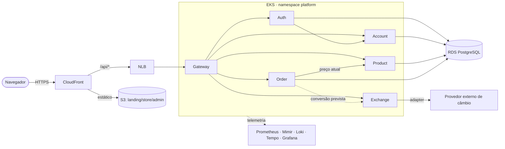

# Do código à prova

!!! quote "A pergunta que a prova faz"
    Não é "o que é Kubernetes?". É **"por que este sistema foi construído assim, o que isso resolve, quanto custa e o que acontece quando uma peça falha?"**. Este material treina essa resposta usando um sistema real: a plataforma **Microsserv52**.

Este guia nasce de duas fontes:

1. as **aulas de 2026.2** de *Platforms, Microservices, DevOps and APIs* (Insper), com teoria, definições e critérios de avaliação;
2. a **documentação do projeto** publicada em [microsserv52.github.io/platform](https://microsserv52.github.io/platform/), com a arquitetura, os manifests, os resultados de carga, os custos e as limitações assumidas.

A regra editorial é simples: **toda afirmação sobre o projeto tem evidência nos docs**; quando algo não foi implementado, o texto diz isso explicitamente. Isso importa porque metade de uma boa resposta oral é saber separar *o que existe* de *o que foi planejado*.

---

## Como usar este material

**Três passadas, não uma leitura.**

| Passada | O que fazer | Tempo sugerido |
| --- | --- | --- |
| 1. Mapa | Leia o [mapa da matéria](00-mapa.md) e o [projeto por dentro](01-projeto.md). Desenhe a arquitetura de memória, sem consultar. | 40 min |
| 2. Capítulos | Um capítulo por sessão. Leia a teoria, pare nos blocos **No projeto**, responda o quiz e faça o checklist. | 6–8 h no total |
| 3. Simulado | Faça o [simulado](16-simulado.md) fechado. Depois responda às perguntas abertas em voz alta, cronometrado. | 2 h |

!!! tip "A prova é sobre trade-offs, não sobre definições"
    O material da disciplina é explícito: você deve **comparar** estilos, **justificar** quando dividir, **calcular** o custo de uma cadeia síncrona e **escolher** entre sincronismo e eventos. Nenhuma dessas habilidades se treina decorando. Por isso cada capítulo termina com *"como responder"* e não apenas com um resumo.

!!! warning "Avaliação oral"
    No calendário da disciplina, **todas as notas estão sujeitas a arguição oral**. O capítulo [Estudo de caso ponta a ponta](15-estudo-de-caso.md) inclui um roteiro de defesa: perguntas que expõem quem só decorou a documentação.

---

## O sistema em uma página

A Microsserv52 é uma **loja demonstrativa**: visitantes navegam pelo catálogo, usuários autenticados criam pedidos de demonstração. **Não há pagamento real, transação financeira ou envio de mercadoria.** O objetivo é a engenharia: seis serviços implantáveis de forma independente, um banco relacional compartilhado com tabelas por serviço, três frontends estáticos, AWS provisionada por Terraform e uma stack de observabilidade completa.

| Peça | Escolha | Número que vale citar |
| --- | --- | --- |
| Entrada pública | CloudFront → NLB → Gateway NodePort | `/api` reescrito; NLB aceita só o prefixo do CloudFront |
| Serviços | 6 Deployments, 2 réplicas cada | HPA 2–6 a 70% de CPU; PDB mantém 1 disponível |
| Banco | RDS PostgreSQL `db.t4g.micro` | 112 conexões; pool de 8 por pod |
| Cache | ElastiCache Redis | provisionado, **`CACHE_ENABLED=false`** |
| Cluster | EKS 1.35, `t3.medium` | 2 nós de base, Cluster Autoscaler 2–6 |
| SLO de disponibilidade | 99,5% em 28 dias | error budget ≈ 3 h 22 min |
| Conversão de moeda | Contrato previsto | Order checado rejeita não-USD com 422; UI usa USD |
| Observabilidade | Prometheus + Mimir + Loki + Tempo + Pyroscope + Grafana + Alloy | 8 dashboards, 5 probes sintéticas |
| Custo | ≈ US$ 240/mês em dois nós | orçamento configurado em US$ 150 |

!!! note "A frase que resume o projeto"
    É uma arquitetura de microsserviços **síncrona**, com banco compartilhado por servidor e tabelas separadas por serviço (propriedade por convenção), implantada em Kubernetes gerenciado, observada por uma stack LGTM auto-hospedada e validada por testes de carga que encontraram o gargalo real: **o máximo do HPA do Product e a CPU dos nós — não o banco**.

---

## As 10 ideias que respondem 80% da prova

1. **Microsserviços trocam complexidade operacional por autonomia de deploy e escala.** Só valem quando esses são problemas reais; comece por um monólito modular.
2. **A fronteira é o domínio, não a tabela.** Bounded context + agregado definem o serviço; `database-per-service` é consequência, não slogan.
3. **Toda chamada síncrona multiplica indisponibilidade.** Três serviços a 99,9% em série dão ≈ 99,7%, não 99,9%.
4. **Chamada remota sem timeout é bug.** Timeout, retry com backoff e jitter, circuit breaker, bulkhead e fallback são camadas, não alternativas.
5. **SLI é razão de eventos bons por eventos válidos; SLO é a meta; SLA é o contrato.** Error budget = 1 − SLO e vira política de decisão.
6. **Kubernetes não deixa o sistema disponível sozinho.** Probes, réplicas, PDB, multi-AZ e autoscaling resolvem *partes* diferentes do problema.
7. **Observabilidade = métricas + logs + traces correlacionados**, com baixa cardinalidade e alertas sobre sintomas.
8. **Assíncrono desacopla disponibilidade, mas cobra o preço da consistência eventual**: outbox, idempotência, saga e DLQ.
9. **Segurança é em camadas**: TLS na borda, token no usuário, autorização no serviço dono do objeto, mTLS/NetworkPolicy entre workloads, segredo de vida curta.
10. **Nuvem é decisão econômica e organizacional.** Em time pequeno, EKS pode ser passivo; o projeto usa EKS para *aprender*, não para minimizar custo.

---

## Diagnóstico rápido

Responda sem consultar. O placar aparece logo acima do primeiro quiz; recarregar zera as respostas.

  
1. Um serviço A chama B, que chama C. Cada um tem disponibilidade de 99,9%. Qual é a disponibilidade máxima do caminho, desprezando retries e cache?

  <ul class="options">
    <li data-key="a">99,9%, porque o caminho é tão forte quanto o elo mais forte.</li>
    <li data-key="b">≈ 99,7%, porque em série as disponibilidades se multiplicam.</li>
    <li data-key="c">99,999%, porque réplicas independentes se somam.</li>
    <li data-key="d">100%, porque o gateway absorve as falhas.</li>
  </ul>
  
0,999³ ≈ 0,99702. Em série, o sistema só funciona se todos funcionarem. Cerca de 26 h/ano de indisponibilidade, contra 8,8 h de um único serviço. Réplicas em paralelo é que somam: 1 − (1 − a)ⁿ.

  
2. O projeto mediu 300 req/s com p95 de 1,25 s, Product em 6/6 réplicas e RDS com 52/112 conexões. Qual é o gargalo correto?

  <ul class="options">
    <li data-key="a">O pool de conexões do banco, que está saturado.</li>
    <li data-key="b">A CPU do RDS, que está acima de 90%.</li>
    <li data-key="c">O teto do HPA do Product somado à CPU dos nós — o banco ainda tem folga.</li>
    <li data-key="d">O k6, que dropped 11.930 iterações, então o servidor não estava saturado.</li>
  </ul>
  
Product fica preso em `maxReplicas: 6`, o p95 passa de 1 s e a CPU do nó satura. O RDS usa 52 de 112 conexões e ~15% de CPU. O k6 descartar iterações significa que 299,6 req/s é um limite inferior, não que o servidor esteja ocioso.

  
3. Por que a liveness probe **não** deve consultar o banco de dados?

  <ul class="options">
    <li data-key="a">Porque uma oscilação do banco faria o Kubernetes reiniciar todas as réplicas ao mesmo tempo.</li>
    <li data-key="b">Porque o banco não suporta conexões de health check.</li>
    <li data-key="c">Porque a liveness só pode usar TCP, nunca HTTP.</li>
    <li data-key="d">Porque reiniciar o pod não resolve nada em nenhum cenário.</li>
  </ul>
  
Liveness responde "o processo está travado?". Se ela depende do banco, uma falha externa vira um reinício em massa — exatamente a indisponibilidade que se queria evitar. Dependência externa pertence, com cautela, à readiness.

  
4. O que o padrão *transactional outbox* resolve?

  <ul class="options">
    <li data-key="a">Duplicatas no consumidor, substituindo a necessidade de idempotência.</li>
    <li data-key="b">A latência de rede entre o serviço e o Kafka.</li>
    <li data-key="c">A ordenação global de todos os eventos do sistema.</li>
    <li data-key="d">A escrita dupla: gravar no banco e publicar no broker de forma atômica, usando a transação local.</li>
  </ul>
  
O evento é gravado na tabela `outbox` na mesma transação do estado de negócio; um relay publica depois. Isso não elimina duplicatas (o relay pode republicar), então o consumidor continua precisando ser idempotente.

  
5. Qual afirmação sobre o projeto é **verdadeira**?

  <ul class="options">
    <li data-key="a">Há um broker Kafka publicando `OrderCreated` para o serviço de notificação.</li>
    <li data-key="b">O cache Redis está provisionado, mas `CACHE_ENABLED=false` e não há lógica de cache por serviço.</li>
    <li data-key="c">O carrinho é persistido no Redis por um serviço de Cart dedicado.</li>
    <li data-key="d">O frontend guarda o JWT no `localStorage` para sobreviver a recarregamentos.</li>
  </ul>
  
Não há Kafka nem Cart service; o carrinho vive no `localStorage` (`ms52-cart-v1`). A sessão é um cookie HttpOnly emitido pelo Gateway, com CSRF, e o frontend nunca lê o token.

---

## Checklist de prontidão

Marque o que você já consegue explicar **sem olhar**. O progresso fica salvo neste navegador.

<label class="study-check"><input type="checkbox" data-key="ready-arch"> Desenho a arquitetura completa (CloudFront → NLB → Gateway → serviços → RDS) e digo o que é público e o que é interno.</label>
<label class="study-check"><input type="checkbox" data-key="ready-why"> Justifico por que o Gateway é o único ponto público e o que aconteceria se um serviço tivesse NodePort.</label>
<label class="study-check"><input type="checkbox" data-key="ready-slo"> Calculo error budget e burn rate para um SLO de 99,5% em 28 dias.</label>
<label class="study-check"><input type="checkbox" data-key="ready-k8s"> Explico startup, liveness e readiness, HPA, PDB e o que cada um *não* resolve.</label>
<label class="study-check"><input type="checkbox" data-key="ready-gargalo"> Conto a história do pool 10 → 5 → 8 com números e digo qual é o gargalo final.</label>
<label class="study-check"><input type="checkbox" data-key="ready-eda"> Explico outbox, saga e idempotência e por que o projeto não implementou Kafka.</label>
<label class="study-check"><input type="checkbox" data-key="ready-sec"> Diferencio autenticação de autorização e aponto onde cada uma acontece no projeto.</label>
<label class="study-check"><input type="checkbox" data-key="ready-custo"> Comparo EKS, ECS Fargate e Railway por custo fixo, controle e tamanho de time.</label>

---

## Por onde continuar

- **Primeira vez no assunto?** Comece pelo [mapa da matéria](00-mapa.md), que liga cada aula ao capítulo e ao pedaço do projeto.
- **Vai defender o projeto?** Vá direto ao [estudo de caso](15-estudo-de-caso.md) e ao [simulado](16-simulado.md).
- **Precisa revisar números?** O [cheatsheet](17-glossario-cheatsheet.md) tem fórmulas, comandos e a tabela de custos.
- **Vai justificar o que falta?** [O que não foi implementado](18-lacunas-e-evolucao.md) explica cada ausência com benefício, motivo, custo e caminho de adoção.

!!! info "Sobre a fidelidade do material"
    Números de carga, custo, SLO e topologia vêm dos docs do projeto e valem para a fotografia documentada (novembro de 2026). O material também marca o que é **meta** e o que é **medição** — uma distinção que a banca costuma cobrar.
